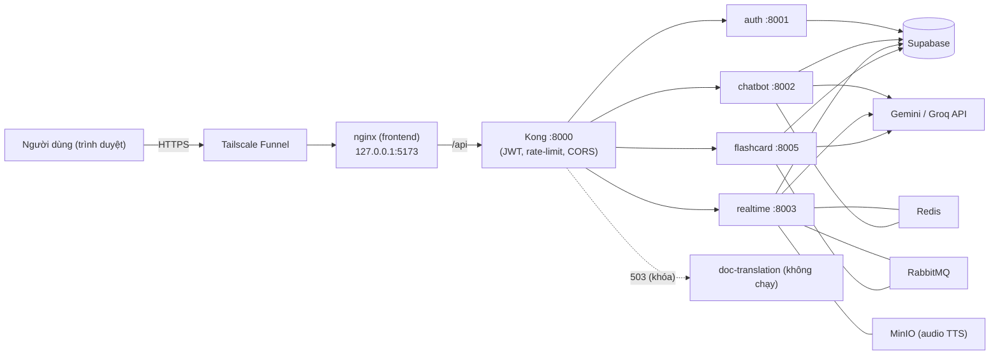

# Triển khai demo công khai (Phương án A)

> **Chỉ muốn chạy được nhanh, làm từng bước?** Đọc **[DEPLOY_QUICKSTART.md](DEPLOY_QUICKSTART.md)** (tự đủ ngữ cảnh, có kết quả mong đợi ở mỗi bước).
> File này là tài liệu tham khảo: lý do thiết kế, kiến trúc, bảng sự cố đầy đủ.

Tài liệu này giải thích **đã làm gì** để đưa hệ thống ra chạy demo, và hướng dẫn **tự triển khai lại trên máy của bạn**.
Phương án A: chạy cả stack bằng Docker Compose trên **một máy**, đưa ra internet bằng **Tailscale Funnel**, LLM gọi qua
**API key (Gemini)**, tính năng **Dịch tài liệu đang khóa**. Toàn bộ thay đổi nằm trong PR
[#21](https://github.com/baovr125/IUH_Academic_Counseling_Chatbot/pull/21) (đã merge vào `main`).

> Tóm tắt một dòng: `docker compose -f docker-compose.yml -f docker-compose.prod.yml` + file `.env.prod` + (tuỳ chọn)
> `tailscale funnel`. Một link duy nhất, frontend và API cùng origin, không cần CORS giữa hai nơi.

## Mục lục

1. [Đã làm gì và vì sao](#1-đã-làm-gì-và-vì-sao)
2. [Kiến trúc triển khai](#2-kiến-trúc-triển-khai)
3. [Yêu cầu máy](#3-yêu-cầu-máy)
4. [Tự triển khai trên máy của bạn](#4-tự-triển-khai-trên-máy-của-bạn)
5. [Đưa ra internet bằng Tailscale Funnel (tuỳ chọn)](#5-đưa-ra-internet-bằng-tailscale-funnel-tuỳ-chọn)
6. [Hai chế độ LLM: API và GPU](#6-hai-chế-độ-llm-api-và-gpu)
7. [Vận hành hằng ngày](#7-vận-hành-hằng-ngày)
8. [Xử lý sự cố](#8-xử-lý-sự-cố)
9. [Hạn chế đã biết và những gì chưa kiểm chứng](#9-hạn-chế-đã-biết-và-những-gì-chưa-kiểm-chứng)
10. [Bảo mật](#10-bảo-mật)

---

## 1. Đã làm gì và vì sao

### Các thay đổi

| Thay đổi | File | Vì sao |
|---|---|---|
| Lớp phủ Compose cho môi trường triển khai | `docker-compose.prod.yml` | Không sửa `docker-compose.yml` dùng cho dev. Lớp phủ đọc `.env.prod`, bỏ mount mã nguồn của chatbot, không mở cổng của Kong, chỉ mở frontend ở `127.0.0.1:5173`, tự khởi động lại |
| Mẫu cấu hình triển khai | `.env.prod.example` | Chép thành `.env.prod` rồi điền. File thật đã nằm trong `.gitignore` |
| Cấu hình nginx của frontend | `frontend/nginx.conf` | `/api` tắt buffering và timeout 600 giây (SSE/streaming không bị cắt), body tối đa 25 MB (ảnh flashcard tới 5 MB), tin `X-Forwarded-Proto` từ tunnel |
| Khóa Dịch tài liệu ở frontend | `frontend/src/config.ts` và 5 file giao diện | Cờ build `VITE_FEATURE_DOC_TRANSLATION`. Ẩn nút/tab; vào `/translation-doc` thì chuyển về `/translation` |
| Khóa Dịch tài liệu ở cổng vào | `gateway/kong.template.yml` | Plugin `request-termination`: route `/api/v1/documents` trả `503` kèm thông báo (chưa đăng nhập vẫn là `401`) |
| Kiểm tra nhanh sau triển khai | `scripts/deploy_smoke.py` | 8 ca kiểm tra cổng vào, chỉ đọc, không ghi dữ liệu |
| Healthcheck RabbitMQ | `docker-compose.prod.yml` | Realtime chỉ thử nối RabbitMQ **một lần** lúc khởi động; nếu broker chưa sẵn sàng thì consumer TTS hỏng im lặng |

PR còn mang theo hai commit trước đó của nhánh `refactor/config-security`: `ef1840e6` (đưa tên model, URL công khai, nguồn
crawl vào cấu hình dùng chung) và `cc9d1346` (bỏ `DEV_ADMIN_TOKEN` mặc định, không trả exception cho client, đóng cổng 8005).

### Các quyết định thiết kế

- **Một origin duy nhất.** Frontend gọi `/api` cùng địa chỉ; nginx chuyển sang Kong. Không cần cấu hình CORS giữa hai
  nơi, và audio TTS (URL tương đối `/api/v1/translate/audio/...`) đi qua Kong nên không cần mở MinIO ra ngoài.
- **LLM bằng API key, không có vLLM trong stack.** Chatbot mặc định (`LLM_PROVIDER=openai`) thử một endpoint
  vLLM/Ollama rồi mới rơi về Gemini; không đặt `LLM_PROVIDER=gemini` thì **mỗi câu hỏi** đều gọi một endpoint không tồn tại.
  `.env.prod.example` đặt sẵn `gemini`; chế độ GPU vẫn giữ để bật khi cần (mục 6).
- **Dịch tài liệu bị khóa** vì `doc-translation-service` không được triển khai (đã comment trong `docker-compose.yml`).
  Khóa ở **hai lớp** để người dùng không gặp lỗi kết nối khó hiểu.
- **Tunnel miễn phí: Tailscale Funnel.** Cloudflare Quick Tunnel không hỗ trợ SSE (theo tài liệu Cloudflare); Cloudflare
  Tunnel có tên cố định cần domain trả phí; ngrok free có giới hạn 1 GB dữ liệu ra mỗi tháng và trang cảnh báo.

## 2. Kiến trúc triển khai



Chỉ `127.0.0.1:5173` được mở ra từ Docker. Tunnel chạy trên máy chủ và trỏ vào cổng này. Các cổng RabbitMQ, Redis, MinIO
chỉ nghe `127.0.0.1`, người ngoài không truy cập được.

## 3. Yêu cầu máy

Đã chạy thử trên: Windows 11, Docker Desktop (Compose v5.4.0), NVIDIA RTX 4060 Laptop 8 GB VRAM, RAM 24 GB.

| Thành phần | Yêu cầu |
|---|---|
| Docker Compose | **>= 2.24** (file prod dùng `!override` / `!reset`). Docker Desktop cũ sẽ báo lỗi cú pháp |
| GPU | **NVIDIA có driver cài sẵn, Docker chạy GPU được** (kiểm tra: `docker run --rm --gpus all ubuntu nvidia-smi`). Chatbot và realtime đều đặt chỗ GPU |
| VRAM | Cả stack dùng khoảng **6,9 GB / 8,2 GB** khi rảnh (đã gồm ~1,2 GB của Windows). **Rất sát** trên card 8 GB, tắt các ứng dụng dùng GPU khác |
| RAM | >= 16 GB (chatbot ~1,6 GB, realtime ~1,3 GB khi rảnh; giới hạn Docker 4,5 GB và 3,5 GB) |
| Đĩa trống | >= 40 GB trên ổ chứa dữ liệu Docker (image ~17 GB, cache build ~24 GB, model ~2,7 GB) |
| Mạng | Cần internet lúc build (tải model NLLB, fastText, thư viện) |
| Cổng trống trên máy | `5173`, `5672`, `15672`, `6379`, `9000`, `9001` (đều bind `127.0.0.1`) |

> Máy **không có GPU NVIDIA** chưa được kiểm chứng. Nó cần gỡ phần đặt chỗ GPU trong Compose và đặt `NLLB_DEVICE=cpu`,
> độ trễ sẽ cao hơn nhiều. Xem mục 9.

## 4. Tự triển khai trên máy của bạn

Lệnh dưới đây viết cho PowerShell; trên Linux/macOS dùng `bash` tương tự.

### Bước 0. Lấy mã nguồn

```powershell
git clone https://github.com/baovr125/IUH_Academic_Counseling_Chatbot.git
cd IUH_Academic_Counseling_Chatbot
git switch main
```

### Bước 1. Tải model ONNX cho chatbot (không nằm trong git)

Thư mục `hf_models/` bị `.gitignore` và được mount vào container chatbot, nên phải tải trước:

```powershell
python scripts/download_models.py
```

Kết quả: `hf_models/vietnamese-bi-encoder-onnx` và `hf_models/bge-reranker-v2-m3-onnx` (~2,7 GB). Nếu script báo không
tìm thấy `huggingface-cli` (bản `huggingface_hub` mới có thể đổi tên lệnh thành `hf`), tải thủ công hai repo
`AnhHao0107/vietnamese-bi-encoder-onnx` và `AnhHao0107/bge-reranker-v2-m3-onnx` vào đúng hai thư mục trên.

Model NLLB và fastText của realtime được tải **tự động trong lúc build image**, không cần làm gì thêm.

### Bước 2. Tạo `.env.prod`

```powershell
Copy-Item .env.prod.example .env.prod
```

Điền các giá trị sau. **Không commit `.env.prod`** (đã có trong `.gitignore`) và không gửi bí mật qua chat thường.

| Biến | Lấy ở đâu |
|---|---|
| `SUPABASE_URL`, `SUPABASE_KEY`, `SUPABASE_SERVICE_ROLE_KEY`, `DATABASE_URL` | Xin **chủ dự án Supabase** qua kênh an toàn. Dùng chung dự án thì tài khoản và dữ liệu RAG có sẵn, không cần chạy migration |
| `GEMINI_API_KEY`, `GROQ_API_KEY` | Khóa của chính bạn (Google AI Studio, Groq). Bản free bị giới hạn theo phút, xem mục 9 |
| `JWT_SECRET_KEY` | **Tự sinh**, >= 32 ký tự: `python -c "import secrets; print(secrets.token_urlsafe(48))"` |
| `RABBITMQ_DEFAULT_PASS`, `MINIO_ROOT_PASSWORD` | **Tự sinh** bằng cùng lệnh trên (mật khẩu RabbitMQ nằm trong URL nên chỉ dùng ký tự `A-Z a-z 0-9 - _`) |
| `PUBLIC_ORIGIN`, `CORS_ALLOW_ORIGINS` | Chạy cục bộ: `http://localhost:5173`. Dùng Funnel: địa chỉ `https://...ts.net` của bạn (mục 5) |

Mỗi nơi triển khai có `JWT_SECRET_KEY` riêng, không dùng chung với máy khác. Kong từ chối khởi động nếu khóa dưới 32 ký tự
hoặc chứa các ký tự `| & \ "`.

> Dùng **dự án Supabase riêng** thay vì dùng chung? Cần chạy các file SQL trong `db/` (`schema_v2_hybrid_rag.sql`,
> `schema_v3_parent_child_rag.sql`) và `db/migrations/` (`002` đến `007`), rồi nạp lại dữ liệu RAG bằng pipeline ingestion.
> Thứ tự áp dụng chưa được kiểm chứng trong tài liệu này; hãy hỏi chủ dự án trước khi chạy.

### Bước 3. Build và chạy

```powershell
docker compose --env-file .env.prod -f docker-compose.yml -f docker-compose.prod.yml up -d --build
```

Lần đầu mất khá lâu vì build các image nặng (torch, CUDA) và tải model. Lần sau chỉ build lại phần thay đổi.

### Bước 4. Kiểm tra

```powershell
docker compose --env-file .env.prod -f docker-compose.yml -f docker-compose.prod.yml ps
python scripts/deploy_smoke.py
```

- Chờ khoảng **2 phút** sau khi khởi động: chatbot nạp model nên chưa trả lời ngay.
- Kỳ vọng: 9 container đang chạy, Kong và auth `healthy`, `deploy_smoke.py` báo `TẤT CẢ ĐẠT (8 ca)`.
- Mở `http://127.0.0.1:5173` và đăng nhập thử.

> Với route `/api/v1/chat/*` hay `/api/v1/translate/*`, trả về `401` khi **không** có token là **đúng thiết kế** (Kong yêu
> cầu JWT). Đừng coi đó là lỗi.

## 5. Đưa ra internet bằng Tailscale Funnel (tuỳ chọn)

Chỉ cần khi muốn người khác truy cập từ ngoài mạng của bạn. **Mỗi người dùng tài khoản và tên máy Tailscale riêng của
mình**, nên mỗi lần triển khai có link khác nhau.

1. Cài [Tailscale](https://tailscale.com/download) và đăng nhập.
2. Trang quản trị [DNS](https://login.tailscale.com/admin/dns) → **Enable HTTPS** (tên máy của bạn sẽ được ghi vào sổ
   chứng chỉ công khai, **không xóa được**; hãy chọn tên máy trung tính, đừng dùng tên thật).
3. Bật Funnel (nếu tài khoản chưa cho phép, lệnh sẽ in link để bật):
   ```powershell
   & "C:\Program Files\Tailscale\tailscale.exe" funnel --bg 5173
   ```
4. Đặt `PUBLIC_ORIGIN` và `CORS_ALLOW_ORIGINS` trong `.env.prod` thành `https://<tên-máy>.<tailnet>.ts.net`
   (không có dấu `/` cuối), rồi tạo lại container để Kong và các service nhận giá trị mới:
   ```powershell
   docker compose --env-file .env.prod -f docker-compose.yml -f docker-compose.prod.yml up -d --force-recreate
   ```
5. Kiểm tra từ điện thoại bằng **4G** (tắt Wi-Fi) và: `python scripts/deploy_smoke.py --base https://<link-của-bạn>`.

Tắt Funnel khi không dùng: `& "C:\Program Files\Tailscale\tailscale.exe" funnel reset`.
Đổi tên máy: `tailscale set --hostname=<tên-mới>`, rồi **làm lại bước 3 và 4**.

Lưu ý: Funnel công khai với mọi người, ai có link đều có thể tự đăng ký tài khoản và dùng quota LLM của bạn. Máy phải bật,
không ngủ, Docker và Tailscale đang chạy.

## 6. Hai chế độ LLM: API và GPU

| | Chế độ API (mặc định) | Chế độ GPU (tuỳ chọn) |
|---|---|---|
| Chatbot | `LLM_PROVIDER=gemini`, `REWRITER_PROVIDER=gemini` | `LLM_PROVIDER=openai`, `REWRITER_PROVIDER=openai`, kèm `OPENAI_BASE_URL`, `OPENAI_API_KEY`, `OPENAI_MODEL_NAME` |
| Dự phòng | Không | Gemini tự động khi endpoint lỗi |
| Flashcard | Dùng Groq, rồi Gemini (nhánh `openai` tự bỏ qua vì chưa đặt `OPENAI_BASE_URL`) | Thêm vLLM làm provider thứ 3 |

Chế độ GPU dùng vLLM/Ollama chạy trên máy GPU khác (đã dùng RunPod). **vLLM phải chạy với `--api-key`** và `OPENAI_API_KEY`
đặt trùng, nếu không ai có URL đều dùng được GPU của bạn. Khối cấu hình mẫu nằm (đang comment) trong `.env.prod.example`.

Để đổi chế độ: sửa `.env.prod`, rồi chạy (**`docker restart` KHÔNG nạp lại `env_file`**):

```powershell
docker compose --env-file .env.prod -f docker-compose.yml -f docker-compose.prod.yml up -d --force-recreate academic-chatbot-service flashcard-service
```

Xác nhận chatbot đang dùng nguồn nào: log có dòng `Local LLM ... failed ... Falling back to Gemini` nghĩa là endpoint GPU không
phản hồi và đang dùng Gemini.

## 7. Vận hành hằng ngày

Đặt tạm một biến cho gọn (PowerShell):
```powershell
$dc = "docker compose --env-file .env.prod -f docker-compose.yml -f docker-compose.prod.yml"
```

| Việc | Lệnh |
|---|---|
| Khởi động | `Invoke-Expression "$dc up -d"` |
| Dừng (giữ dữ liệu) | `Invoke-Expression "$dc down"` — **không** thêm `-v` (xóa volume MinIO) |
| Xem trạng thái | `Invoke-Expression "$dc ps"` |
| Xem log một service | `docker logs -f iuh_academic_chatbot_service` (tên khác: `iuh_realtime_translation_service`, `iuh_flashcard_service`, `iuh_auth_service`, `iuh_kong_gateway`, `iuh_frontend`) |
| Áp dụng thay đổi `.env.prod` | `Invoke-Expression "$dc up -d --force-recreate <service>"` |
| Kiểm tra nhanh | `python scripts/deploy_smoke.py` |
| Cập nhật mã | `git pull` rồi `Invoke-Expression "$dc up -d --build"` |
| Quay về bản cũ | `git switch --detach <commit hoặc tag>` rồi `Invoke-Expression "$dc up -d --build"` |
| Xem VRAM | `nvidia-smi` |

## 8. Xử lý sự cố

| Triệu chứng | Nguyên nhân thường gặp | Cách xử lý |
|---|---|---|
| `kong-gateway` thoát ngay, log nói `JWT_SECRET_KEY` | Khóa dưới 32 ký tự, là giá trị mẫu, hoặc có ký tự `\| & \ "` | Sinh khóa mới (mục 4, bước 2), tạo lại container |
| `up` lỗi `could not select device driver "nvidia"` | Docker chưa dùng được GPU | Cài driver NVIDIA, bật WSL2 GPU; kiểm tra `docker run --rm --gpus all ubuntu nvidia-smi` |
| Lỗi cú pháp `!override` / `!reset` khi chạy `docker compose` | Compose cũ hơn 2.24 | Cập nhật Docker Desktop |
| Trình duyệt báo lỗi CORS | `PUBLIC_ORIGIN` không khớp địa chỉ đang mở | Sửa `.env.prod`, rồi `up -d --force-recreate` |
| Chat trả lời chậm, log có `Falling back to Gemini` | `LLM_PROVIDER` chưa là `gemini`, hoặc endpoint GPU không với tới được | Mục 6 |
| Lỗi `429` / hết quota từ Gemini | Key free giới hạn theo phút/ngày | Đợi, bật billing, hoặc đặt `VOCAB_VERIFY_ENABLED=0` (giảm ~3 lần token cho flashcard AI) |
| Log realtime có `Failed to start RabbitMQ TTS consumer` | Service khởi động trước khi RabbitMQ sẵn sàng | `docker compose ... up -d --force-recreate realtime-translation-service` (file prod đã có healthcheck để tránh) |
| `401` ở `/api/v1/chat/health` khi gọi không token | Đúng thiết kế (Kong yêu cầu JWT) | Không cần sửa |
| `413 Payload Too Large` khi upload | Vượt giới hạn 25 MB của nginx | Giảm kích thước tệp, hoặc tăng `client_max_body_size` trong `frontend/nginx.conf` |
| Micro không hoạt động | Trình duyệt chỉ cho dùng micro trên HTTPS hoặc `localhost` | Mở bằng `http://localhost:5173` hoặc link HTTPS của Funnel, không dùng IP LAN |
| Lỗi `port is already allocated` | Cổng 5173/6379/9000... đã bị chiếm | Dừng chương trình đang dùng cổng đó |
| Hết dung lượng đĩa | Cache build Docker lớn | `docker builder prune` (xóa cache build, không xóa image đang dùng) |

## 9. Hạn chế đã biết và những gì chưa kiểm chứng

**Hạn chế đã biết**

- **Dịch tài liệu đang khóa.** Muốn bật lại: bỏ comment khối `doc-translation-*` trong `docker-compose.yml`, xóa plugin
  `request-termination` ở `doc-routes` trong `gateway/kong.template.yml`, và bỏ `VITE_FEATURE_DOC_TRANSLATION: "false"`
  trong `docker-compose.prod.yml`. Chưa được kiểm chứng với cấu hình này.
- **Audio phát âm từ điển của admin** dùng URL tuyệt đối `MINIO_PUBLIC_URL` (mặc định `http://localhost:9000`) và đã được
  lưu cứng trong cơ sở dữ liệu, nên người xem từ xa không nghe được. Audio TTS thường và flashcard **không** bị ảnh hưởng.
- **Key Gemini free** dễ chạm giới hạn khi nhiều người dùng cùng lúc, vì mỗi câu hỏi chatbot gọi LLM ít nhất 2 lần.
- **CI trên `main` đang đỏ sẵn** ở job `realtime_translation_service` (4 test: `test_health_check_returns_200`,
  `test_translation_flow_1_default`, `test_translation_flow_2_domain`, `test_spacy_to_wordnet_pos`) do môi trường CI
  thiếu model NLLB, Redis và dữ liệu NLTK. Không do thay đổi triển khai.
- Đăng ký tài khoản đang mở với bất kỳ ai biết link (Kong giới hạn 10 lần/phút cho đăng nhập/đăng ký).

**Đã kiểm chứng trên máy thật** (Windows 11, RTX 4060 8 GB): build thành công, 9 container chạy, 4 service trả `/health` 200,
`nginx -t` đạt, Kong `healthy`, `deploy_smoke.py` 8/8, khởi động nguội 2 lần không lỗi RabbitMQ, frontend `tsc` sạch và
vitest 645/645, trang mở được từ điện thoại qua Funnel.

**Chưa kiểm chứng**

- Streaming (SSE) và tải trang qua Funnel với nhiều người dùng; việc Kong có thấy **IP thật** của client (nếu không, giới hạn
  10 lần/phút sẽ áp chung cho mọi người).
- Hành vi khi nhiều người dùng đồng thời (VRAM chỉ còn khoảng 1,2 GB trống trên card 8 GB; chưa test tải).
- Máy không có GPU, và chế độ GPU (RunPod) sau khi merge.

## 10. Bảo mật

- `.env.prod` chứa bí mật thật: đã bị `.gitignore` chặn, **không commit, không chụp màn hình, không gửi qua chat thường**.
  Trước khi commit, kiểm tra: `git status` không được thấy `.env.prod`.
- Không dùng chung `JWT_SECRET_KEY`, mật khẩu RabbitMQ/MinIO giữa các máy hoặc với môi trường dev.
- Khóa `SUPABASE_SERVICE_ROLE_KEY` bypass RLS: chỉ server dùng, **tuyệt đối không đưa ra frontend**.
- Funnel làm dịch vụ **công khai**: chỉ gửi link cho người cần xem; tắt (`funnel reset`) khi xong.
- Sau buổi demo: dừng container, tắt Funnel, và nếu đã chia sẻ cho người ngoài thì xoay lại các bí mật (JWT, RabbitMQ, MinIO,
  khóa Gemini/Groq).
