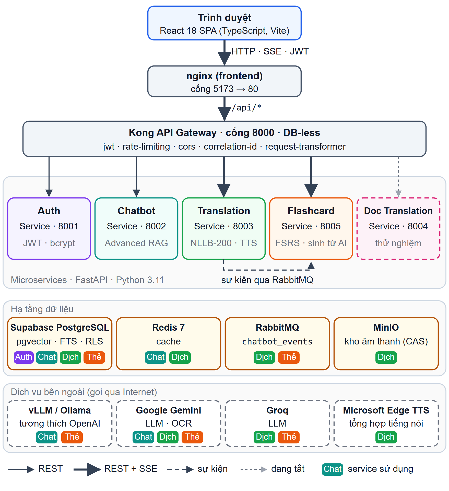
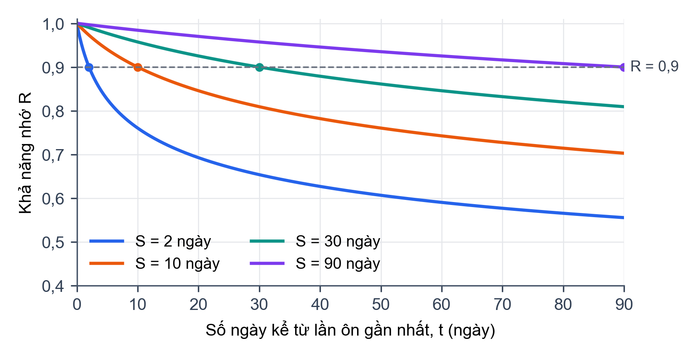
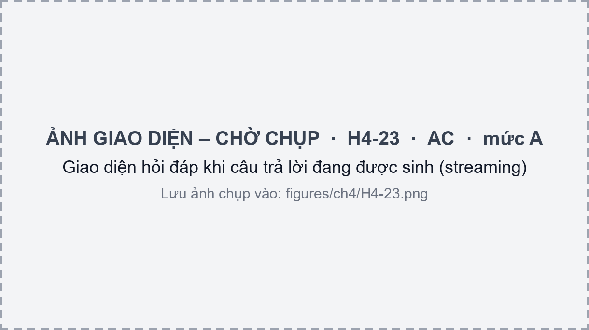

# CHƯƠNG 3. MẪU HÌNH MINH HỌA (PHIÊN 0B)

Chương này chỉ dùng để duyệt phong cách hình của Phiên 0b. Mỗi loại hình có một hình mẫu, vẽ bằng bộ công cụ `build/render_figures.py`. Nội dung từng hình đã được đối chiếu với mã nguồn ngày 30/10/2026.

## 3.1 Sơ đồ kiến trúc và sơ đồ use case

Hình 3.1 là sơ đồ kiến trúc tổng thể vẽ bằng SVG theo bảng màu cố định. Mỗi service có một màu riêng, dùng thống nhất ở mọi sơ đồ trong báo cáo. Chip màu trong khối hạ tầng cho biết service nào sử dụng thành phần đó.

Hình 3.2 là sơ đồ use case tổng quát vẽ bằng PlantUML. Các use case chi tiết UC01–UC18 sẽ nằm ở 5 sơ đồ use case theo phân hệ.

## 3.2 Lưu đồ và sơ đồ tuần tự

Hình 3.3 là lưu đồ semantic cache hai tầng, vẽ bằng sơ đồ hoạt động của PlantUML.

Sơ đồ tuần tự của luồng hỏi đáp quá dài để đặt trong một hình, nên được tách thành Hình 3.4 (tiếp nhận, định tuyến, tra cache) và Hình 3.5 (truy xuất và sinh câu trả lời).

## 3.3 Biểu đồ, ví dụ thực tế và hộp ví dụ

Hình 3.6 là biểu đồ vẽ bằng matplotlib. Số liệu được tính bằng chính gói `fsrs` mà Flashcard Service sử dụng.

{width=13cm}

::: {custom-style="Example Box"}
**Ví dụ 3.1.** Với độ ổn định S = 10 ngày, mô hình cho R(10) = 0,9: sau đúng 10 ngày, xác suất còn nhớ là 90%. Đây là định nghĩa của độ ổn định trong FSRS.

Nếu sinh viên ôn lại ở ngày thứ 10 và chọn Good, độ ổn định tăng lên, nên lần ôn kế tiếp được đẩy xa hơn.
:::

Hình 3.7 là một hình "ví dụ thực tế" dựng từ log truy vấn thật của hệ thống. Nội dung câu hỏi và kết quả Router được chép nguyên văn từ log.

## 3.4 Ảnh giao diện giữ chỗ

Hình 3.8 minh họa ảnh giữ chỗ cho ảnh giao diện chưa chụp. Khi có ảnh thật, chỉ cần lưu đè file `figures/ch4/H4-23.png` rồi ghép lại báo cáo.

## Tiểu kết chương {.unnumbered}

Bản mẫu này để nhóm duyệt phong cách hình trước khi vẽ hàng loạt.
