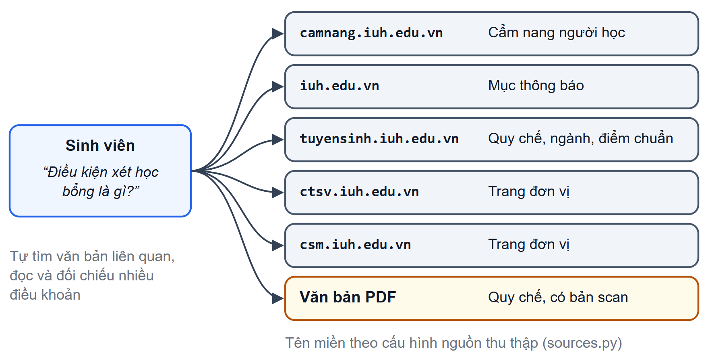
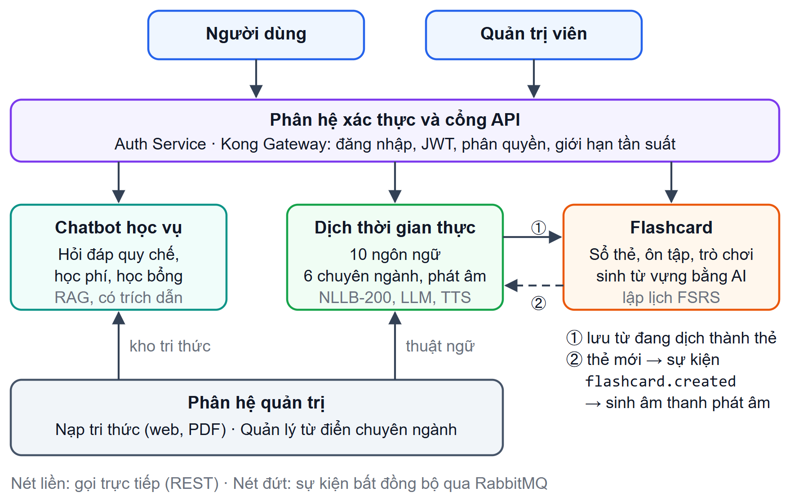

# CHƯƠNG 1. TỔNG QUAN ĐỀ TÀI

Chương này trình bày lý do chọn đề tài, khảo sát các giải pháp hiện có, rồi nêu mục tiêu, đối tượng, phạm vi, phương pháp nghiên cứu, các đóng góp chính và bố cục của báo cáo.

## 1.1 Lý do chọn đề tài

Trong suốt quá trình học, sinh viên thường xuyên cần tra cứu thông tin học vụ: quy chế đào tạo theo hệ thống tín chỉ [@iuh_quyche], điều kiện xét tốt nghiệp, học phí, học bổng, thủ tục bảo lưu, đăng ký học phần. Tại Trường Đại học Công nghiệp Thành phố Hồ Chí Minh (IUH), các thông tin chính thức này được công bố trên nhiều kênh khác nhau. Như Hình 1.1 cho thấy, nhóm đã xác định ít nhất năm tên miền chứa thông tin học vụ:
- trang Cẩm nang người học tại camnang.iuh.edu.vn [@iuh_camnang];
- mục thông báo trên cổng iuh.edu.vn;
- trang tuyển sinh tuyensinh.iuh.edu.vn;
- trang của các đơn vị như ctsv.iuh.edu.vn, csm.iuh.edu.vn.

Bên cạnh đó còn có các văn bản quy chế, quy định ở dạng PDF, trong đó có cả bản scan. Đây cũng chính là danh sách nguồn mà hệ thống của đề tài thu thập để xây dựng kho tri thức (mục 4.1).

{width=12.5cm}

> [TODO: Nhóm bổ sung vai trò của hai trang ctsv.iuh.edu.vn và csm.iuh.edu.vn. Repo chỉ có tên miền trong `data_ingestion/sources.py`, không có thông tin về đơn vị quản lý.]

Khi cần câu trả lời cho một câu hỏi cụ thể, chẳng hạn "điều kiện xét học bổng khuyến khích học tập là gì", sinh viên phải tự xác định văn bản liên quan, đọc nhiều điều khoản và tự đối chiếu. Việc tra cứu vì thế tốn thời gian, và sinh viên dễ dựa vào nguồn không chính thức như hỏi bạn bè hay các nhóm mạng xã hội.

Các mô hình ngôn ngữ lớn (Large Language Model – LLM) có thể trả lời câu hỏi bằng ngôn ngữ tự nhiên, nhưng có thể sinh ra nội dung nghe hợp lý mà sai sự thật. Hiện tượng này gọi là ảo giác (hallucination) [@ji2023hallucination]. Với thông tin học vụ, một câu trả lời sai về điều kiện tốt nghiệp hay hạn nộp học phí có thể gây hậu quả thực tế cho sinh viên. Kỹ thuật sinh tăng cường truy xuất (Retrieval-Augmented Generation – RAG) khắc phục một phần hạn chế này: hệ thống tìm các đoạn văn bản liên quan trong kho tài liệu tin cậy, rồi yêu cầu LLM trả lời dựa trên chính các đoạn đó [@lewis2020rag; @gao2023rag].

Ngoài tra cứu học vụ, sinh viên còn thường xuyên đọc tài liệu chuyên ngành bằng ngoại ngữ và cần ghi nhớ từ vựng mới. Hai nhu cầu này được đề tài hỗ trợ bằng các tiện ích đi kèm trên cùng nền tảng.

Từ các lý do trên, nhóm chọn đề tài **IUH_Academic_Counseling_Chatbot**:
- **Trọng tâm:** chatbot tư vấn học vụ dựa trên RAG, cùng pipeline xây dựng kho tri thức từ website và văn bản của trường.
- **Tiện ích hỗ trợ:** dịch thuật theo chuyên ngành và học từ vựng theo thuật toán lặp lại ngắt quãng.

## 1.2 Khảo sát hiện trạng

### 1.2.1 Các kênh tra cứu thông tin học vụ hiện nay

Hiện nay, sinh viên IUH tra cứu thông tin học vụ qua ba nhóm kênh chính:
- **Cẩm nang người học:** nội dung chính thức và tương đối đầy đủ, nhưng người đọc phải biết văn bản nào chứa thông tin cần tìm và phải đọc nguyên văn các điều khoản dài.
- **Thông báo trên cổng thông tin và trang của các đơn vị:** phù hợp với thông tin có thời hạn, nhưng được sắp theo thời gian đăng nên khó tìm lại thông báo cũ và khó biết thông báo nào còn hiệu lực.
- **Hỏi trực tiếp** phòng ban, cố vấn học tập hoặc giáo vụ khoa: chính xác và phù hợp từng trường hợp, nhưng phụ thuộc giờ làm việc và không phản hồi ngay được.

Điểm chung của các kênh trên là chưa cho phép đặt câu hỏi bằng ngôn ngữ tự nhiên và nhận câu trả lời tổng hợp từ nhiều văn bản.

> [TODO: Nếu nhóm có kết quả khảo sát sinh viên về nhu cầu tra cứu (kế hoạch mục 10, mục 9), bổ sung số liệu và bảng kết quả tại đây.]

### 1.2.2 Chatbot và trợ lý AI trong giáo dục

Các chatbot hỗ trợ sinh viên có thể chia thành ba nhóm theo cách tạo câu trả lời:
- **Chatbot dựa trên luật (rule-based):** trả lời theo kịch bản định sẵn. Cách này dễ kiểm soát nội dung, nhưng chỉ đáp ứng những câu hỏi đã được dự liệu, và phải sửa kịch bản thủ công mỗi khi quy định thay đổi.
- **Trợ lý dựa trên LLM tổng quát** như ChatGPT, Gemini: hiểu và sinh tiếng Việt tốt, nhưng kiến thức dừng ở thời điểm huấn luyện và không bao gồm đầy đủ văn bản nội bộ của một trường. Khi thiếu thông tin, mô hình vẫn có thể trả lời sai [@ji2023hallucination]. Ứng dụng LLM còn đối mặt với tấn công chèn lệnh (prompt injection), được OWASP xếp vào nhóm rủi ro hàng đầu [@owasp_llm].
- **Hệ thống RAG:** truy xuất văn bản liên quan từ kho tri thức trước khi sinh câu trả lời [@lewis2020rag], nên câu trả lời bám vào nguồn tin cậy và có thể kèm trích dẫn. Các khảo sát gần đây mô tả RAG phát triển từ dạng cơ bản sang dạng nâng cao và dạng mô-đun, với các kỹ thuật như viết lại câu hỏi, truy xuất lai và xếp hạng lại [@gao2023rag].

Với lĩnh vực có kho văn bản chính thức và thay đổi theo thời gian như thông tin học vụ, RAG là hướng phù hợp nhất.

### 1.2.3 Khoảng trống đề tài hướng tới

Bảng 1.1 so sánh các nhóm giải pháp đã khảo sát với hệ thống của đề tài. Bảng đánh giá theo chức năng cơ bản của từng nhóm, không xét các tính năng mở rộng ở gói trả phí.

Bảng 1.1. So sánh các nhóm giải pháp hiện có với hệ thống của đề tài

| Tiêu chí | Website, cẩm nang | Chatbot LLM tổng quát | Hệ thống của đề tài |
|------------------------------------|----------------|----------------|----------------|
| Trả lời dựa trên văn bản chính thức của IUH, có dẫn nguồn | Có (người dùng tự tìm) | Không bảo đảm | Có |
| Hỏi đáp bằng ngôn ngữ tự nhiên | Không | Có | Có |
| Cập nhật khi văn bản của trường thay đổi | Có (đăng bài mới) | Phụ thuộc dữ liệu huấn luyện | Có (quản trị viên nạp lại tri thức) |
| Từ chối câu hỏi ngoài phạm vi học vụ | — | Không | Có |
| Dịch theo chuyên ngành và học từ vựng trong cùng hệ thống | Không | Không | Có |

> [TODO: Nhóm kiểm tra lại các ô đánh giá sản phẩm bên ngoài tại thời điểm nộp báo cáo; ghi chú phiên bản hoặc ngày kiểm tra nếu GVHD yêu cầu.]

Như vậy, chưa có giải pháp nào vừa trả lời câu hỏi học vụ của IUH bằng ngôn ngữ tự nhiên, vừa dựa trên văn bản chính thức và có dẫn nguồn. Đây là khoảng trống chính mà đề tài hướng tới.

## 1.3 Mục tiêu

### 1.3.1 Mục tiêu tổng quát

Xây dựng một hệ thống web theo kiến trúc microservices, trong đó chatbot tư vấn học vụ dựa trên RAG giúp sinh viên IUH tra cứu thông tin chính thức bằng ngôn ngữ tự nhiên, có dẫn nguồn. Hệ thống có thêm các tiện ích dịch thuật và học từ vựng trên cùng nền tảng.

### 1.3.2 Mục tiêu cụ thể

Hình 1.2 khái quát các phân hệ của hệ thống và liên kết giữa chúng. Mục tiêu cụ thể chia thành hai nhóm.

{width=13cm}

**Nhóm mục tiêu chính – chatbot tư vấn học vụ:**
- Xây dựng pipeline kho tri thức: thu thập trang web và văn bản PDF (kể cả bản scan), làm sạch, phân đoạn theo cặp đoạn cha–con, sinh vector nhúng và lưu vào cơ sở dữ liệu. Quản trị viên nạp thêm tài liệu qua giao diện quản trị.
- Trả lời câu hỏi về quy chế, học phí, học bổng, thủ tục dựa trên kho tri thức, kèm trích dẫn nguồn và trả lời dạng luồng (streaming).
- Áp dụng các kỹ thuật RAG nâng cao: viết lại và tách câu hỏi, truy xuất lai, xếp hạng lại, bộ nhớ đệm ngữ nghĩa.
- Từ chối câu hỏi ngoài phạm vi và chặn câu hỏi có dấu hiệu tấn công chèn lệnh.
- Đánh giá thực nghiệm chất lượng truy xuất, chất lượng câu trả lời và độ trễ (Chương 5).

**Nhóm mục tiêu hỗ trợ:**
- Dịch văn bản giữa 10 ngôn ngữ, có chế độ dịch theo 6 chuyên ngành dựa trên từ điển thuật ngữ.
- Quản lý thẻ từ vựng, lập lịch ôn tập bằng thuật toán FSRS, sinh từ vựng bằng AI.
- Xác thực, phân quyền bằng JSON Web Token (JWT) qua một cổng API có giới hạn tần suất.
- Đóng gói toàn hệ thống bằng Docker Compose, kiểm thử tự động trong quy trình tích hợp liên tục.

## 1.4 Đối tượng và phạm vi nghiên cứu

**Đối tượng nghiên cứu** về mặt công nghệ gồm:
- mô hình ngôn ngữ lớn và kỹ thuật thiết kế prompt;
- các kỹ thuật RAG nâng cao: viết lại và tách câu hỏi, tìm kiếm lai kết hợp tìm kiếm vector với tìm kiếm toàn văn, xếp hạng lại bằng cross-encoder, truy xuất theo cặp đoạn cha–con, bộ nhớ đệm ngữ nghĩa;
- kiến trúc microservices với cổng API [@newman2021].

Dịch máy nơ-ron và thuật toán lặp lại ngắt quãng được tìm hiểu ở mức đủ để xây dựng các tiện ích hỗ trợ.

**Người dùng** của hệ thống gồm ba nhóm:
- sinh viên và giảng viên IUH (vai trò `student`);
- người dùng công cộng như phụ huynh, học sinh (vai trò `public`);
- quản trị viên (vai trò `admin`), chịu trách nhiệm nạp tri thức và quản lý từ điển chuyên ngành.

**Phạm vi:**
- **Dữ liệu tri thức:** thông tin công khai trên các website của IUH nêu ở mục 1.1 và các văn bản do quản trị viên tải lên.
- **Đánh giá chuyên sâu:** tập trung vào chatbot. Các tiện ích hỗ trợ được kiểm thử chức năng và đánh giá ở mức cơ bản.
- **Nền tảng:** ứng dụng web có giao diện tương thích nhiều kích thước màn hình.

Đề tài **không** bao gồm:
- kết nối với hệ thống quản lý đào tạo nội bộ của trường (điểm, thời khóa biểu cá nhân);
- ứng dụng di động riêng;
- khôi phục mật khẩu qua email.

Chức năng dịch tài liệu (PDF, DOCX, PPTX) mới ở mức thử nghiệm và chưa đưa vào vận hành.

## 1.5 Phương pháp nghiên cứu

Đề tài được thực hiện theo sáu bước:
1. **Nghiên cứu tài liệu:** tìm hiểu các công trình về RAG và kỹ thuật nâng cao [@gao2023rag], cùng kiến trúc microservices [@newman2021].
2. **Phân tích yêu cầu** từ kết quả khảo sát ở mục 1.2 (Chương 3).
3. **Thiết kế** kiến trúc, cơ sở dữ liệu, API và cơ chế bảo mật (Chương 3).
4. **Cài đặt lặp theo phân hệ,** mỗi phân hệ là một service FastAPI độc lập (Chương 4).
5. **Kiểm thử tự động:** pytest cho backend, Vitest cho frontend, chạy trên GitHub Actions.
6. **Đánh giá thực nghiệm** bằng các script đánh giá trong mã nguồn, chủ yếu cho chatbot (Chương 5).

Bước 4 và 5 được lặp lại cho từng phân hệ.

## 1.6 Đóng góp chính

Các đóng góp chính của đề tài gồm:
- **Pipeline RAG nâng cao cho văn bản học vụ tiếng Việt:** bước định tuyến dùng LLM để viết lại và tách câu hỏi kép; truy xuất lai kết hợp tìm kiếm vector và tìm kiếm toàn văn, hợp nhất bằng Reciprocal Rank Fusion; xếp hạng lại bằng cross-encoder; mở rộng ngữ cảnh theo cặp đoạn cha–con.
- **Bộ nhớ đệm ngữ nghĩa hai tầng:** tầng khớp chính xác trên Redis và tầng ngữ nghĩa trên pgvector, có bước xác nhận lại bằng cross-encoder. Câu trả lời chỉ được lưu khi vượt qua bộ tiêu chí chất lượng.
- **Pipeline xây dựng kho tri thức** từ nhiều website và văn bản PDF của IUH, có OCR cho bản scan và phân đoạn theo cấu trúc văn bản.
- **Các tiện ích hỗ trợ liên thông:** dịch theo chuyên ngành bằng NLLB-200 kết hợp LLM và từ điển thuật ngữ; flashcard lập lịch bằng FSRS; từ đang dịch được lưu thẳng thành thẻ học.
- **Kiến trúc microservices có cổng API tập trung,** đóng gói bằng Docker Compose, kèm bộ kiểm thử tự động.

## 1.7 Bố cục báo cáo

Ngoài phần mở đầu, tài liệu tham khảo và phụ lục, báo cáo gồm sáu chương. Chương 1 giới thiệu đề tài. Chương 2 trình bày cơ sở lý thuyết, trọng tâm là mô hình ngôn ngữ lớn và RAG. Chương 3 phân tích yêu cầu và thiết kế hệ thống. Chương 4 trình bày việc xây dựng pipeline tri thức và chatbot, sau đó tóm tắt các phân hệ hỗ trợ, ứng dụng web và việc triển khai. Chương 5 trình bày kiểm thử và đánh giá thực nghiệm. Chương 6 tổng kết kết quả, hạn chế và hướng phát triển.

## Tiểu kết chương {.unnumbered}

Các kênh tra cứu học vụ hiện có chưa hỗ trợ hỏi đáp bằng ngôn ngữ tự nhiên, còn chatbot dựa trên LLM tổng quát có nguy cơ trả lời sai. Vì vậy, đề tài tập trung xây dựng chatbot tư vấn học vụ dựa trên RAG, trả lời theo văn bản chính thức của IUH và có dẫn nguồn; Chương 2 trình bày cơ sở lý thuyết cho hướng tiếp cận này.
