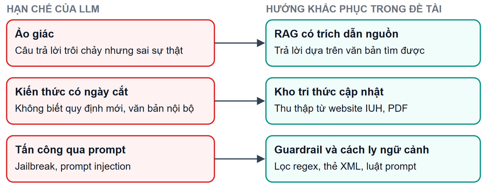
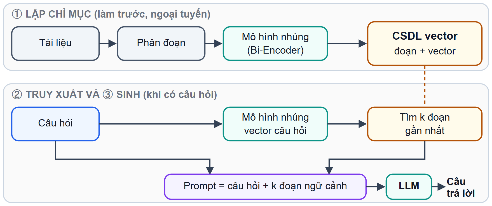
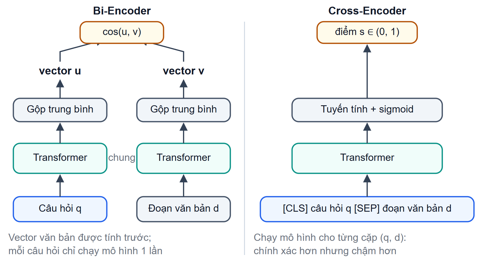
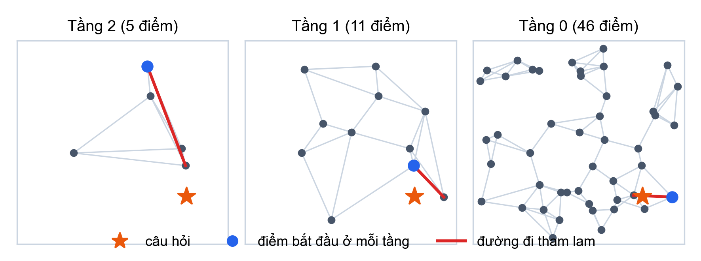
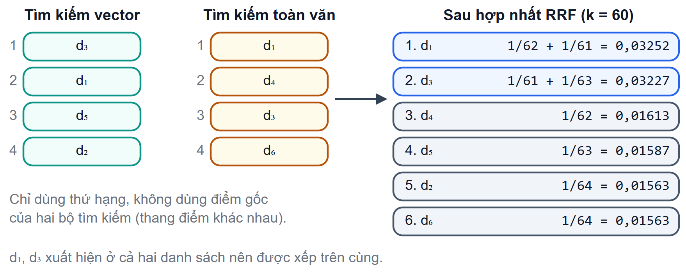
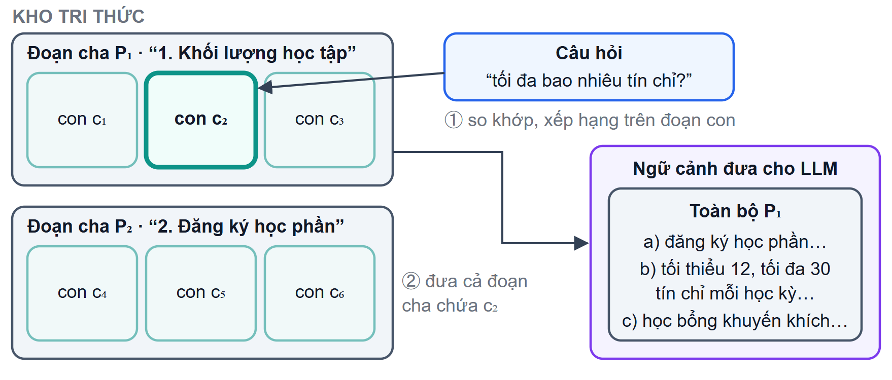
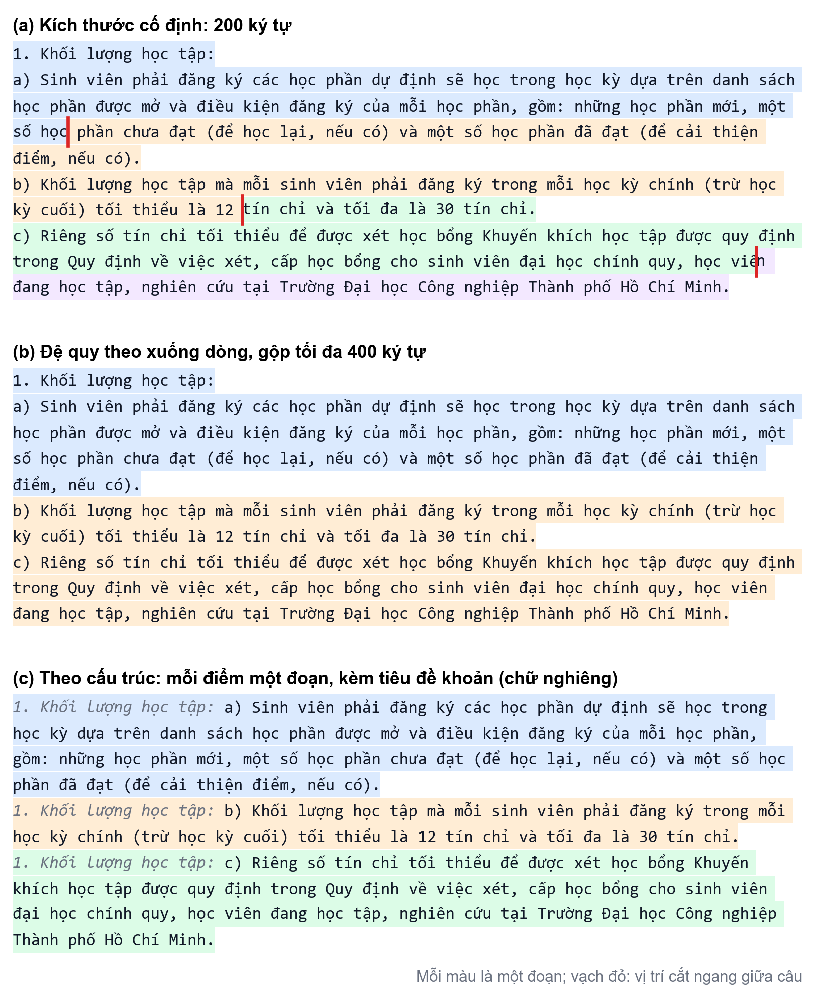

# CHƯƠNG 2. CƠ SỞ LÝ THUYẾT VÀ CÔNG NGHỆ SỬ DỤNG

Chương này trình bày nền tảng lý thuyết của đề tài. Trọng tâm là mô hình ngôn ngữ lớn và kỹ thuật sinh tăng cường truy xuất, nền tảng của chatbot học vụ (mục 2.1, 2.2). Các mục sau trình bày ngắn gọn nền tảng của các phân hệ hỗ trợ (mục 2.3), kiến trúc và công nghệ của hệ thống (mục 2.4), và các nghiên cứu liên quan (mục 2.5). Mỗi lý thuyết kết thúc bằng phần **áp dụng trong đề tài**; chi tiết cài đặt được trình bày ở Chương 4.

## 2.1 Mô hình ngôn ngữ lớn

### 2.1.1 Kiến trúc Transformer

Mô hình ngôn ngữ lớn (Large Language Model – LLM) là mạng nơ-ron có hàng tỷ tham số, được huấn luyện trên kho văn bản rất lớn để dự đoán token tiếp theo. Hầu hết LLM hiện nay dựa trên kiến trúc Transformer [@vaswani2017]. Kiến trúc gốc gồm bộ mã hóa (encoder) biến chuỗi đầu vào thành các vector ngữ cảnh, và bộ giải mã (decoder) sinh chuỗi đầu ra từng phần tử một (Hình 2.1).

![Hình 2.1. Kiến trúc Transformer gồm bộ mã hóa và bộ giải mã (Vẽ lại theo [@vaswani2017])](../figures/ch2/H2-01.png){width=10.5cm}

Thành phần cốt lõi của Transformer là cơ chế **chú ý (attention)**: với mỗi vị trí trong chuỗi, mô hình tính mức độ liên quan giữa vị trí đó và mọi vị trí khác, rồi tổng hợp thông tin theo các trọng số này, như công thức (2-1):

$$ \operatorname{Attention}(Q,K,V)=\operatorname{softmax}\left(\frac{QK^{\top}}{\sqrt{d_k}}\right)V \tag{2-1} $$

trong đó $Q$, $K$, $V$ là ma trận truy vấn, khóa và giá trị, thu được bằng cách nhân biểu diễn của các token với ba ma trận trọng số học được; $d_k$ là số chiều của vector khóa. Phép chia cho $\sqrt{d_k}$ giữ cho tích vô hướng không quá lớn, tránh làm hàm softmax bão hòa.

Transformer dùng **attention đa đầu (multi-head attention)**: chiếu $Q$, $K$, $V$ thành nhiều không gian con, tính attention song song trên từng không gian rồi ghép kết quả (Hình 2.2). Mỗi đầu có thể học một kiểu quan hệ khác nhau giữa các token.

![Hình 2.2. Scaled dot-product attention (trái) và multi-head attention (phải) (Vẽ lại theo [@vaswani2017])](../figures/ch2/H2-02.png){width=13cm}

Phần lớn LLM sinh văn bản hiện nay chỉ dùng khối giải mã (decoder-only) và được huấn luyện theo mục tiêu tự hồi quy: xác suất của một chuỗi được phân rã thành tích các xác suất có điều kiện của từng token khi biết các token đứng trước. Khi suy luận, mô hình sinh từng token, nối token vừa sinh vào đầu vào rồi dự đoán token tiếp theo.

**Áp dụng trong đề tài.** Mô hình sinh mặc định của chatbot là `QuantTrio/Qwen3.6-35B-A3B-AWQ`, một biến thể của họ Qwen3 [@yang2025qwen3]. Mô hình dùng kiến trúc hỗn hợp chuyên gia (Mixture-of-Experts): tổng khoảng 35 tỷ tham số nhưng chỉ khoảng 3 tỷ tham số hoạt động cho mỗi token, và được lượng tử hóa AWQ để chạy trên GPU có bộ nhớ hạn chế. Mô hình được phục vụ qua vLLM hoặc Ollama với giao diện tương thích OpenAI. Danh sách đầy đủ các mô hình dùng trong hệ thống ở Bảng 2.1 (mục 2.4.3).

### 2.1.2 Sinh văn bản và kỹ thuật thiết kế prompt

Ở mỗi bước sinh, LLM tính một vector điểm (logit) $z$ cho mọi token trong bộ từ vựng $V$. Khi lấy mẫu, phân phối xác suất được điều chỉnh bằng **nhiệt độ** $T$, như công thức (2-2):

$$ p_i=\frac{\exp(z_i/T)}{\sum_{j=1}^{|V|}\exp(z_j/T)} \tag{2-2} $$

Khi $T<1$, phân phối nhọn hơn và câu trả lời ổn định hơn; khi $T\to0$, việc lấy mẫu tiến về chọn token có điểm cao nhất (giải mã tham lam); khi $T>1$, câu trả lời đa dạng hơn nhưng dễ lạc đề. **Lấy mẫu hạt nhân (top-p)** [@holtzman2020] chỉ lấy mẫu trong tập token nhỏ nhất có tổng xác suất đạt ngưỡng $p$, nhờ đó loại bỏ các token có xác suất rất thấp.

**Prompt** là toàn bộ văn bản đầu vào của LLM. Kỹ thuật thiết kế prompt điều khiển hành vi của mô hình mà không cần huấn luyện lại. Các kỹ thuật chính gồm:
- **lời nhắc hệ thống (system prompt):** mô tả vai trò, giọng văn và các luật bắt buộc;
- **học từ vài ví dụ (few-shot):** đưa vài cặp câu hỏi – câu trả lời mẫu vào prompt để mô hình bắt chước định dạng và cách lập luận [@brown2020];
- **chuỗi suy luận (Chain-of-Thought):** yêu cầu mô hình trình bày các bước trung gian trước khi trả lời, cải thiện rõ độ chính xác ở bài toán số học và suy luận nhiều bước [@wei2022cot];
- **đầu ra có cấu trúc:** yêu cầu mô hình trả về JSON theo lược đồ cố định để chương trình kiểm tra tự động.

**Áp dụng trong đề tài.** Thông tin học vụ cần chính xác và ổn định, nên lời gọi sinh câu trả lời dùng nhiệt độ thấp (`temperature = 0,2`, `top_p = 0,8` với nhà cung cấp tương thích OpenAI). Prompt của chatbot được ghép từ persona và luật an toàn, luật riêng theo loại câu hỏi (intent), ví dụ few-shot, bộ nhớ hội thoại, ngữ cảnh truy xuất và câu hỏi. Với câu hỏi cần tính toán như học phí hay điểm trung bình, luật yêu cầu tính từng bước trong khối `<thinking>`. Bộ định tuyến của chatbot dùng đầu ra JSON có cấu trúc. Chi tiết ở mục 4.2.7.

### 2.1.3 Hạn chế của LLM

Khi dùng để tư vấn thông tin chính thức, LLM có ba hạn chế quan trọng (Hình 2.3):
- **Ảo giác (hallucination):** mô hình sinh nội dung trôi chảy nhưng sai sự thật hoặc không có căn cứ [@ji2023hallucination], vì được huấn luyện để sinh văn bản có xác suất cao chứ không để kiểm chứng sự thật.
- **Kiến thức có ngày cắt:** tri thức chỉ cập nhật đến thời điểm huấn luyện, và không bao gồm các văn bản nội bộ như quy định riêng của một trường đại học.
- **Tấn công qua prompt:** người dùng có thể chèn câu lệnh để vượt qua luật của hệ thống (jailbreak, prompt injection); lệnh độc hại cũng có thể nằm sẵn trong tài liệu được đưa vào ngữ cảnh. OWASP xếp prompt injection vào nhóm rủi ro hàng đầu của ứng dụng LLM [@owasp_llm].

{width=13cm}

**Áp dụng trong đề tài.** Hai hạn chế đầu được khắc phục bằng RAG (mục 2.2): câu trả lời dựa trên kho tri thức được cập nhật từ website của trường và có trích dẫn. Hạn chế thứ ba được giảm thiểu bằng ba lớp: bộ lọc biểu thức chính quy chặn mẫu tấn công trước khi gọi LLM, đóng gói ngữ cảnh truy xuất trong các thẻ riêng, và luật prompt yêu cầu không thực thi lệnh nằm trong ngữ cảnh (mục 4.2.2, 4.2.6).

## 2.2 Sinh tăng cường truy xuất (Retrieval-Augmented Generation)

### 2.2.1 Kiến trúc RAG

Sinh tăng cường truy xuất (Retrieval-Augmented Generation – RAG) kết hợp hai thành phần [@lewis2020rag]: **bộ truy xuất (retriever)** tìm trong kho tri thức các đoạn văn bản liên quan đến câu hỏi, và **bộ sinh (generator)**, thường là một LLM, tạo câu trả lời dựa trên câu hỏi và các đoạn văn bản đó. Kiến trúc cơ bản (Naive RAG) gồm ba giai đoạn (Hình 2.4):
1. **Lập chỉ mục:** chia tài liệu thành đoạn, tính vector nhúng và lưu vào cơ sở dữ liệu vector.
2. **Truy xuất:** tìm các đoạn gần câu hỏi nhất.
3. **Sinh:** đưa các đoạn này cùng câu hỏi vào prompt của LLM.

{width=13cm}

Naive RAG có nhiều điểm yếu: câu hỏi mơ hồ hoặc chứa nhiều ý làm giảm chất lượng truy xuất; các đoạn truy xuất được có thể không liên quan hoặc trùng lặp; ngữ cảnh quá dài làm mô hình bỏ sót thông tin. Khảo sát của Gao và cộng sự phân loại các cải tiến thành hai mô hình [@gao2023rag] (Hình 2.5):
- **Advanced RAG** bổ sung các bước *trước truy xuất* (viết lại, mở rộng câu hỏi) và *sau truy xuất* (xếp hạng lại, nén ngữ cảnh).
- **Modular RAG** tổ chức hệ thống thành các mô-đun có thể thay thế và sắp xếp linh hoạt, như định tuyến, bộ nhớ, tìm kiếm, kiểm tra.

![Hình 2.5. So sánh Naive RAG, Advanced RAG và Modular RAG (Vẽ lại theo [@gao2023rag])](../figures/ch2/H2-10.png)

**Áp dụng trong đề tài.** Pipeline chatbot thuộc dạng Advanced RAG có tổ chức mô-đun:
- trước truy xuất có bộ lọc an toàn, bộ định tuyến phân loại intent, viết lại và tách câu hỏi;
- truy xuất bằng tìm kiếm lai;
- sau truy xuất có xếp hạng lại, mở rộng ngữ cảnh theo đoạn cha và sắp xếp lại thứ tự;
- bộ nhớ đệm ngữ nghĩa đặt trước bước truy xuất.

Các mục 2.2.2 đến 2.2.6 trình bày cơ sở lý thuyết của từng bước.

### 2.2.2 Biểu diễn văn bản: Bi-Encoder và Cross-Encoder

Để so sánh câu hỏi với văn bản theo ngữ nghĩa, mỗi đoạn văn bản được biểu diễn bằng một **vector nhúng (embedding)**; hai văn bản gần nghĩa thì có vector gần nhau. Độ gần thường đo bằng **độ tương tự cosine** giữa vector $\mathbf{q}$ của câu hỏi và vector $\mathbf{d}$ của đoạn văn bản, như công thức (2-3):

$$ \cos(\mathbf{q},\mathbf{d})=\frac{\mathbf{q}\cdot\mathbf{d}}{\lVert\mathbf{q}\rVert\,\lVert\mathbf{d}\rVert} \tag{2-3} $$

Giá trị nằm trong đoạn $[-1,1]$; càng gần 1 thì hai văn bản càng tương tự. Có hai cách dùng mô hình Transformer để chấm mức liên quan giữa câu hỏi và văn bản (Hình 2.6):
- **Bi-Encoder** [@reimers2019sbert; @karpukhin2020dpr] mã hóa câu hỏi và văn bản **độc lập** bằng cùng một mạng. Vì vector của văn bản không phụ thuộc vào câu hỏi, có thể tính trước cho toàn bộ kho; khi có câu hỏi chỉ cần mã hóa câu hỏi một lần rồi tìm láng giềng gần nhất. Mô hình thường được huấn luyện bằng hàm mất mát tương phản, kéo cặp (câu hỏi, đoạn đúng) lại gần và đẩy các cặp sai ra xa.
- **Cross-Encoder** [@nogueira2019] ghép câu hỏi và văn bản thành **một chuỗi** rồi đưa qua mô hình, để attention so khớp trực tiếp từng từ của hai bên; điểm liên quan được đưa về khoảng $(0,1)$ bằng hàm sigmoid. Cross-Encoder chính xác hơn nhưng phải chạy mô hình cho từng cặp, nên chỉ dùng để **xếp hạng lại** một số ít ứng viên mà Bi-Encoder đã lọc trước.

{width=13cm}

**Áp dụng trong đề tài.** Bi-Encoder là `bkai-foundation-models/vietnamese-bi-encoder`, xây trên PhoBERT [@nguyen2020phobert], sinh vector 768 chiều cho toàn bộ kho tri thức và bộ nhớ đệm ngữ nghĩa. Cross-Encoder là `BAAI/bge-reranker-v2-m3`, mô hình xếp hạng lại đa ngôn ngữ thuộc họ BGE M3 [@chen2024bgem3]. Cả hai chạy bằng ONNX Runtime trên GPU hoặc CPU. Điểm Cross-Encoder được dùng với ba ngưỡng: 0,20 để loại đoạn gần như không liên quan, 0,65 để đánh dấu đoạn "tốt", và 0,80 để xác nhận một lượt trùng bộ nhớ đệm.

### 2.2.3 Tìm kiếm vector và chỉ mục HNSW

Tìm chính xác $k$ vector gần nhất trong kho gồm $N$ vector phải so sánh với cả $N$ vector. Với kho lớn, người ta dùng **tìm kiếm láng giềng gần đúng (Approximate Nearest Neighbor – ANN)**, chấp nhận đánh đổi một chút độ chính xác để tăng tốc.

**HNSW (Hierarchical Navigable Small World)** [@malkov2020hnsw] là thuật toán ANN dựa trên đồ thị nhiều tầng (Hình 2.7). Tầng 0 chứa mọi điểm, mỗi tầng phía trên chứa một tập con thưa hơn; mỗi điểm nối với tối đa $M$ láng giềng gần nhất trong cùng tầng. Khi tìm kiếm, thuật toán bắt đầu từ tầng cao nhất, đi tham lam tới láng giềng gần câu hỏi hơn, rồi xuống dần tầng dưới; ở tầng 0, thuật toán giữ một danh sách ứng viên kích thước $ef$. Nhờ cấu trúc nhiều tầng, độ phức tạp tìm kiếm trung bình xấp xỉ $O(\log N)$. Ba tham số chính là số liên kết $M$, kích thước danh sách ứng viên khi xây chỉ mục (`ef_construction`) và khi tìm kiếm (`ef_search`); tăng các tham số này làm tăng độ phủ nhưng tốn bộ nhớ và thời gian hơn.

{width=12cm}

**Áp dụng trong đề tài.** PostgreSQL với tiện ích pgvector [@pgvector] lưu vector 768 chiều. Bảng `document_chunks` và `semantic_cache` có chỉ mục HNSW với phép đo cosine, tham số `m = 16`, `ef_construction = 64`. Mã nguồn không đặt `ef_search`, nên giá trị mặc định 40 của pgvector được dùng.

> [TODO: Kiểm tra trên CSDL Supabase giá trị `hnsw.ef_search` và số ứng viên thực tế mà nhánh vector trả về. Theo tài liệu pgvector, quét chỉ mục HNSW trả về tối đa `ef_search` hàng, trong khi hàm `match_chunks_hybrid_rrf` yêu cầu tới 100 ứng viên (kế hoạch cũ mục 11, điểm 20).]

### 2.2.4 Tìm kiếm toàn văn và tìm kiếm lai

Tìm kiếm vector mạnh ở việc hiểu nghĩa, nhưng có thể bỏ sót các truy vấn cần **khớp chính xác từ khóa** như mã học phần, số hiệu văn bản hay tên riêng. Tìm kiếm toàn văn bổ sung điểm yếu này. Cách chấm điểm từ khóa kinh điển là TF-IDF và BM25 [@manning2008ir; @robertson2009bm25]: từ càng hiếm trong toàn kho thì càng có trọng số cao; BM25 còn làm bão hòa tần suất từ và chuẩn hóa theo độ dài văn bản.

Tìm kiếm toàn văn của PostgreSQL [@postgres_fts] **không cài đặt BM25**. Văn bản được chuyển thành kiểu `tsvector` (danh sách từ vị kèm vị trí), câu hỏi được chuyển thành `tsquery`, và hàm `ts_rank_cd` xếp hạng theo **mật độ phủ (cover density)** [@clarke2000]: văn bản có nhiều đoạn ngắn chứa đủ các từ của truy vấn thì điểm càng cao.

Hai cách tìm kiếm cho ra hai danh sách xếp hạng với **thang điểm không so sánh được**. **Hợp nhất thứ hạng nghịch đảo (Reciprocal Rank Fusion – RRF)** [@cormack2009rrf] chỉ dùng **thứ hạng**, theo công thức (2-4):

$$ \operatorname{RRF}(d)=\sum_{r\in R}\frac{1}{k+\operatorname{rank}_r(d)} \tag{2-4} $$

trong đó $R$ là tập các danh sách xếp hạng, $\operatorname{rank}_r(d)$ là vị trí (bắt đầu từ 1) của tài liệu $d$ trong danh sách $r$ (không có trong danh sách thì không được cộng điểm), và $k$ là hằng số làm mượt. Tài liệu đứng cao trong **cả hai** danh sách được xếp trên cùng (Hình 2.8).

{width=13cm}

::: {custom-style="Example Box"}
**Ví dụ 2.1.** Với $k=60$: tài liệu $d_1$ đứng thứ 2 trong danh sách vector và thứ 1 trong danh sách toàn văn, nên $\operatorname{RRF}(d_1)=\frac{1}{62}+\frac{1}{61}\approx0{,}03252$. Tài liệu $d_3$ đứng thứ 1 và thứ 3, nên $\operatorname{RRF}(d_3)=\frac{1}{61}+\frac{1}{63}\approx0{,}03227$. Dù $d_3$ đứng đầu danh sách vector, $d_1$ vẫn được xếp trên vì có thứ hạng tốt hơn khi xét cả hai danh sách.
:::

**Áp dụng trong đề tài.** Hàm `match_chunks_hybrid_rrf` trong CSDL cài đặt công thức (2-4) với $k=60$. Nhánh toàn văn dùng cấu hình `simple` (không tách gốc từ, không bỏ từ dừng) kết hợp hàm `unaccent` bỏ dấu tiếng Việt, nên "học phí" và "hoc phi" khớp với nhau, và xếp hạng bằng `ts_rank_cd`. Như vậy hệ thống dùng `ts_rank_cd` chứ **không dùng BM25**; BM25 chỉ được nêu ở trên như nền tảng của việc chấm điểm từ khóa.

### 2.2.5 Các kỹ thuật RAG nâng cao

**Viết lại và tách câu hỏi.** Câu hỏi thường phụ thuộc ngữ cảnh hội thoại (ví dụ "còn học kỳ hè thì sao?") hoặc chứa nhiều ý. Ma và cộng sự đề xuất thêm bước viết lại câu hỏi trước khi truy xuất [@ma2023rewrite]. Biến thể *đa truy vấn* tách câu hỏi thành nhiều câu hỏi con, truy xuất cho từng câu rồi hợp kết quả. Một hướng khác là HyDE: truy xuất bằng vector của một câu trả lời giả định do LLM sinh ra [@gao2023hyde]. Đề tài **không áp dụng** HyDE, vì kỹ thuật này tốn thêm một lời gọi LLM và câu trả lời giả định có thể chứa thông tin học vụ sai.

**Hiện tượng "lạc giữa ngữ cảnh" (lost in the middle).** Liu và cộng sự cho thấy LLM trả lời chính xác nhất khi tài liệu chứa đáp án nằm ở **đầu hoặc cuối** ngữ cảnh, và kém rõ rệt khi tài liệu nằm ở giữa [@liu2024lost]. Từ đó có thể sắp xếp các đoạn theo kiểu **"bánh mì kẹp" (sandwich)**: đoạn tốt nhất ở đầu, đoạn tốt thứ nhì ở cuối, các đoạn kém hơn ở giữa. Với $n$ đoạn đã xếp hạng giảm dần, đoạn hạng $r$ được đặt vào vị trí $\pi(r)$ theo công thức (2-5):

$$ \pi(r)=\begin{cases}\frac{r+1}{2}, & r\ \text{lẻ}\\ n-\frac{r}{2}+1, & r\ \text{chẵn}\end{cases} \tag{2-5} $$

Ví dụ với $n=5$, thứ tự trong ngữ cảnh là $[1,3,5,4,2]$.

**Truy xuất đoạn nhỏ, trả về đoạn lớn (Small-to-Big, Parent–Child).** Đoạn nhỏ cho vector "sắc nét" và truy xuất chính xác, còn đoạn lớn cung cấp đủ ngữ cảnh để LLM trả lời. Kỹ thuật Parent–Child giải quyết mâu thuẫn này bằng hai cấp: văn bản được chia thành **đoạn cha** lớn theo cấu trúc, mỗi đoạn cha chia thành nhiều **đoạn con** nhỏ; hệ thống truy xuất trên đoạn con nhưng đưa **đoạn cha** tương ứng vào prompt (Hình 2.9).

{width=13cm}

**Tự phản tư và hiệu chỉnh truy xuất.** Self-RAG [@asai2024selfrag] huấn luyện mô hình sinh các "token phản tư" để tự đánh giá có cần truy xuất không, tài liệu có liên quan không và câu trả lời có được tài liệu hỗ trợ không. CRAG [@yan2024crag] dùng một bộ đánh giá nhẹ để chấm chất lượng tài liệu và kích hoạt hành động hiệu chỉnh khi tài liệu kém.

**Bộ nhớ đệm ngữ nghĩa (semantic cache).** Bộ nhớ đệm ngữ nghĩa lưu vector của các câu hỏi đã trả lời; khi câu hỏi mới đủ gần một câu đã lưu thì trả lại câu trả lời cũ, bỏ qua bước truy xuất và sinh. Rủi ro là hai câu gần nghĩa nhưng khác chi tiết quan trọng (ví dụ "Điều 10" và "Điều 11") bị coi là trùng, nên cần thêm bước xác nhận. Điều kiện trùng của hệ thống được viết thành công thức (2-6):

$$ \operatorname{HIT}(q,c)=\big[\cos(\mathbf{q},\mathbf{c})\ge\theta_{bi}\big]\wedge\big[s(q,c)\ge\theta_{ce}\big]\wedge\big[\operatorname{num}(q)=\operatorname{num}(c)\big] \tag{2-6} $$

trong đó $c$ là câu hỏi đã lưu, $\theta_{bi}$ là ngưỡng độ tương tự của Bi-Encoder, $s(q,c)$ là điểm Cross-Encoder với ngưỡng $\theta_{ce}$, và $\operatorname{num}(\cdot)$ là tập các con số xuất hiện trong câu.

**Áp dụng trong đề tài.**
- Bộ định tuyến viết lại câu hỏi thành câu độc lập và tách thành tối đa 4 câu hỏi con, truy xuất song song.
- Sắp xếp sandwich được cài đặt đúng công thức (2-5).
- Kho tri thức được tổ chức theo Parent–Child.
- Bộ nhớ đệm ngữ nghĩa dùng $\theta_{bi}=0{,}60$, $\theta_{ce}=0{,}80$ và so khớp con số; câu trả lời chỉ được ghi vào bộ nhớ đệm khi qua "cổng chất lượng".
- Self-RAG được áp dụng ở mức prompt: không huấn luyện lại mô hình, mà yêu cầu mô hình tự đánh giá mức liên quan của tài liệu, mâu thuẫn giữa các nguồn và độ tin cậy của câu trả lời trong khối `<thinking>`. CRAG chưa được áp dụng.

Chi tiết cài đặt ở mục 4.2.

### 2.2.6 Phân đoạn văn bản và trích xuất dữ liệu

Trước khi lập chỉ mục, văn bản phải được **trích xuất** từ nguồn gốc rồi **phân đoạn**. Với trang web, cần bỏ menu, chân trang, quảng cáo để giữ nội dung chính; thư viện trafilatura được thiết kế cho nhiệm vụ này [@barbaresi2021]. PDF có lớp văn bản có thể đọc trực tiếp, còn PDF dạng ảnh scan cần nhận dạng ký tự quang học (OCR).

Có ba chiến lược phân đoạn phổ biến (Hình 2.10):
- **Theo kích thước cố định:** đơn giản nhưng dễ cắt ngang câu, ngang điều khoản.
- **Đệ quy theo dấu phân tách** (đoạn, dòng, câu): giữ được câu nhưng không hiểu cấu trúc tài liệu.
- **Theo cấu trúc** (chương, điều, khoản): mỗi đoạn là một đơn vị nghĩa trọn vẹn, nhưng phụ thuộc định dạng nguồn.

Hình 2.10 áp dụng ba chiến lược trên cùng một đoạn trích thật của Quy chế đào tạo. Cắt cố định tách rời con số "12" khỏi đơn vị "tín chỉ"; phân đoạn đệ quy gộp hai ý khác nhau vào một đoạn; phân đoạn theo cấu trúc giữ trọn từng điểm và lặp lại tiêu đề khoản làm tiền tố, nên mỗi đoạn vẫn rõ nghĩa khi đứng một mình.

**Áp dụng trong đề tài.** Bộ phân đoạn `HybridChunker` tách đoạn cha theo cấu trúc tiêu đề (đoạn cha dài hơn khoảng 1 200 token mới được tách tiếp), và đoạn con dài tối đa 600 ký tự, chồng lấn 100 ký tự. Trang web được trích xuất bằng trafilatura, PDF bằng PyMuPDF, PDF scan bằng OCR của Gemini với Tesseract làm phương án dự phòng (mục 4.1).

### 2.2.7 Độ đo đánh giá truy xuất và sinh

Mục này định nghĩa các độ đo dùng ở Chương 5. Giả sử tập đánh giá gồm $|Q|$ câu hỏi, mỗi câu hỏi có một hoặc nhiều đoạn văn bản đúng đã được gán nhãn, và $\mathrm{rank}_i$ là vị trí của đoạn đúng đầu tiên với câu hỏi thứ $i$ ($\mathrm{rank}_i=\infty$ nếu không tìm thấy).

**Tỉ lệ trúng (Hit Rate@K)** là tỉ lệ câu hỏi có ít nhất một đoạn đúng nằm trong $K$ kết quả đầu, theo công thức (2-7):

$$ \mathrm{HitRate@}K=\frac{1}{|Q|}\sum_{i=1}^{|Q|}\mathbb{1}\big[\mathrm{rank}_i\le K\big] \tag{2-7} $$

trong đó $\mathbb{1}[\cdot]$ bằng 1 khi điều kiện đúng và 0 khi sai. **Thứ hạng nghịch đảo trung bình (MRR)** thưởng nhiều hơn khi đoạn đúng nằm ở vị trí cao [@manning2008ir], theo công thức (2-8), với quy ước $1/\infty=0$:

$$ \mathrm{MRR}=\frac{1}{|Q|}\sum_{i=1}^{|Q|}\frac{1}{\mathrm{rank}_i} \tag{2-8} $$

Ví dụ với ba câu hỏi có đoạn đúng đầu tiên ở vị trí 1, 3 và không xuất hiện, ta có $\mathrm{HitRate@}3=2/3$ và $\mathrm{MRR}=\frac{1}{3}\left(1+\frac{1}{3}+0\right)\approx0{,}444$. Ngoài ra còn các độ đo độ chính xác và độ phủ tại $K$ (P@K, R@K) và nDCG@K, độ đo xét cả mức độ liên quan nhiều bậc lẫn vị trí của kết quả [@jarvelin2002].

Với chất lượng câu trả lời, hai tiêu chí thường dùng là **tính trung thực** (mọi khẳng định đều được ngữ cảnh hỗ trợ) và **mức độ đáp ứng** (câu trả lời đúng trọng tâm câu hỏi). Hai tiêu chí này có thể do người chấm hoặc do một LLM khác chấm theo thang điểm định trước.
