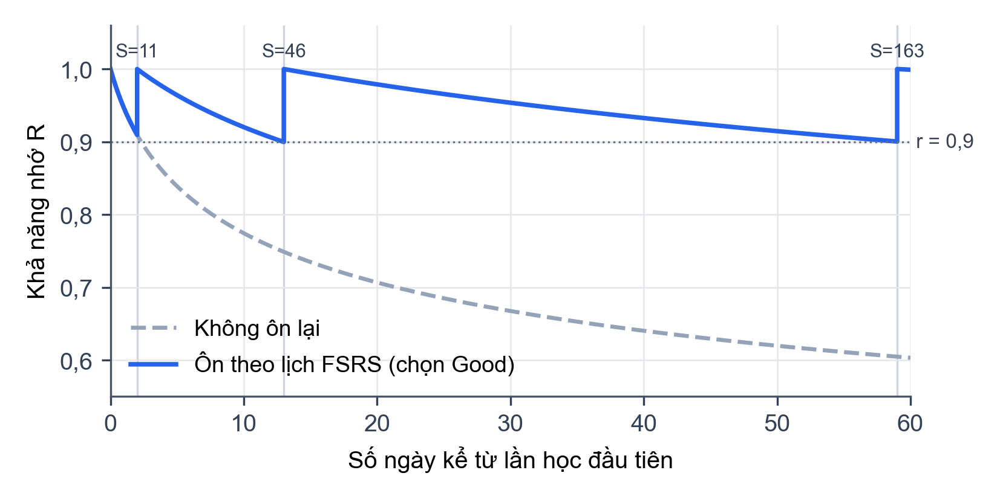

## 2.3 Nền tảng cho các phân hệ hỗ trợ

### 2.3.1 Dịch máy nơ-ron và xử lý ngôn ngữ

**Dịch máy nơ-ron** coi bài toán dịch là ánh xạ chuỗi nguồn thành chuỗi đích bằng một mạng nơ-ron duy nhất, thường theo kiến trúc mã hóa – giải mã của Transformer (Hình 2.1): bộ mã hóa đọc câu nguồn, bộ giải mã sinh từng token đích và dùng chú ý chéo (cross-attention) để quyết định nên "nhìn" vào phần nào của câu nguồn. **NLLB-200** (No Language Left Behind) là họ mô hình dịch đa ngôn ngữ của Meta AI, hỗ trợ khoảng 200 ngôn ngữ trong cùng một mô hình [@nllb2022]; mã ngôn ngữ đích (ví dụ `vie_Latn`) được đưa làm token đầu tiên của chuỗi đích để bộ giải mã biết cần sinh ngôn ngữ nào. **CTranslate2** là thư viện suy luận tối ưu cho Transformer [@ctranslate2], hỗ trợ chạy mô hình ở kiểu `float16` trên GPU hoặc kiểu số nguyên 8 bit (`int8`) trên CPU để giảm bộ nhớ.

**Nhận diện ngôn ngữ** đặc biệt khó với văn bản ngắn hoặc các ngôn ngữ họ hàng gần. fastText [@joulin2017] là bộ phân loại tuyến tính nhanh trên n-gram ký tự, mạnh với văn bản dài; Lingua [@stahl_lingua] dùng mô hình n-gram ký tự cho từng ngôn ngữ, chính xác hơn với văn bản ngắn. Kết hợp hai bộ nhận diện giúp tận dụng ưu điểm của cả hai.

**Dịch theo chuyên ngành** đòi hỏi biết văn bản thuộc chuyên ngành nào, vì một thuật ngữ có thể mang nghĩa khác nhau tùy lĩnh vực (ví dụ "interest" là *lãi suất* trong tài chính). Có thể để LLM tự khai chuyên ngành, nhưng độ tin cậy do LLM tự khai thường "bão hòa" gần 1 kể cả khi sai, nên cần đối chiếu với bằng chứng từ vựng là các thuật ngữ của từ điển chuyên ngành xuất hiện trong văn bản.

**Áp dụng trong đề tài.**
- Dịch thông thường dùng NLLB-200 bản distilled 600 triệu tham số trên CTranslate2, kiểu `float16` khi có GPU và `int8` khi chạy CPU.
- Nhận diện ngôn ngữ kết hợp fastText và Lingua theo trọng số, cộng thêm bằng chứng theo hệ chữ, rồi hiệu chỉnh độ tin cậy bằng hồi quy logistic. Kết quả không chắc chắn thì hệ thống không dịch mà yêu cầu người dùng chọn ngôn ngữ nguồn.
- Dịch theo chuyên ngành gọi LLM kèm bảng thuật ngữ từ điển; lời khai chuyên ngành của LLM bị bác bỏ khi bằng chứng từ vựng của một chuyên ngành khác vượt trội.
- Phân tích nghĩa của từ tiếng Anh dùng thuật toán Lesk trên WordNet; phát âm dùng dịch vụ giọng đọc nơ-ron Microsoft Edge qua thư viện `edge-tts` [@edgetts].

Chi tiết ở mục 4.3.1.

### 2.3.2 Lặp lại ngắt quãng và thuật toán FSRS

Ebbinghaus là người đầu tiên đo lường một cách hệ thống tốc độ quên: lượng thông tin còn nhớ giảm rất nhanh ngay sau khi học, rồi chậm dần [@ebbinghaus1913]. **Hiệu ứng ngắt quãng (spacing effect)** cho thấy cùng một số lần ôn, phân bố giãn cách theo thời gian giúp nhớ lâu hơn học dồn [@cepeda2006]. Các thuật toán lặp lại ngắt quãng lập lịch để mỗi lần ôn rơi vào lúc người học sắp quên (Hình 2.11).

{width=12cm}

**FSRS (Free Spaced Repetition Scheduler)** dựa trên mô hình trí nhớ DSR [@ye2022fsrs; @ye2023fsrs], mô tả mỗi thẻ bằng ba đại lượng: độ khó $D\in[1,10]$; độ ổn định $S$, là số ngày để khả năng nhớ giảm từ 100% xuống 90%; và khả năng nhớ $R\in[0,1]$, là xác suất nhớ lại tại thời điểm đang xét. Theo FSRS-6, khả năng nhớ sau $t$ ngày kể từ lần ôn gần nhất được mô hình hóa bằng hàm lũy thừa, như công thức (2-9):

$$ R(t,S)=\left(1+F\,\frac{t}{S}\right)^{-w_{20}},\qquad F=0{,}9^{-1/w_{20}}-1 \tag{2-9} $$

trong đó $w_{20}$ là hệ số suy giảm (mặc định 0,1542), và hằng số $F$ được chọn để $R(S,S)=0{,}9$, đúng với định nghĩa độ ổn định. Khoảng ôn tiếp theo được chọn sao cho khả năng nhớ tại thời điểm ôn đúng bằng tỉ lệ ghi nhớ mong muốn $r$, giải từ (2-9) ra công thức (2-10):

$$ I(r,S)=\frac{S}{F}\left(r^{-1/w_{20}}-1\right) \tag{2-10} $$

Với $r=0{,}9$ thì $I=S$. Sau mỗi lần ôn, người học chọn một trong bốn mức Again, Hard, Good, Easy; FSRS dùng mức này để cập nhật $D$ và $S$ theo 21 tham số học từ dữ liệu ôn tập lớn [@fsrs_wiki]. Độ ổn định tăng nhiều hơn khi thẻ dễ, khi $S$ hiện tại còn nhỏ, và khi ôn lúc đã gần quên; chọn Again thì độ ổn định giảm. Khác với thuật toán SM-2 dùng hằng số kinh nghiệm, FSRS ước lượng được xác suất nhớ nên có thể đặt mục tiêu "nhớ được 90%".

**Áp dụng trong đề tài.** Flashcard Service dùng gói `fsrs` 6.x với tỉ lệ ghi nhớ mong muốn $r=0{,}9$ và 21 tham số mặc định. Scheduler không dùng bước học trong ngày (`learning_steps=()`, `relearning_steps=()`), nên thẻ mới chuyển thẳng sang trạng thái ôn tập sau lần ôn đầu tiên và mọi khoảng ôn đều tính bằng ngày. Chi tiết ở mục 4.3.2.
