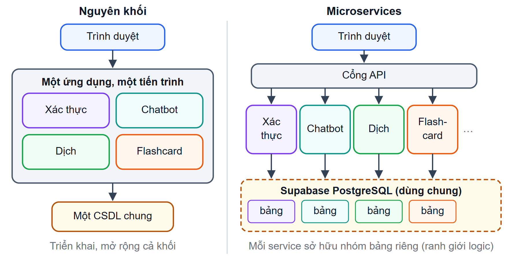
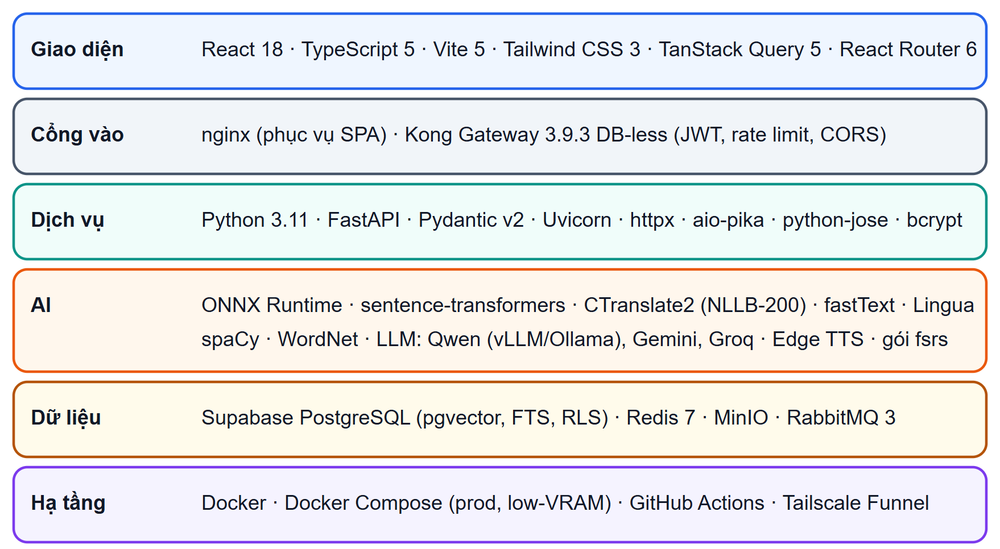

## 2.4 Kiến trúc và công nghệ

### 2.4.1 Kiến trúc microservices và cổng API

**Kiến trúc microservices** chia hệ thống thành nhiều service nhỏ, mỗi service đảm nhận một năng lực nghiệp vụ, chạy trong tiến trình riêng, triển khai độc lập và giao tiếp qua mạng [@newman2021; @richardson2018]. So với kiến trúc nguyên khối (Hình 2.12), microservices cho phép triển khai và mở rộng từng service riêng và cô lập lỗi trong phạm vi một service; đổi lại là độ phức tạp của hệ phân tán. Một nguyên tắc quan trọng là **mỗi service một cơ sở dữ liệu**: service khác chỉ truy cập dữ liệu qua API hoặc sự kiện của service sở hữu [@richardson2018].

{width=13cm}

**Mẫu cổng API** đặt một điểm vào duy nhất trước các service [@richardson2018]. Cổng định tuyến yêu cầu theo đường dẫn và đảm nhận các việc chung: kiểm tra token xác thực, giới hạn tần suất truy cập, chia sẻ tài nguyên khác nguồn gốc (CORS), gắn mã định danh cho từng yêu cầu để truy vết. Nhờ vậy giao diện chỉ cần biết một địa chỉ, và các service không phải mở cổng ra ngoài.

**Áp dụng trong đề tài.** Hệ thống gồm bốn service FastAPI đang vận hành (xác thực, chatbot, dịch thuật, flashcard) đặt sau cổng Kong Gateway chạy ở chế độ không cơ sở dữ liệu [@kong_docs]. Nguyên tắc mỗi service một cơ sở dữ liệu chỉ được áp dụng **ở mức quy ước**: các service dùng chung một CSDL PostgreSQL trên Supabase, nhưng mỗi service chỉ đọc ghi các bảng của mình (mục 3.4.1).

### 2.4.2 Giao tiếp, lưu trữ và xác thực

Các thành phần giao tiếp theo ba kiểu:
- **REST:** gửi một yêu cầu HTTP và chờ một phản hồi; đơn giản, phù hợp thao tác đọc ghi.
- **Server-Sent Events (SSE)** [@whatwg_sse]: máy chủ giữ kết nối HTTP mở và gửi nhiều sự kiện một chiều về máy khách. SSE phù hợp để hiển thị câu trả lời của LLM ngay khi từng phần được sinh ra.
- **Hàng đợi thông điệp:** bên gửi phát sự kiện rồi tiếp tục công việc, bên nhận xử lý vào lúc khác. RabbitMQ [@rabbitmq_docs] chuyển thông điệp qua một *exchange* tới các hàng đợi theo khóa định tuyến.

Về lưu trữ, Redis là kho khóa – giá trị trong bộ nhớ, thường dùng làm bộ nhớ đệm có thời gian sống; MinIO là hệ lưu trữ đối tượng tương thích S3, dùng cho tệp nhị phân như âm thanh [@minio_docs]. Khi tên tệp được đặt bằng giá trị băm của nội dung (lưu trữ định địa chỉ theo nội dung), cùng một nội dung luôn có cùng một khóa, nên tránh được việc lưu trùng.

**JSON Web Token (JWT)** [@jones2015jwt] là chuỗi gồm ba phần `header.payload.signature`. Payload chứa các *claim* như định danh người dùng, hạn dùng, bên phát hành; chữ ký bảo đảm hai phần trước không bị sửa. JWT không trạng thái nên máy chủ không cần tra CSDL để kiểm tra token, đổi lại khó thu hồi token trước khi hết hạn; hai kỹ thuật phổ biến để hạn chế điểm yếu này là hạn dùng ngắn kèm làm mới, và số phiên bản token lưu trong CSDL. Mật khẩu được băm bằng **bcrypt** [@provos1999], thuật toán chủ động chậm với chi phí tăng gấp đôi mỗi khi tham số *cost* tăng 1, nên việc dò mật khẩu bằng vét cạn rất tốn kém.

**Áp dụng trong đề tài.**
- REST cho mọi API; SSE cho câu trả lời của chatbot, dịch dạng luồng và tiến độ nạp tri thức; RabbitMQ với exchange `chatbot_events` cho luồng sinh âm thanh của thẻ học.
- Redis làm bộ nhớ đệm cho chatbot và dịch thuật; MinIO lưu tệp phát âm theo khóa băm nội dung.
- Token ký bằng HS256, gồm 7 claim, hạn 60 phút, có số phiên bản để thu hồi; mật khẩu băm bằng bcrypt cost 12 (mục 3.6).

### 2.4.3 Công nghệ và mô hình sử dụng

Hình 2.13 tổng hợp các công nghệ của hệ thống theo từng tầng:
- **Máy chủ:** Python 3.11, FastAPI [@fastapi_docs], Pydantic, ONNX Runtime.
- **Giao diện:** React 18 [@react_docs], TypeScript, Vite, Tailwind CSS, TanStack Query.
- **Dữ liệu:** Supabase PostgreSQL với pgvector và bảo mật mức hàng [@supabase_docs], Redis, MinIO, RabbitMQ.
- **Hạ tầng:** Kong Gateway, Docker Compose [@docker_docs], GitHub Actions.

Bảng 2.1 tổng hợp các mô hình trí tuệ nhân tạo được cấu hình mặc định trong mã nguồn. Mỗi phân hệ gọi LLM qua một lớp trừu tượng, cấu hình bằng biến môi trường và có thứ tự dự phòng khi mô hình đầu tiên lỗi hoặc hết hạn mức.

Bảng 2.1. Các mô hình trí tuệ nhân tạo sử dụng trong hệ thống (giá trị mặc định trong mã nguồn)

| Mô hình | Vai trò | Nơi chạy | Phân hệ |
|-----------------------------|----------------------------|--------------------------|--------------|
| `QuantTrio/Qwen3.6-35B-A3B-AWQ` | Định tuyến, sinh câu trả lời | vLLM/Ollama, GPU riêng | Chatbot |
| Gemini (`gemini-3.5-flash-lite` và các model kế tiếp) | Dự phòng cho chatbot; OCR khi nạp tri thức | API đám mây | Chatbot |
| `bkai-foundation-models/vietnamese-bi-encoder` | Vector nhúng 768 chiều | ONNX Runtime | Chatbot |
| `BAAI/bge-reranker-v2-m3` | Xếp hạng lại | ONNX Runtime | Chatbot |
| NLLB-200 distilled 600M | Dịch máy | CTranslate2, GPU hoặc CPU | Dịch thuật |
| Groq `qwen/qwen3.8-27b`, `llama-3.1-8b-instant` | Dịch chuyên ngành; dịch dự phòng | API đám mây | Dịch thuật |
| fastText, Lingua | Nhận diện ngôn ngữ | CPU | Dịch thuật |
| Groq `openai/gpt-oss-120b` | Sinh từ vựng (JSON) | API đám mây | Flashcard |
| Microsoft Edge Neural TTS | Tổng hợp tiếng nói | API đám mây | Dịch thuật, Flashcard |

> [TODO: Ghi rõ cấu hình thực tế (biến môi trường) dùng khi chạy demo và khi đo ở Chương 5, vì mặc định trong `llm_providers.py` (`openai`) và trong `rag_service.py` (`gemini`) khác nhau (kế hoạch cũ mục 11, điểm 2).]

## 2.5 Các nghiên cứu liên quan

Nền tảng của đề tài là RAG gốc của Lewis và cộng sự [@lewis2020rag] và cách phân loại Naive, Advanced, Modular RAG của Gao và cộng sự [@gao2023rag], được dùng để tổ chức pipeline chatbot. Các kỹ thuật được áp dụng gồm viết lại câu hỏi [@ma2023rewrite] (mở rộng thành tách tối đa 4 câu hỏi con), sắp xếp ngữ cảnh theo hiện tượng lạc giữa ngữ cảnh [@liu2024lost], và Self-RAG [@asai2024selfrag] ở mức prompt; HyDE [@gao2023hyde] không được áp dụng, còn CRAG [@yan2024crag] mới dừng ở việc lọc tài liệu theo ngưỡng điểm xếp hạng lại. Ý tưởng chọn mẫu prompt theo loại câu hỏi của SpatioRoute [@chunhachatrachai2026], dù được đề xuất cho bài toán suy luận không gian trên video, tương đồng với cách chatbot của đề tài chọn luật prompt theo intent.

Tại IUH, khóa luận của Đoàn Quang Quý và Nguyễn Minh Long [@quy2025] xây dựng gia sư lập trình dựa trên RAG với LlamaIndex, có tìm kiếm kết hợp ngữ nghĩa với BM25, xếp hạng lại và biến đổi câu hỏi, cho thấy RAG khả thi trong bối cảnh giáo dục tại trường. Đề tài này áp dụng hướng tiếp cận tương tự cho miền thông tin học vụ, bổ sung bộ nhớ đệm ngữ nghĩa, truy xuất theo cặp đoạn cha – con và pipeline thu thập tri thức từ nhiều website của trường.

## Tiểu kết chương {.unnumbered}

Chương 2 đã trình bày nền tảng lý thuyết của đề tài. Mô hình ngôn ngữ lớn có khả năng sinh ngôn ngữ mạnh nhưng có ba hạn chế: ảo giác, kiến thức có ngày cắt và dễ bị tấn công qua prompt. RAG khắc phục hai hạn chế đầu bằng cách truy xuất văn bản tin cậy trước khi sinh, và các kỹ thuật nâng cao (tìm kiếm lai hợp nhất bằng RRF, xếp hạng lại bằng Cross-Encoder, Parent–Child, sắp xếp sandwich, bộ nhớ đệm ngữ nghĩa) giúp tăng chất lượng truy xuất và khai thác ngữ cảnh. Các phân hệ hỗ trợ dựa trên dịch máy NLLB-200, nhận diện ngôn ngữ kết hợp hai mô hình và thuật toán lặp lại ngắt quãng FSRS; toàn hệ thống được xây dựng theo kiến trúc microservices với cổng API. Chương 3 dựa trên các nền tảng này để phân tích và thiết kế hệ thống.
