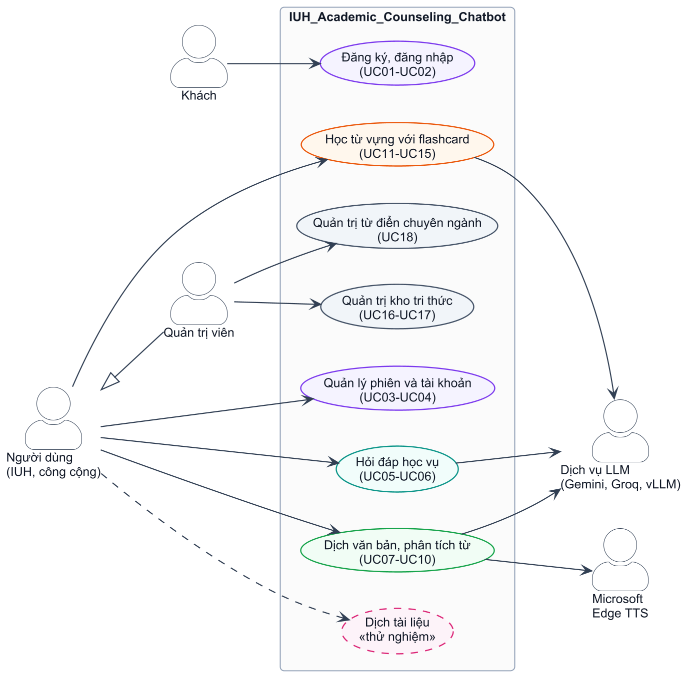
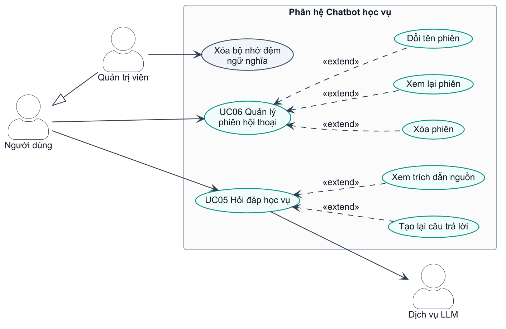
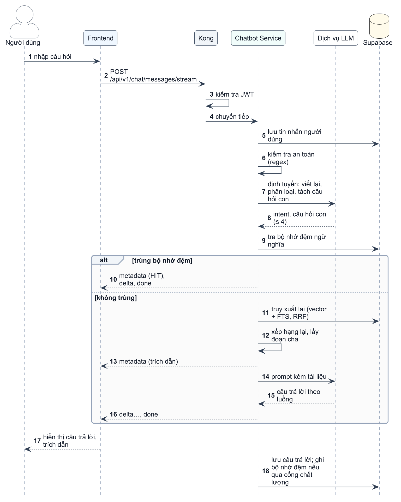
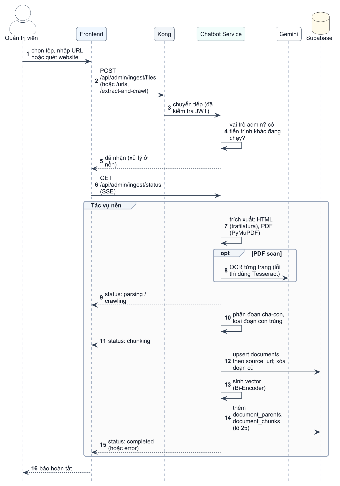

# CHƯƠNG 3. PHÂN TÍCH VÀ THIẾT KẾ HỆ THỐNG

Chương này phân tích yêu cầu, mô hình hóa chức năng bằng use case, rồi trình bày thiết kế kiến trúc, cơ sở dữ liệu, API, bảo mật và giao diện. Các use case của chatbot và quản trị tri thức được đặc tả chi tiết; các phân hệ hỗ trợ chỉ được liệt kê, phần đặc tả tiêu biểu đặt ở Phụ lục B. Mọi yêu cầu và luồng xử lý đều được đối chiếu với mã nguồn: các router của từng service, cấu hình của Kong và bảng định tuyến của giao diện.

## 3.1 Phân tích yêu cầu

### 3.1.1 Tác nhân của hệ thống

Bảng 3.1 mô tả các tác nhân của hệ thống. Trong các mục tiếp theo, "Người dùng" chỉ chung hai vai trò `student` và `public`; Quản trị viên kế thừa mọi chức năng của Người dùng.

Bảng 3.1. Các tác nhân của hệ thống

| Tác nhân | Mô tả | Cách xác định trong hệ thống |
|----------------|------------------------------------|----------------------------------|
| Khách | Người chưa đăng nhập | Chỉ truy cập được trang `/login`; mọi trang khác được bảo vệ bởi `RequireAuth` |
| Người dùng – sinh viên, giảng viên IUH | Người dùng chính của hệ thống | Vai trò `student`. Đăng ký bằng email `@student.iuh.edu.vn` hoặc `@iuh.edu.vn`, bắt buộc khai báo khoa và ngành. MSSV được suy ra từ email sinh viên |
| Người dùng công cộng | Phụ huynh, học sinh phổ thông, người quan tâm | Vai trò `public`. Dùng các chức năng như người dùng IUH, nhưng có hạn mức sinh từ vựng bằng AI thấp hơn |
| Quản trị viên | Người quản lý kho tri thức và từ điển chuyên ngành | Vai trò `admin`, chỉ được gán trực tiếp trong CSDL; đăng ký không bao giờ tạo tài khoản admin |
| Dịch vụ LLM | Gemini, Groq, máy chủ vLLM/Ollama | Hệ thống bên ngoài, được gọi qua HTTP |
| Microsoft Edge TTS | Dịch vụ tổng hợp tiếng nói | Hệ thống bên ngoài, gọi qua thư viện `edge-tts` |

### 3.1.2 Yêu cầu chức năng

Bảng 3.2 liệt kê các yêu cầu chức năng theo phân hệ. Yêu cầu của chatbot và quản trị tri thức được tách chi tiết; yêu cầu của các phân hệ hỗ trợ được gộp theo nhóm.

Bảng 3.2. Yêu cầu chức năng của hệ thống

| Mã | Phân hệ | Yêu cầu | Use case |
|--------|--------------|------------------------------------------------------------|----------|
| YC01 | Chatbot | Hỏi đáp học vụ bằng ngôn ngữ tự nhiên, trả lời dạng luồng, kèm trích dẫn nguồn | UC05 |
| YC02 | Chatbot | Từ chối câu hỏi ngoài phạm vi, chặn câu hỏi có dấu hiệu tấn công prompt | UC05 |
| YC03 | Chatbot | Tạo lại câu trả lời, bỏ qua bộ nhớ đệm | UC05 |
| YC04 | Chatbot | Xem danh sách phiên, xem lại, đổi tên và xóa phiên hội thoại | UC06 |
| YC05 | Quản trị tri thức | Nạp tri thức từ tệp, từ URL hoặc quét các website của trường; theo dõi tiến độ | UC16 |
| YC06 | Quản trị tri thức | Tìm kiếm, đổi tên, xóa tài liệu trong kho tri thức | UC17 |
| YC07 | Quản trị tri thức | Xóa toàn bộ bộ nhớ đệm ngữ nghĩa của chatbot | — |
| YC08 | Xác thực | Đăng ký, đăng nhập bằng email hoặc MSSV, làm mới và thu hồi token, quản lý hồ sơ và cài đặt | UC01–UC04 |
| YC09 | Dịch thuật | Dịch giữa 10 ngôn ngữ, tự nhận diện ngôn ngữ nguồn, dịch theo 6 chuyên ngành | UC07, UC08 |
| YC10 | Dịch thuật | Phân tích nghĩa của từ, nghe phát âm, lưu từ thành thẻ học; quản lý từ điển chuyên ngành | UC09, UC10, UC18 |
| YC11 | Flashcard | Quản lý sổ thẻ và thẻ, ôn tập theo FSRS, xem thống kê | UC11, UC12 |
| YC12 | Flashcard | Sinh từ vựng bằng AI có hạn mức, dùng bộ từ mẫu, nhập Excel, chơi trò chơi ôn từ | UC13–UC15 |

### 3.1.3 Yêu cầu phi chức năng

Bảng 3.3 trình bày các yêu cầu phi chức năng chính cùng biện pháp đáp ứng đã cài đặt; mức đáp ứng thực tế được đánh giá ở Chương 5. Ngoài ra, giao diện bằng tiếng Việt, dùng được trên nhiều kích thước màn hình, và mã nguồn có kiểm thử tự động chạy trên GitHub Actions.

Bảng 3.3. Yêu cầu phi chức năng và biện pháp đáp ứng

| Nhóm | Yêu cầu | Biện pháp trong hệ thống |
|------------|------------------------------------|----------------------------------------------|
| Hiệu năng | Thấy câu trả lời sớm; không tính lại câu hỏi lặp lại | Trả lời dạng luồng qua SSE; bộ nhớ đệm ngữ nghĩa hai tầng của chatbot; bộ nhớ đệm Redis cho kết quả dịch |
| Bảo mật | Chỉ người đã xác thực mới dùng được chức năng; chức năng quản trị chỉ dành cho admin | JWT hạn 60 phút, kiểm tra ở cả Kong và từng service |
| Bảo mật | Chống dò mật khẩu và lạm dụng tài nguyên | Bcrypt cost 12; tạm khóa khi đăng nhập sai nhiều lần; giới hạn tần suất tại Kong |
| Bảo mật | Chống tấn công prompt | Lọc biểu thức chính quy, cách ly ngữ cảnh bằng thẻ, ép đầu ra JSON theo lược đồ |
| Bảo mật | Không lộ dữ liệu qua khóa công khai của CSDL | Bật RLS, không tạo policy; các service dùng khóa service-role phía máy chủ |
| Khả dụng | Một mô hình bên ngoài lỗi không làm dừng chức năng | Chuỗi dự phòng LLM (vLLM → Gemini); dịch quay về NLLB khi LLM lỗi |
| Mở rộng, triển khai | Thêm, nâng cấp phân hệ độc lập; chạy được trên một máy có GPU phổ thông | Microservices sau cổng API; giới hạn tài nguyên theo container; cấu hình cho máy khoảng 6 GB VRAM |

## 3.2 Mô hình hóa chức năng

### 3.2.1 Sơ đồ use case tổng quát

Hình 3.1 là sơ đồ use case tổng quát, nhóm các chức năng theo phân hệ:
- Khách chỉ có thể đăng ký và đăng nhập.
- Người dùng sử dụng chatbot, dịch thuật và flashcard.
- Quản trị viên có thêm các chức năng quản trị kho tri thức và từ điển chuyên ngành.
- Chức năng dịch tài liệu được gắn nhãn «thử nghiệm», vì đang bị tắt ở cả cổng API và giao diện.

Hệ thống tương tác với hai nhóm dịch vụ bên ngoài: các nhà cung cấp LLM (Gemini, Groq, máy chủ vLLM/Ollama) và Microsoft Edge TTS.

{width=13cm}

### 3.2.2 Phân hệ Chatbot học vụ

Hình 3.2 trình bày các use case của phân hệ Chatbot học vụ. Use case trung tâm của hệ thống là UC05 Hỏi đáp học vụ; đặc tả của UC06 Quản lý phiên hội thoại được đặt ở Phụ lục B.

{width=13cm}

Bảng 3.4 đặc tả use case hỏi đáp học vụ.

```{.usecase caption="Bảng 3.4. Đặc tả use case UC05 Hỏi đáp học vụ"}
Use case: UC05 Hỏi đáp học vụ
Mục đích: Nhận câu trả lời chính xác, có dẫn nguồn cho câu hỏi về quy chế, học phí, học bổng, thủ tục.
Mô tả: Người dùng đặt câu hỏi bằng tiếng Việt tự nhiên. Hệ thống trả lời dạng luồng dựa trên kho tri thức, kèm trích dẫn.
Tác nhân: Người dùng; Dịch vụ LLM (tác nhân phụ)
Điều kiện trước: Người dùng đang đăng nhập và ở trang Chatbot (`/chat`).
Điều kiện sau: Câu hỏi và câu trả lời được lưu vào phiên hội thoại; câu trả lời đạt cổng chất lượng được ghi vào bộ nhớ đệm.
Luồng sự kiện chính:
A: 1. Nhập câu hỏi (tối đa 2 000 ký tự) và gửi.
H: 2. Gửi `POST /api/v1/chat/messages/stream`; lưu tin nhắn người dùng.
H: 3. Kiểm tra an toàn bằng biểu thức chính quy.
H: 4. Bộ định tuyến (LLM) viết lại câu hỏi thành câu độc lập, phân loại intent, tách tối đa 4 câu hỏi con.
H: 5. Tra bộ nhớ đệm ngữ nghĩa bằng câu hỏi con đầu tiên.
H: 6. Truy xuất lai, xếp hạng lại và lấy các đoạn cha cho từng câu hỏi con.
H: 7. Gửi sự kiện `metadata` chứa danh sách trích dẫn.
H: 8. Sinh câu trả lời bằng LLM theo prompt của intent; gửi từng phần qua sự kiện `delta`, ẩn khối `<thinking>`; kết thúc bằng `done`.
A: 9. Đọc câu trả lời, mở trích dẫn để xem nguồn.
H: 10. Lưu câu trả lời; ghi bộ nhớ đệm ở nền nếu qua cổng chất lượng.
Luồng sự kiện phụ:
3a. Câu hỏi chứa mẫu tấn công prompt: trả lời từ chối, kết thúc.
4a. Câu hỏi ngoài phạm vi học vụ: trả thông báo phạm vi hỗ trợ, kết thúc.
4b. Câu chào hỏi, cảm ơn: trả lời trực tiếp không tra cứu tài liệu.
5a. Trùng bộ nhớ đệm: gửi `metadata` (HIT) và câu trả lời đã lưu, bỏ qua bước 6–8.
6a. Không có đoạn nào đạt ngưỡng điểm 0,20: LLM được yêu cầu nói rõ chưa tìm thấy thông tin chính thức.
9a. Người dùng chọn "Tạo lại câu trả lời": gửi lại với `bypassCache = true`; lượt trước bị thay thế.
```

Hình 3.3 trình bày sơ đồ tuần tự của UC05 ở mức tổng quan, gồm các bên tham gia và các sự kiện SSE gửi về giao diện. Bộ nhớ đệm ngữ nghĩa, kho tài liệu và lịch sử hội thoại đều nằm trong Supabase; các bước bên trong Chatbot Service được trình bày chi tiết ở mục 4.2.



### 3.2.3 Phân hệ Quản trị tri thức

Quản trị viên duy trì kho tri thức qua hai use case: UC16 Nạp tri thức và UC17 Quản lý tài liệu tri thức. Các chức năng này yêu cầu vai trò `admin`, do từng service kiểm tra bằng hàm `get_current_admin_user`. Sơ đồ use case của phân hệ quản trị và đặc tả UC17 được đặt ở Phụ lục B.

Bảng 3.5 đặc tả use case nạp tri thức.

```{.usecase caption="Bảng 3.5. Đặc tả use case UC16 Nạp tri thức"}
Use case: UC16 Nạp tri thức
Mục đích: Đưa văn bản mới vào kho tri thức của chatbot.
Mô tả: Quản trị viên tải tệp, nhập URL hoặc quét các website của trường; hệ thống trích xuất, phân đoạn, sinh vector và lưu CSDL.
Tác nhân: Quản trị viên; Gemini (tác nhân phụ, OCR)
Điều kiện trước: Đăng nhập với vai trò `admin`, ở trang Quản trị (`/admin`).
Điều kiện sau: Tài liệu, đoạn cha và đoạn con kèm vector được lưu; tài liệu xuất hiện trong danh sách kho tri thức.
Luồng sự kiện chính:
A: 1. Chọn cách nạp: tải tệp (PDF, Markdown, TXT), nhập URL hoặc quét các website của trường.
H: 2. Nhận yêu cầu qua `POST /api/admin/ingest/files`, `/urls` hoặc `/extract-and-crawl`; xử lý ở nền.
H: 3. Trích xuất nội dung: HTML bằng trafilatura, PDF bằng PyMuPDF; PDF scan dùng OCR (Gemini, dự phòng Tesseract).
H: 4. Phân đoạn thành đoạn cha và đoạn con (loại đoạn con trùng), sinh vector bằng Bi-Encoder, ghi CSDL (cùng URL nguồn thì thay các đoạn cũ).
H: 5. Gửi tiến độ qua SSE (`GET /api/admin/ingest/status`) đến khi hoàn tất.
Luồng sự kiện phụ:
3a. Một URL hoặc tệp lỗi: ghi nhận lỗi của mục đó, tiếp tục các mục còn lại.
2a. Người dùng không phải admin: trả HTTP 403.
2b. Đang có một tiến trình nạp khác chưa xong: từ chối yêu cầu mới, báo phải chờ.
```

Hình 3.4 trình bày sơ đồ tuần tự của UC16, gồm phần tiếp nhận yêu cầu và tác vụ chạy ở nền. Cách xử lý theo từng loại nguồn được trình bày ở mục 4.1.



### 3.2.4 Các phân hệ hỗ trợ

Bảng 3.6 liệt kê use case của các phân hệ hỗ trợ: xác thực, dịch thuật, flashcard và quản lý từ điển chuyên ngành. Sơ đồ use case của từng phân hệ và một đặc tả tiêu biểu cho mỗi phân hệ (UC02, UC08, UC12) được đặt ở Phụ lục B.

Bảng 3.6. Use case của các phân hệ hỗ trợ

| Mã | Phân hệ | Use case | Tác nhân |
|------|------------|------------------------------------------|----------------------|
| UC01 | Xác thực | Đăng ký tài khoản | Khách |
| UC02 | Xác thực | Đăng nhập | Khách |
| UC03 | Xác thực | Làm mới phiên và đăng xuất | Người dùng |
| UC04 | Xác thực | Quản lý hồ sơ, mật khẩu và cài đặt | Người dùng |
| UC07 | Dịch thuật | Dịch văn bản | Người dùng |
| UC08 | Dịch thuật | Dịch theo chuyên ngành | Người dùng, Dịch vụ LLM |
| UC09 | Dịch thuật | Phân tích từ và nghe phát âm | Người dùng, Edge TTS |
| UC10 | Dịch thuật | Lưu từ thành thẻ học | Người dùng |
| UC11 | Flashcard | Quản lý sổ thẻ và thẻ | Người dùng |
| UC12 | Flashcard | Ôn tập theo FSRS | Người dùng |
| UC13 | Flashcard | Sinh từ vựng bằng AI | Người dùng, Dịch vụ LLM |
| UC14 | Flashcard | Dùng bộ từ mẫu và nhập Excel | Người dùng |
| UC15 | Flashcard | Trò chơi ôn từ | Người dùng |
| UC18 | Dịch thuật | Quản lý từ điển chuyên ngành | Quản trị viên |
