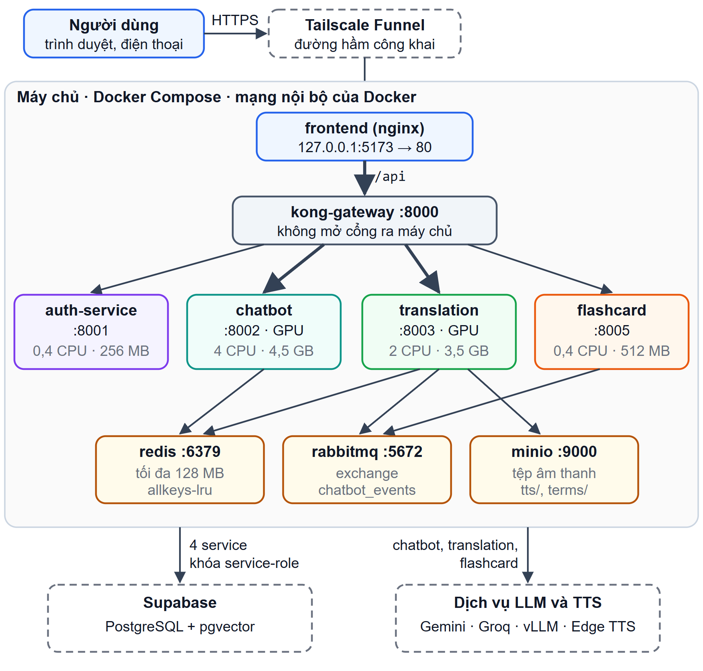
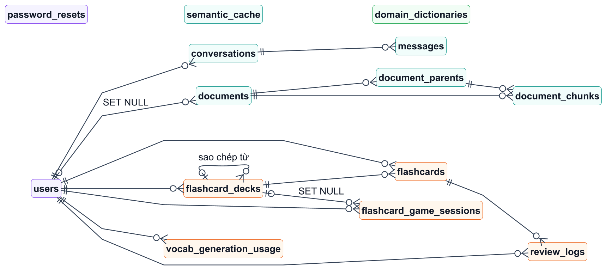
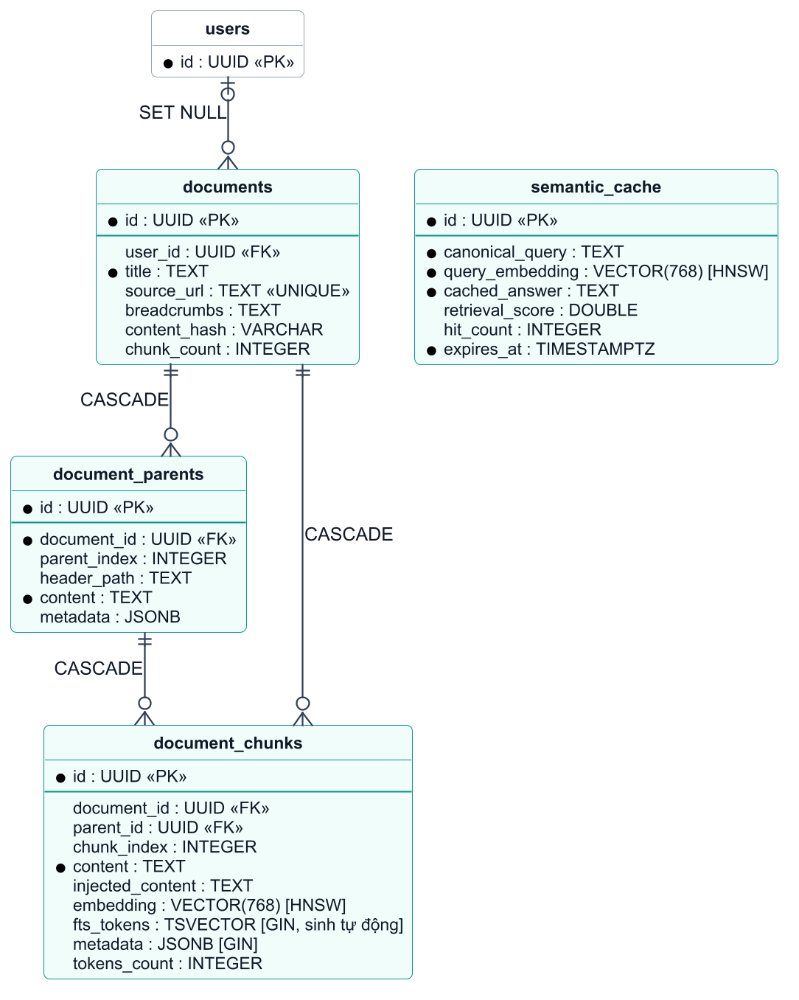
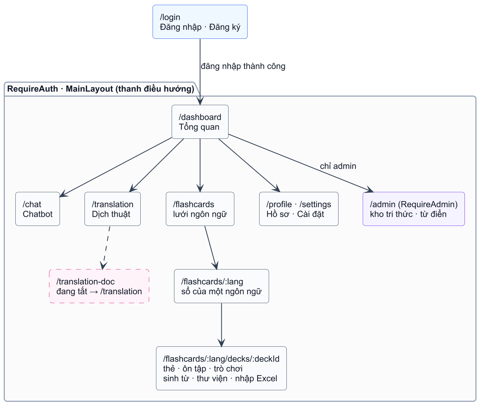

## 3.3 Thiết kế kiến trúc tổng thể

### 3.3.1 Sơ đồ kiến trúc

Hệ thống được xây dựng theo kiến trúc microservices, gồm năm tầng như Hình 3.5:
- **Tầng trình bày:** ứng dụng React chạy trong trình duyệt, được nginx phục vụ dưới dạng tệp tĩnh.
- **Tầng cổng API:** Kong 3.9 chạy ở chế độ không cơ sở dữ liệu; mọi yêu cầu `/api/*` đều đi qua Kong để được định tuyến, xác thực và giới hạn tần suất.
- **Tầng dịch vụ:** bốn service FastAPI đang chạy là Auth, Chatbot, Translation và Flashcard. Service Dịch tài liệu có trong mã nguồn nhưng đang tắt.
- **Tầng hạ tầng dữ liệu:** Supabase PostgreSQL (kèm pgvector), Redis, RabbitMQ và MinIO.
- **Dịch vụ bên ngoài:** các nhà cung cấp LLM và Microsoft Edge TTS.

{width=13.5cm}

Bên trong, bốn service dùng chung một cách tổ chức mã nguồn theo lớp: `routers` khai báo endpoint và xác thực, `schemas` kiểm tra dữ liệu vào ra bằng Pydantic, `services` chứa logic nghiệp vụ và truy cập CSDL, `utils` chứa tiện ích dùng chung như giải mã JWT. Chatbot có thêm các gói `guardrails` (lọc câu hỏi, đóng gói ngữ cảnh), `prompts` (mẫu prompt theo intent) và `data_ingestion` (thu thập, phân đoạn, sinh vector).

### 3.3.2 Định tuyến qua cổng API

Kong được cấu hình bằng một tệp khai báo duy nhất (`gateway/kong.template.yml`); khóa ký JWT và các giá trị bí mật khác được điền vào khi container khởi động. Bảng 3.7 tóm tắt các nhóm route.

Bảng 3.7. Các nhóm route của Kong

| Tiền tố đường dẫn | Service | Kiểm tra JWT | Giới hạn riêng |
|--------------------------------------|-------------|------------------|----------------------|
| `/api/v1/auth/login`, `/register` | Auth | Không | 10/phút, 100/giờ |
| `/api/v1/auth` (còn lại) | Auth | Không (service tự kiểm tra) | — |
| `/api/v1/chat`, `/api/admin` | Chatbot | Có | — |
| `/api/v1/translate`, `/api/v1/admin/dictionary` | Translation | Có, trừ `/tts`, `/audio` | `/tts`, `/audio`: 100/phút |
| `/api/v1/flashcards`, `/decks`, `/cards` | Flashcard | Có | `/vocabulary`: 6/phút, 60/giờ |
| `/api/v1/documents` | Dịch tài liệu | Có | Luôn trả 503 (đang tắt) |

Với mỗi yêu cầu, các plugin chạy theo thứ tự: gắn mã truy vết `X-Request-ID`, kiểm tra nguồn gọi (CORS), kiểm tra JWT, giới hạn tần suất, xóa các header danh tính do người dùng tự gửi, rồi chuyển tiếp tới service. Thời gian chờ được đặt theo tính chất công việc: 60 giây cho Auth và Flashcard, 180 giây cho Translation và 600 giây cho Chatbot vì câu trả lời được sinh dạng luồng.

Ngoài giới hạn riêng, Kong còn áp giới hạn chung 1 000 yêu cầu/phút, bộ đếm lưu trong bộ nhớ của Kong. Cấu hình không đặt tham số `limit_by`, nên Kong gộp bộ đếm theo *consumer* và chỉ gộp theo địa chỉ IP khi không xác định được consumer. Với route không kiểm tra JWT, bộ đếm tính theo IP thật của người dùng, vì Kong chỉ tin header `X-Forwarded-For` khi yêu cầu đến từ nginx. Với route có kiểm tra JWT, mọi token đều thuộc một consumer chung là `auth-issuer`, nên theo tài liệu của Kong, bộ đếm được dùng chung cho tất cả người dùng đã đăng nhập. Điểm này được kiểm chứng ở Chương 5.

### 3.3.3 Luồng giao tiếp

Các thành phần giao tiếp theo ba kiểu:
- **REST đồng bộ** cho phần lớn thao tác đọc và ghi.
- **Server-Sent Events (SSE)** cho câu trả lời của chatbot, bản dịch dạng luồng và tiến độ nạp tri thức. Để SSE hoạt động qua proxy, nginx tắt bộ đệm và đặt thời gian chờ đọc 600 giây.
- **Sự kiện qua RabbitMQ** khi service gửi không cần chờ kết quả. Hiện chỉ luồng sinh âm thanh cho thẻ học dùng kiểu này: Flashcard Service phát `flashcard.created` lên exchange `chatbot_events`, Translation Service sinh âm thanh rồi phát lại `flashcard.audio_ready`.

Tin nhắn chỉ được xác nhận khi khối xử lý kết thúc, nên nếu service dừng giữa chừng thì tin nhắn được giao lại. Ngược lại, lỗi xảy ra trong lúc xử lý chỉ được ghi log và tin nhắn vẫn được xác nhận, nên hệ thống chưa tự thử lại các sự kiện thất bại.

### 3.3.4 Sơ đồ triển khai

Toàn bộ hệ thống được đóng gói bằng Docker Compose. Hình 3.6 là sơ đồ triển khai của bản demo công khai, khác bản chạy trên máy phát triển ở ba điểm:
- chỉ cổng 5173 của frontend được mở, và chỉ nghe trên `127.0.0.1`; Tailscale Funnel đưa cổng này ra Internet qua HTTPS;
- Kong không mở cổng ra máy chủ, nginx chuyển `/api` sang Kong qua mạng nội bộ của Docker;
- chức năng dịch tài liệu bị khóa ở cả giao diện và Kong.

{width=12.5cm}

Mỗi container được đặt giới hạn CPU và RAM (Bảng A.1, Phụ lục A). Chatbot (Bi-Encoder, Cross-Encoder) và Translation (NLLB-200) được cấp GPU; với máy có khoảng 6 GB VRAM, tệp `docker-compose.lowvram.yml` điều chỉnh để hai service này dùng chung GPU.

## 3.4 Thiết kế cơ sở dữ liệu

### 3.4.1 Phân chia dữ liệu theo service

Bốn service dùng chung một CSDL PostgreSQL do Supabase cung cấp, gồm 14 bảng (Hình 3.7). Như đã nêu ở mục 2.4.1, nguyên tắc mỗi service một CSDL chỉ được áp dụng ở mức quy ước: mỗi service chỉ đọc ghi các bảng của mình và lấy dữ liệu của service khác qua REST hoặc sự kiện. Cách làm này đơn giản hóa việc vận hành, nhưng ranh giới dữ liệu không được CSDL cưỡng chế.

Trong các ERD, mỗi bảng được tô màu theo service sở hữu: tím là Auth, xanh ngọc là Chatbot, cam là Flashcard, xanh lá là Translation. Dấu ● đánh dấu cột bắt buộc; bảng viền nét đứt thuộc nhóm khác, chỉ vẽ lại để thể hiện quan hệ. Khóa chính của mọi bảng là UUID sinh tự động. Xóa người dùng sẽ xóa kéo theo dữ liệu cá nhân nhờ ràng buộc `ON DELETE CASCADE`; riêng tài liệu tri thức và ván chơi dùng `ON DELETE SET NULL`. Mô tả dựa trên tệp `db/schema_complete.sql`; thuộc tính đầy đủ của các bảng chính ở Phụ lục E.

### 3.4.2 Nhóm bảng tri thức RAG

Nhóm bảng tri thức gồm bốn bảng (Hình 3.8): `documents` lưu tài liệu gốc; `document_parents` và `document_chunks` lưu đoạn cha và đoạn con theo mô hình Parent–Child (mục 2.2.5); `semantic_cache` lưu các câu trả lời đã qua cổng chất lượng.

{width=11cm}

Hai cột tìm kiếm của `document_chunks` được đánh chỉ mục:
- **`embedding`** (vector 768 chiều): chỉ mục HNSW theo khoảng cách cosine, `m = 16`, `ef_construction = 64`.
- **`fts_tokens`:** cột sinh tự động theo biểu thức `to_tsvector('simple', immutable_unaccent(COALESCE(injected_content, content)))`, tức bỏ dấu tiếng Việt rồi tách từ, có chỉ mục GIN.

Hàm `match_chunks_hybrid_rrf` dùng cả hai chỉ mục để truy xuất lai trong một lần gọi và trả về đoạn con kèm nội dung đoạn cha (luồng xử lý ở Hình E.1, Phụ lục E). Cột `source_url` của `documents` là khóa duy nhất, nên khi nạp lại một tài liệu, các đoạn cũ được thay toàn bộ.

### 3.4.3 Các nhóm bảng khác

**Người dùng và hội thoại** (Hình E.2, Phụ lục E). Bảng `users` thuộc Auth Service; cột `token_version` phục vụ việc thu hồi token. Hai bảng `conversations` và `messages` thuộc Chatbot Service; `messages` lưu cả mã các đoạn được trích dẫn và số liệu của lượt sinh. Cột `messages.feedback` đã có trong schema nhưng backend chưa có endpoint ghi giá trị này. Bảng `password_resets` có sẵn nhưng chưa được sử dụng.

**Flashcard** (Hình E.3, Phụ lục E). Năm bảng lưu sổ thẻ (kể cả bộ từ mẫu của hệ thống), thẻ cùng trạng thái FSRS (`state`, `stability`, `difficulty`, `due`), nhật ký ôn, hạn mức sinh từ vựng theo ngày và các ván chơi. Các chỉ mục UNIQUE một phần bảo đảm quy tắc nghiệp vụ ngay tại CSDL, ví dụ mỗi người chỉ có một bản sao của một bộ từ mẫu và mỗi ván chơi chỉ được ghi một lần.

**Dịch thuật.** Bảng `domain_dictionaries` là nguồn chính của từ điển chuyên ngành, có ràng buộc `UNIQUE(domain, word)`. Redis giữ bản sao từ điển để tra nhanh và bộ nhớ đệm kết quả dịch; số phiên bản từ điển là một phần của khóa đệm, nên khi từ điển thay đổi chỉ cần tăng số phiên bản thay vì xóa từng khóa. MinIO lưu tệp âm thanh phát âm.

## 3.5 Thiết kế API

Các quy ước chung của API:
- **Đường dẫn:** tiền tố `/api/v1/` rồi đến tên phân hệ; riêng API nạp tri thức dùng `/api/admin/ingest`.
- **Xác thực:** token gửi trong header `Authorization: Bearer <token>`. Đối tượng `EventSource` của trình duyệt không gắn được header, nên các route SSE nhận thêm token qua tham số `?token=`.
- **Định dạng phản hồi:** thành công có dạng `{ok: true, data}`. Định dạng lỗi chưa thống nhất: Auth và Flashcard trả `{ok: false, error}`, Chatbot và Translation dùng dạng mặc định `{detail}` của FastAPI, Kong trả `{message}`. Giao diện gom các dạng này về một dạng chung trước khi hiển thị.

Hệ thống có ba luồng SSE, mỗi sự kiện là một dòng `data:` chứa một đối tượng JSON:
- **Hỏi đáp:** `metadata` (mã phiên, trích dẫn), nhiều sự kiện `delta` (từng phần câu trả lời), rồi `done`, hoặc `error` nếu có lỗi.
- **Dịch:** `detection`, `domain`, nhiều sự kiện `text`, có thể kèm `warnings` và `reset` khi phải thay bằng bản dịch dự phòng.
- **Tiến độ nạp tri thức:** trạng thái `parsing`/`crawling` → `chunking` → `embedding` → `completed` hoặc `error`.

Bảng nhóm endpoint, mã trạng thái HTTP, định dạng phản hồi và chi tiết các sự kiện SSE được đặt ở Phụ lục C.

## 3.6 Thiết kế bảo mật

Hệ thống dùng JWT ký bằng HS256 với 7 claim (mục 2.4.2), được kiểm tra ở hai lớp. Kong kiểm tra chữ ký, hạn dùng và thời hạn tối đa 24 giờ. Mỗi service giải mã lại token, bắt buộc có `exp`, `iss`, `sub`, rồi lấy mã người dùng và vai trò từ claim; chức năng quản trị kiểm tra `role = admin`. Kong xóa các header danh tính do người dùng tự gửi, và các service cũng không đọc các header này.

Access token có hạn 60 phút; giao diện gọi `/auth/refresh` để lấy token mới trước khi hết hạn, và một phiên kéo dài tối đa 7 ngày tính từ lần đăng nhập gốc. Khi đăng xuất hoặc đổi mật khẩu, `token_version` tăng thêm 1 và token cũ không làm mới được nữa. Việc thu hồi này chỉ có hiệu lực tức thì tại Auth Service; các service khác chỉ kiểm tra chữ ký và hạn dùng nên vẫn chấp nhận token cũ đến khi hết hạn.

Bảng 3.8 đối chiếu các mối đe dọa chính với biện pháp đã cài đặt, theo nhóm rủi ro của OWASP Top 10 [@owasp_top10].

Bảng 3.8. Mô hình đe dọa và biện pháp

| Mối đe dọa | Biện pháp | OWASP |
|--------------------|--------------------------------------------------|-------|
| Dò mật khẩu, dò tài khoản | Giới hạn 10 yêu cầu/phút cho đăng nhập; khóa 15 phút sau 5 lần sai theo (IP, tài khoản) hoặc 30 lần theo tài khoản; thông báo lỗi chung và luôn chạy bcrypt, kể cả khi không có tài khoản | A07 |
| Giả mạo token, mạo danh qua header | Khóa ký ≥ 32 ký tự; ép thuật toán HS256; bắt buộc `exp`, `iss`, `sub`; xóa header `X-User-*` | A02, A07 |
| Leo quyền, truy cập dữ liệu người khác | Vai trò khi đăng ký bị ép về `student` hoặc `public`; thao tác trên sổ và thẻ flashcard kiểm tra chủ sở hữu; riêng phiên hội thoại của chatbot còn thiếu bước này (mục 4.2.9) | A01 |
| Đọc ghi CSDL bằng khóa công khai | Bật RLS, không tạo policy; thu quyền `anon`, `authenticated` | A01, A05 |
| Tấn công prompt | Lọc biểu thức chính quy; đóng gói ngữ cảnh trong thẻ riêng; ép đầu ra JSON ở bước định tuyến | A03 |
| Lạm dụng tài nguyên, lộ thông tin nội bộ | Giới hạn tần suất; hạn mức sinh từ vựng theo ngày; lỗi CSDL chỉ trả thông báo chung | A04, A05 |

Các hạn chế còn tồn tại, như chưa xác minh email khi đăng ký, chưa có chức năng đặt lại mật khẩu, phạm vi thu hồi token còn hẹp, phiên hội thoại của chatbot chưa kiểm tra chủ sở hữu và chưa có Content-Security-Policy, được bàn ở Chương 6.

## 3.7 Thiết kế giao diện

Giao diện là một ứng dụng trang đơn gồm một trang công khai (`/login`) và bảy nhóm trang cần đăng nhập, dùng chung khung bố cục có thanh điều hướng bên trái (Hình 3.9). Trang Flashcard có ba cấp: lưới ngôn ngữ, các sổ của một ngôn ngữ, và chi tiết một sổ. Trang `/admin` chỉ dành cho quản trị viên; phân quyền ở giao diện chỉ nhằm điều hướng, quyền thật luôn được kiểm tra ở máy chủ. Giao diện dùng Tailwind CSS với một màu chủ đạo xanh dương hài hòa với logo IUH, có chế độ sáng, tối và responsive cho điện thoại, máy tính bảng, máy tính.

{width=12cm}

## Tiểu kết chương {.unnumbered}

Chương 3 đã phân tích yêu cầu, mô hình hóa 18 use case trong năm phân hệ, trong đó hai use case trọng tâm là hỏi đáp học vụ (UC05) và nạp tri thức (UC16) được đặc tả và mô tả bằng sơ đồ tuần tự. Về thiết kế, hệ thống gồm bốn service FastAPI sau cổng Kong, giao tiếp bằng REST, SSE và sự kiện; dữ liệu nằm trong 14 bảng trên một Supabase dùng chung, trong đó nhóm bảng tri thức có chỉ mục HNSW và GIN phục vụ truy xuất lai. Quá trình đối chiếu với mã nguồn cũng phát hiện một số điểm chưa hoàn chỉnh như phạm vi thu hồi token, cách gộp bộ đếm giới hạn tần suất và định dạng lỗi chưa thống nhất; các điểm này được tổng hợp ở Chương 6. Chương 4 trình bày việc xây dựng hệ thống theo thiết kế này.
