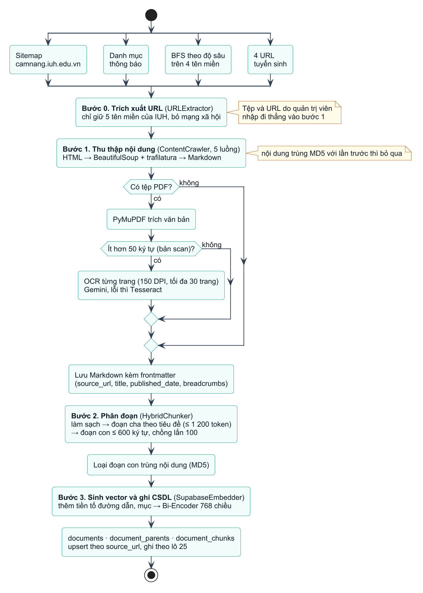
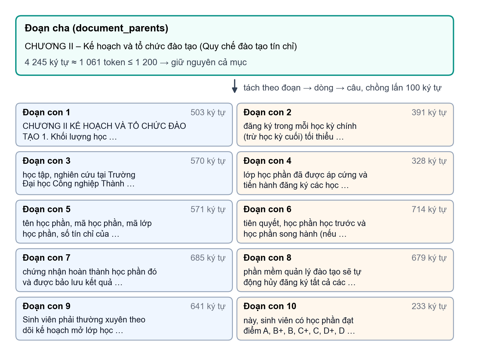
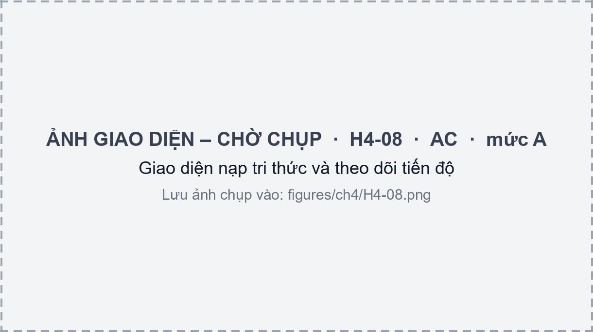

# CHƯƠNG 4. XÂY DỰNG HỆ THỐNG

Chương này trình bày việc xây dựng hệ thống theo thiết kế ở Chương 3. Phần lớn chương dành cho chatbot học vụ, gồm pipeline xây dựng kho tri thức (mục 4.1) và pipeline hỏi đáp RAG (mục 4.2). Các phân hệ hỗ trợ, ứng dụng web và việc triển khai được trình bày ngắn gọn ở mục 4.3 và 4.4.

## 4.1 Pipeline thu thập và xử lý tri thức

Chất lượng câu trả lời của chatbot phụ thuộc trước hết vào kho tri thức. Pipeline thu thập và xử lý tri thức biến các trang web và văn bản của IUH thành các đoạn văn bản kèm vector nhúng trong CSDL. Pipeline nằm trong gói `data_ingestion` của Chatbot Service và có hai cách chạy dùng chung các thành phần:
- **dòng lệnh** (`run_pipeline.py`), dùng khi nạp hàng loạt hoặc dựng lại kho từ đầu;
- **API quản trị** (`/api/admin/ingest`), dùng từ trang Quản trị của giao diện.

Hình 4.1 trình bày bốn bước của pipeline; các mục 4.1.1 đến 4.1.4 lần lượt trình bày từng bước.

### 4.1.1 Nguồn dữ liệu và trích xuất URL

Bước 0 gom danh sách URL cần thu thập từ bốn loại nguồn, khai báo trong `sources.py` (Bảng 4.1). Lớp `URLExtractor` đọc sitemap XML, duyệt các trang danh mục có phân trang, và duyệt theo chiều rộng (BFS) với độ sâu giới hạn riêng cho từng tên miền, có nghỉ ngẫu nhiên giữa các yêu cầu để không gây tải cho máy chủ của trường. Mọi URL do bộ trích xuất thu thập đi qua bộ lọc chỉ giữ năm tên miền của IUH và loại bỏ liên kết mạng xã hội; URL do quản trị viên nhập tay không qua bộ lọc này.

Bảng 4.1. Các nguồn dữ liệu của kho tri thức

| Loại nguồn | Địa chỉ | Giới hạn |
|------------------|------------------------------------------|----------------|
| Sitemap | `camnang.iuh.edu.vn/sitemap.xml` | Toàn bộ URL trong sitemap |
| Trang danh mục | `iuh.edu.vn/vi/thong-bao.html` | Tối đa 10 trang |
| Duyệt BFS | `iuh.edu.vn`, `camnang.iuh.edu.vn`, `ctsv.iuh.edu.vn`, `csm.iuh.edu.vn` | Độ sâu lần lượt 2, 5, 4, 3 |
| URL cố định | 4 trang của `tuyensinh.iuh.edu.vn`: quy chế, ngành đào tạo, điểm chuẩn, đề án tuyển sinh | — |
| Quản trị viên | Tệp `.pdf`, `.md`, `.txt` tải lên; danh sách URL nhập tay | — |

### 4.1.2 Thu thập và trích xuất nội dung

Bước 1 do lớp `ContentCrawler` thực hiện, chạy song song 5 luồng. Với mỗi trang, crawler:
1. tải trang bằng `requests` (thời gian chờ 10 giây) và dùng BeautifulSoup lấy tiêu đề, đường dẫn chuyên mục (breadcrumbs), ngày đăng;
2. loại phần thừa của trang rồi chuyển nội dung chính thành Markdown bằng trafilatura [@barbaresi2021], giữ liên kết;
3. tìm các tệp PDF mà trang liên kết tới, trích văn bản và nối vào cuối nội dung;
4. lưu kết quả thành một tệp Markdown có phần đầu (frontmatter) gồm `source_url`, `title`, `published_date`, `breadcrumbs`.

Để không xử lý lại trang không thay đổi, crawler lưu giá trị băm MD5 của nội dung từng URL; khi chạy lại, trang có cùng giá trị băm và đã có tệp Markdown sẽ được bỏ qua.



**PDF và OCR.** Lớp `PDFExtractor` đọc văn bản bằng PyMuPDF. Nếu văn bản thu được ngắn hơn 50 ký tự, tệp được coi là bản scan và được OCR từng trang: mỗi trang được kết xuất thành ảnh 150 DPI (tối đa 30 trang một tệp) rồi gửi lên Gemini với yêu cầu chép nguyên văn tiếng Việt và giữ cấu trúc bảng. Hàm `execute_ocr` thử lần lượt một danh sách mô hình Gemini; mô hình hết hạn mức (lỗi 429) bị loại khỏi danh sách trong lúc chạy, lỗi quá tải (503) thì chờ 10 giây rồi thử lại. Khi mọi mô hình đều lỗi, Tesseract với ngôn ngữ tiếng Việt được dùng làm phương án dự phòng. Ảnh nhúng trong trang web không được OCR.

### 4.1.3 Phân đoạn theo cặp đoạn cha – con

Bước 2 dùng lớp `HybridChunker`, cài đặt kỹ thuật Parent–Child đã trình bày ở mục 2.2.5. Trước khi phân đoạn, hàm `clean_noise` chuẩn hóa Unicode về dạng NFKC, bỏ ký tự ẩn, nối lại các câu bị ngắt dòng cứng (thường gặp trong PDF), xóa các ký tự rác `(cid:…)` và gộp khoảng trắng.

**Đoạn cha.** Văn bản được tách theo các tiêu đề Markdown (từ `#` đến `######`); mỗi đoạn cha giữ chuỗi tiêu đề cấp trên của nó. Một mục chỉ bị tách tiếp khi vượt 1 200 token, trước hết theo các tiêu đề phụ in đậm dạng "**I. …**", "**1. …**", nếu không có thì theo đoạn văn. Số token được ước lượng bằng $\max(\text{số từ},\ \text{số ký tự}/4)$ thay vì dùng bộ tách token thật, để không phụ thuộc vào mô hình.

**Đoạn con.** Mỗi đoạn cha được chia thành đoạn con dài tối đa 600 ký tự, chồng lấn 100 ký tự. Văn bản thường được tách đệ quy theo thứ tự ưu tiên: đoạn văn, dòng, câu, từ, ký tự. Bảng Markdown được tách riêng theo nhóm hàng, mỗi nhóm lặp lại hàng tiêu đề để đoạn con vẫn đọc được khi đứng một mình. Mỗi đoạn con được gắn tiền tố là chuỗi tiêu đề của đoạn cha. Sau khi phân đoạn, các đoạn con có nội dung trùng nhau (so bằng MD5 sau khi chuẩn hóa chữ thường và khoảng trắng) chỉ được giữ một.

Hình 4.2 là kết quả khi chạy `HybridChunker` của hệ thống trên một đoạn cha thật: mục "Chương II – Kế hoạch và tổ chức đào tạo" của Quy chế đào tạo, lấy từ log truy vấn của chatbot. Mục dài 4 245 ký tự, ước lượng 1 061 token, dưới ngưỡng 1 200 nên được giữ nguyên làm một đoạn cha, và được tách thành 10 đoạn con.

{width=14cm}

Kết quả cho thấy ba điểm:
- Độ dài đoạn con dao động từ 233 đến 714 ký tự. Đoạn dài nhất gồm tối đa 600 ký tự nội dung, 100 ký tự chồng lấn và tiền tố tiêu đề.
- Phần chồng lấn được cắt theo số ký tự rồi lùi về dấu cách gần nhất, nên đoạn con thường bắt đầu giữa câu (ví dụ đoạn con 2 bắt đầu bằng "đăng ký trong mỗi học kỳ chính…").
- Tiền tố tiêu đề giữ nguyên ký hiệu Markdown (`[###### CHƯƠNG II]`), trong khi bước sau lại thêm tên mục đã bỏ ký hiệu; tên mục vì thế xuất hiện hai lần trong văn bản được sinh vector.

### 4.1.4 Sinh vector và ghi cơ sở dữ liệu

Bước 3 do lớp `SupabaseEmbedder` thực hiện. Trước khi sinh vector, hàm `inject_meta` thêm vào đầu mỗi đoạn con một tiền tố gồm đường dẫn chuyên mục và tên mục, để vector mang cả ngữ cảnh của đoạn. Văn bản sau khi thêm tiền tố được lưu ở cột `injected_content` và là phần được sinh vector; cột `content` giữ nội dung gốc. Ví dụ với đoạn con 2 ở Hình 4.2 (trang này không có breadcrumbs):

```
[Mục: CHƯƠNG II] [###### CHƯƠNG II]
 đăng ký trong mỗi học kỳ chính (trừ học kỳ cuối) tối thiểu là 12 tín chỉ…
```

Vector được sinh bằng Bi-Encoder `vietnamese-bi-encoder` (768 chiều). Khi chạy qua API quản trị, pipeline dùng lại mô hình đã nạp sẵn trong Chatbot Service thay vì nạp thêm một bản. Với mỗi tài liệu, nhóm theo `source_url`, pipeline:
1. upsert dòng `documents` theo `source_url`, kèm giá trị băm nội dung và số đoạn con;
2. xóa toàn bộ đoạn cha và đoạn con cũ của tài liệu, nên cập nhật một tài liệu là thay mới hoàn toàn;
3. ghi các đoạn cha theo lô 25 dòng và lấy lại khóa chính do CSDL sinh;
4. sinh vector cho các đoạn con và ghi theo lô 25 dòng, kèm khóa của đoạn cha tương ứng.

Ghi theo lô nhỏ giúp tránh lỗi hết thời gian chờ khi gửi dữ liệu vector lớn qua HTTP; mỗi lời gọi tới Supabase được thử lại tối đa 3 lần. Cột `fts_tokens` phục vụ tìm kiếm toàn văn do CSDL tự sinh (mục 3.4.2).

### 4.1.5 Vận hành qua API quản trị

API `/api/admin/ingest` chỉ dành cho vai trò `admin` và cung cấp ba cách nạp: tải tệp (`POST /files`), nhập danh sách URL (`POST /urls`) và quét toàn bộ các website của trường (`POST /extract-and-crawl`). Yêu cầu được nhận ngay và xử lý ở nền. Giao diện theo dõi tiến độ qua luồng SSE `GET /status`, với các trạng thái `parsing` hoặc `crawling` → `chunking` → `embedding` → `completed` hoặc `error` (Hình 4.3). Ngoài ra, quản trị viên có thể tìm kiếm, đổi tên và xóa tài liệu trong kho (UC17).



Cách vận hành này có ba hạn chế. Thứ nhất, trạng thái tiến trình nằm trong bộ nhớ của Chatbot Service, nên chỉ chạy được một tiến trình nạp tại một thời điểm và trạng thái mất khi service khởi động lại. Thứ hai, mỗi lần nạp qua API đều xóa thư mục tạm và phân đoạn lại toàn bộ các tệp trong đó. Thứ ba, crawler tắt kiểm tra chứng chỉ SSL khi tải trang (`verify=False`).

### 4.1.6 Thống kê kho tri thức

Bảng 4.2 thống kê kho tri thức dùng cho các thí nghiệm ở Chương 5. Số liệu do script `eval/kb_stats.py` đọc trực tiếp từ cơ sở dữ liệu ngày 31/10/2026; các tài liệu được nạp hoặc cập nhật lần cuối trong khoảng từ 13/10/2026 đến 30/10/2026. Kho gồm 415 tài liệu, 1 092 đoạn cha và 3 181 đoạn con, trung bình khoảng 7.7 đoạn con mỗi tài liệu. Hai tên miền `ctsv.iuh.edu.vn` và `iuh.edu.vn` chiếm nhiều tài liệu nhất, nhưng `tuyensinh.iuh.edu.vn` chỉ có 4 tài liệu mà tới 675 đoạn con (trung bình hơn 160 đoạn mỗi tài liệu) vì đây là các trang dài như quy chế tuyển sinh, danh sách ngành và điểm chuẩn. Tên miền `pdt.iuh.edu.vn` không nằm trong danh sách được phép của bộ trích xuất; các tài liệu này do quản trị viên nhập trực tiếp qua giao diện, vốn không qua bộ lọc tên miền.

Bảng 4.2. Thống kê kho tri thức theo nguồn (ngày 31/10/2026)

| Nguồn | Số tài liệu | Số đoạn cha | Số đoạn con |
|------------------------------|------------|------------|------------|
| `ctsv.iuh.edu.vn` | 222 | 256 | 537 |
| `iuh.edu.vn` | 87 | 465 | 973 |
| `camnang.iuh.edu.vn` | 60 | 199 | 597 |
| `csm.iuh.edu.vn` | 35 | 49 | 262 |
| `tuyensinh.iuh.edu.vn` | 4 | 104 | 675 |
| `pdt.iuh.edu.vn` | 3 | 4 | 12 |
| Tệp do quản trị viên tải lên | 4 | 15 | 125 |
| **Tổng** | **415** | **1 092** | **3 181** |
