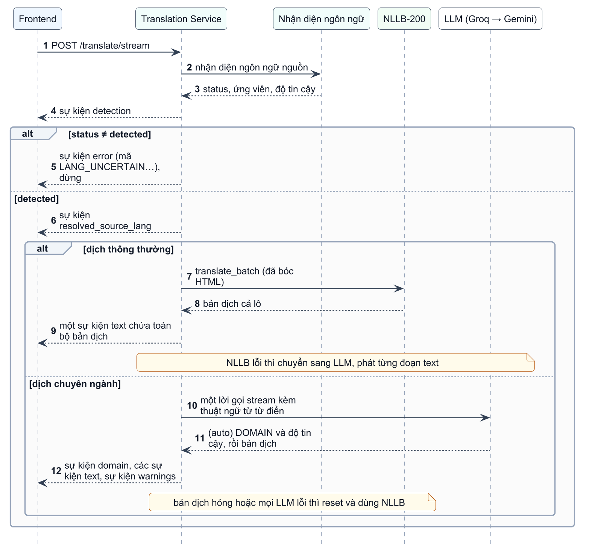
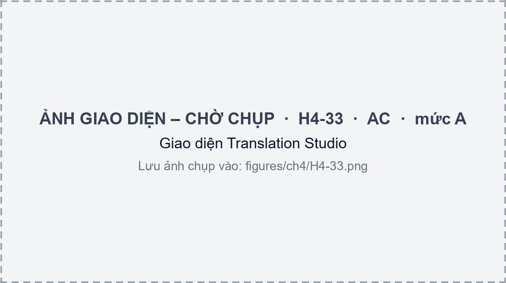
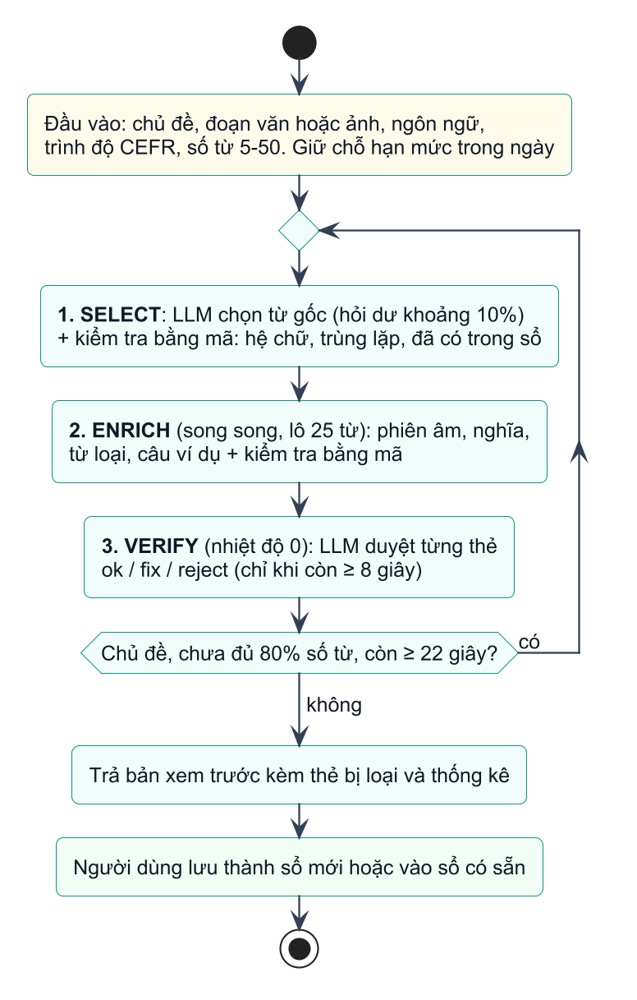
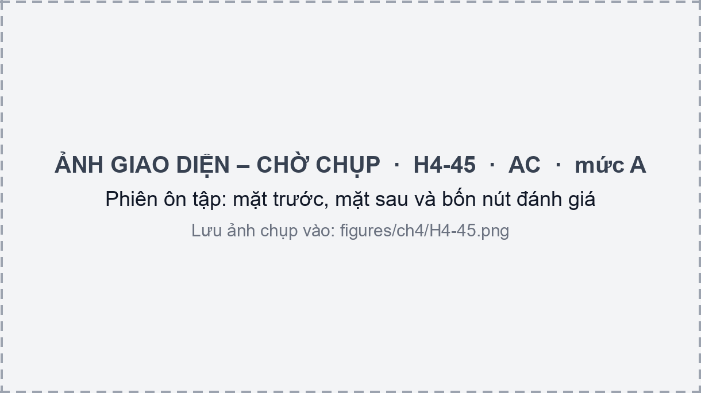
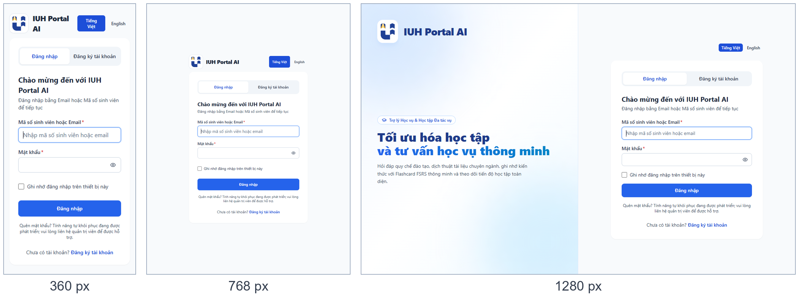

## 4.3 Các phân hệ hỗ trợ

Ba service còn lại phục vụ việc học ngoại ngữ và quản lý tài khoản quanh chatbot. Mục này chỉ trình bày các quyết định cài đặt chính của từng service; danh sách endpoint và lược đồ dữ liệu nằm ở Phụ lục C và E.

### 4.3.1 Dịch thuật (Realtime Translation Service)

**Chức năng và endpoint.** Service dịch văn bản giữa 10 ngôn ngữ (Anh, Đức, Trung, Nhật, Hàn, Pháp, Tây Ban Nha, Nga, Thái, Việt). Endpoint `POST /translate/text` nhận tối đa 1 000 ký tự và trả kết quả một lần; `POST /translate/stream` nhận tối đa 3 000 ký tự và trả theo luồng SSE. Các endpoint còn lại gồm nhận diện ngôn ngữ (`/detect`), phân tích từ trong ngữ cảnh (`/analyze_word`), trích thẻ từ vựng (`/flashcard`) và phát âm (`/tts`, `/audio`).

**Mô hình dịch và phương án dự phòng.** Dịch thông thường dùng NLLB-200 bản distilled 600M, chạy bằng CTranslate2 với trọng số lượng tử hóa INT8: kiểu tính toán là `float16` trên GPU và `int8` trên CPU, và nếu nạp GPU lỗi thì tự thử lại trên CPU. Mô hình được nạp và chạy thử một câu khi service khởi động. Văn bản HTML được xử lý bằng cách thay mỗi nút văn bản bằng chỗ giữ chỗ, dịch các nút theo lô rồi dựng lại, nên thẻ HTML được giữ nguyên. Khi NLLB không dùng được, service chuyển sang Groq rồi Gemini; nếu cả hai đều lỗi, endpoint trả HTTP 503. Kết quả của `/text` được lưu trong Redis 24 giờ với khóa gồm cặp ngôn ngữ, chuyên ngành, phiên bản từ điển và mã băm văn bản; `/stream` ở chế độ thông thường không dùng bộ nhớ đệm này. Ở chế độ thông thường, NLLB dịch cả lô rồi mới trả nên endpoint chỉ phát một sự kiện `text` chứa toàn bộ bản dịch; chỉ nhánh dự phòng Groq hoặc Gemini mới phát từng đoạn.

**Nhận diện ngôn ngữ.** Khi người dùng chọn "tự động", văn bản được làm sạch (bỏ HTML, URL, email), phân loại theo hệ chữ rồi qua hai bộ nhận diện: fastText (`lid.176`) và, khi cần, Lingua với 35 ngôn ngữ gồm 10 ngôn ngữ hỗ trợ và 25 ngôn ngữ họ hàng dễ nhầm. Kết quả hai bộ được hợp nhất có trọng số và hiệu chỉnh thành một độ tin cậy. Chính sách quan trọng nhất là **chỉ khi trạng thái là `detected` thì văn bản mới được dịch**. Các trạng thái còn lại (`uncertain`, `unsupported`, `unknown`, `invalid_input`, `system_error`) dừng lại và trả mã lỗi để giao diện yêu cầu người dùng chọn ngôn ngữ nguồn kèm tối đa ba ứng viên, thay vì đoán sai rồi dịch một cách tự tin. Ngôn ngữ do người dùng chọn tay luôn được ưu tiên.

**Dịch theo chuyên ngành.** Có sáu lĩnh vực cố định (Công nghệ thông tin, Y khoa, Kinh tế – Tài chính, Kỹ thuật cơ khí, Luật, Marketing) và chế độ tự nhận diện. Thuật ngữ nằm trong bảng `domain_dictionaries` do quản trị viên quản lý, được nạp vào chỉ mục trong bộ nhớ và làm mới sau 300 giây hoặc khi từ điển thay đổi. Với mỗi câu, các thuật ngữ khớp (ưu tiên cụm dài nhất) được chèn vào prompt dưới dạng bảng thuật ngữ, rồi một lời gọi LLM dạng stream (Groq, dự phòng Gemini; chờ token đầu tối đa 10 giây, tổng 40 giây) tạo bản dịch. Ở chế độ tự nhận diện, mô hình mở đầu bằng dòng `DOMAIN: <tên> | CONF: <điểm>`. Hàm `decide_domain` không dùng độ tin cậy này một mình vì theo ghi chú trong mã nguồn, giá trị mô hình tự khai thường bão hòa quanh 0,95–1,0 kể cả khi sai; thay vào đó nó yêu cầu tên lĩnh vực hợp lệ, độ tin cậy từ 0,75 trở lên và bằng chứng thuật ngữ từ từ điển. Từ hoặc cụm ngắn khớp chính xác một mục trong từ điển được trả thẳng từ từ điển mà không gọi LLM; nếu khớp nhiều lĩnh vực, giao diện cho người dùng chọn. Khi bản dịch của LLM bị hỏng (rỗng, hoặc sao chép nguyên văn) hoặc mọi LLM đều lỗi, service gửi sự kiện `reset` rồi dùng NLLB kèm cảnh báo.

Hình 4.12 tóm tắt thứ tự sự kiện của endpoint `/stream`. Giao diện Translation Studio ở Hình 4.13.

{width=13cm}

**Phân tích từ và phát âm.** Với từ tiếng Anh được bôi đen, `/analyze_word` dùng spaCy để lấy lemma và từ loại, khử nhập nhằng nghĩa bằng thuật toán Lesk trên WordNet, rồi dịch các định nghĩa và ví dụ sang tiếng Việt bằng NLLB. Phát âm dùng Microsoft Edge TTS (edge-tts) với bảng giọng đọc cho 10 ngôn ngữ. Tệp âm thanh được lưu trong MinIO theo cơ chế định danh theo nội dung (content-addressable): khóa đối tượng suy ra từ ngôn ngữ và văn bản đã chuẩn hóa, nên nhiều thẻ và nhiều người dùng dùng chung một tệp. Hai endpoint `/tts` và `/audio` không yêu cầu JWT vì được phát bằng thẻ `<audio>`, và chỉ chịu giới hạn tần suất của Kong (Bảng 3.7).

### 4.3.2 Flashcard (Flashcard Service)

Phân hệ Flashcard được xây dựng có tham khảo trang web luyenty.com [@luyenty]. Phần dưới trình bày các quyết định cài đặt của chính hệ thống.

> [TODO: Nhóm ghi cụ thể những gì đã tham khảo từ luyenty.com (ví dụ cách tổ chức sổ thẻ, kiểu ôn tập, giao diện) để thay câu trên bằng một câu cụ thể, và điền ngày truy cập ở tài liệu tham khảo; tôi không truy cập được trang này từ máy hiện tại nên chưa mô tả nội dung của nó.]

**Tổ chức dữ liệu.** Mỗi sổ thẻ thuộc đúng một ngôn ngữ trong chín ngôn ngữ học được; thẻ thuộc ngôn ngữ khác bị từ chối bằng mã `409 LANG_MISMATCH`, và service không bao giờ tự đoán ngôn ngữ. Người dùng có tối đa một sổ mặc định cho mỗi ngôn ngữ, nơi lưu các từ chọn từ trang Dịch thuật.

**Lập lịch ôn tập FSRS.** Hàm `calculate_fsrs` dùng gói `fsrs` từ phiên bản 6 với `Scheduler(learning_steps=(), relearning_steps=(), enable_fuzzing=True)`. Lý thuyết của thuật toán đã trình bày ở mục 2.3 (công thức (2-9) và (2-10)). Vì cơ sở dữ liệu không lưu bước học trong ngày nên mã bỏ các bước này, dẫn tới hai hệ quả: thẻ mới chuyển thẳng sang trạng thái Review sau lần ôn đầu, và chọn "Again" vẫn giữ thẻ ở Review (chỉ tăng `lapses`); hai trạng thái Learning và Relearning có trong quy ước cột `state` nhưng không bao giờ xuất hiện. `enable_fuzzing` thêm nhiễu nhỏ vào khoảng cách để các thẻ học cùng ngày không đến hạn cùng một lúc. Mỗi lần ôn ghi một dòng vào bảng `review_logs`. Nếu không nạp được gói `fsrs`, module dùng một bộ lập lịch đơn giản cố định và ghi cảnh báo; trường `fsrs` của `/health` cho biết nhánh nào đang chạy.

**Hàng đợi học.** Endpoint `study-queue` xếp thẻ đến hạn trước (quá hạn lâu nhất trước), rồi đến thẻ mới (tối đa 20 thẻ mới mỗi lượt), và có chế độ chỉ ôn thẻ hay quên (`lapses > 0` hoặc độ khó từ 7 trở lên). Mỗi thẻ được gán ngẫu nhiên một kiểu ôn theo trạng thái (Hình 4.15 là một phiên ôn tập): thẻ mới luôn là lật thẻ; thẻ khó (đã quên, độ khó từ 5 trở lên, hoặc đang học lại) có 35% là chính tả, 25% là nghe, còn lại là lật thẻ; thẻ bình thường có 20% là chính tả, 35% là chọn đáp án, 15% là nghe và 30% là lật thẻ. Chính tả chỉ dùng cho từ có tối đa 3 chữ, còn chọn đáp án và nghe cần ít nhất ba đáp án nhiễu. Đáp án nhiễu lấy từ các thẻ cùng sổ. Câu điền từ được tạo bằng cách đục lỗ từ cần học trong câu ví dụ, kể cả khi từ ở dạng biến hình. Chấm chính tả dùng tỉ lệ tương đồng chuỗi con chung dài nhất của `difflib.SequenceMatcher`: khớp hoàn toàn đề xuất mức Easy, từ 0,75 trở lên đề xuất Hard, còn lại là Again. Một thẻ được coi là đã thuộc khi độ bền (stability) từ 21 ngày trở lên.

**Sinh từ vựng bằng AI.** Người dùng nhập chủ đề, đoạn văn hoặc ảnh, kèm ngôn ngữ, trình độ CEFR và số từ từ 5 đến 50 (Hình 4.14). Việc tách thành ba bước nhỏ giúp mỗi lời gọi ngắn và cho phép kiểm tra từng bước bằng mã: bước SELECT chọn từ gốc, bước ENRICH bổ sung phiên âm, nghĩa tiếng Việt, từ loại và câu ví dụ theo lô 25 từ chạy song song, bước VERIFY dùng LLM duyệt lại từng thẻ (giữ, sửa hoặc loại). Giữa các bước, mã kiểm tra hệ chữ của từ (theo tên Unicode, không tốn lời gọi LLM), trùng lặp, từ loại, định dạng phiên âm và việc câu ví dụ có chứa từ khóa. Tổng thời gian được giới hạn 50 giây để dưới mức chờ 60 giây của Kong; bước VERIFY chỉ chạy khi còn ít nhất 8 giây, và với chủ đề, nếu chưa đủ 80% số từ mà còn ít nhất 22 giây thì chạy thêm một vòng. Dữ liệu người dùng được đặt trong khối `<user_input>` đã loại thẻ đóng mở và đầu ra bị ép đúng lược đồ JSON để hạn chế chèn lệnh. Nhà cung cấp LLM được thử theo thứ tự Groq, Gemini, endpoint tương thích OpenAI, có bộ ngắt mạch (circuit breaker) tạm bỏ nhà cung cấp vừa lỗi. Số lượt sinh mỗi ngày bị giới hạn theo vai trò: 50 cho quản trị viên, 10 cho sinh viên và 3 cho tài khoản công cộng; lượt được giữ chỗ trước và hoàn lại nếu quá trình thất bại.

{width=8cm}

**Bộ từ mẫu, nhập tệp và âm thanh.** Các bộ từ mẫu của hệ thống là những sổ đánh dấu `is_system`. Vì mỗi thẻ mang trạng thái FSRS riêng, thẻ không thể dùng chung giữa nhiều người, nên khi người dùng thêm một bộ vào sổ của mình, service **sao chép** toàn bộ thẻ (clone-on-start). Người dùng cũng có thể nhập thẻ từ tệp Excel hoặc CSV, với tên cột được nhận diện qua bảng bí danh (Term, Từ vựng, Word…). Khi một thẻ được tạo, service phát sự kiện `flashcard.created` lên RabbitMQ; Translation Service nhận sự kiện, sinh âm thanh rồi phát lại `flashcard.audio_ready` để cập nhật địa chỉ âm thanh của thẻ. Khi phát âm, giao diện thực tế gọi `/translate/tts` theo văn bản của thẻ trước, và chỉ dùng địa chỉ âm thanh đã lưu khi thẻ không có văn bản.

**Trò chơi ôn từ.** Có bốn trò, mỗi trò hai chế độ thư giãn và thử thách (Bảng 4.9). Giao diện chỉ gửi kết quả từng câu; điểm, số sao và điểm kinh nghiệm (XP) do máy chủ tính để người chơi không thể tự ghi điểm. Kết quả trò chơi cũng cập nhật lịch ôn nhưng thận trọng: chỉ các thẻ đã học và đã đến hạn được tính, trả lời đúng ngay là Good, đúng sau khi xem gợi ý là Hard, sai là Again, và không bao giờ là Easy vì đoán trúng trong trò chơi chưa chứng tỏ đã nhớ. Mỗi ván có mã yêu cầu duy nhất của client nên gửi lại cùng một ván không làm đổi lịch ôn lần thứ hai.

Bảng 4.9. Bốn trò chơi ôn từ và cách tính điểm

| Trò | Cách tính điểm (rút gọn) | Số thẻ tối thiểu |
|-------------------|----------------------------------------------------------------|------|
| Ghép cặp | Mỗi cặp đúng được `max(25, 100 − 15·số lần sai)`; thưởng tốc độ ở chế độ thử thách | 4 |
| Đua 60 giây | `10 × hệ số combo`, hệ số tăng mỗi 3 câu đúng liên tiếp, tối đa ×5 | 4 |
| Xếp chữ | `max(20, 100 − 25·gợi ý − 10·lần sai)`; chỉ cho ngôn ngữ chữ cái (Anh, Đức, Pháp, Tây Ban Nha, Nga) | 4 |
| Bắn bóng nghĩa | Đúng ngay: `10 × hệ số combo`; đúng sau khi bắn sai: `max(5, 10 − 3·lần sai)`; bóng trôi mất: 0 | 5 |

### 4.3.3 Xác thực và cổng API

Auth Service cung cấp các endpoint đăng ký, đăng nhập, làm mới và thu hồi token, xem và sửa hồ sơ, đổi mật khẩu và lưu cài đặt cá nhân. Thiết kế bảo mật đã được trình bày ở mục 3.6, nên ở đây chỉ nêu các điểm cài đặt cụ thể. Mật khẩu được băm bằng bcrypt (chỉ 72 byte đầu có tác dụng nên lược đồ dữ liệu từ chối mật khẩu dài hơn). Khi đăng nhập, bcrypt luôn được chạy, dùng một mã băm giả nếu tài khoản không tồn tại, để thời gian phản hồi không tiết lộ tài khoản có tồn tại hay không. Bộ đếm đăng nhập sai (lớp `LoginThrottle`) lưu trong bộ nhớ của tiến trình nên bị xóa khi service khởi động lại và không dùng chung giữa nhiều bản sao; mã đã ghi chú hướng thay bằng Redis. Thuật toán ký cố định là HS256 để tránh bị hạ cấp, và service từ chối khởi động nếu `JWT_SECRET_KEY` ngắn hơn 32 ký tự hoặc trùng giá trị mẫu đã biết. Trang tài liệu API (`/docs`) tắt mặc định. Mô-đun kiểm tra JWT `utils/security.py` được giữ giống hệt nhau ở bốn service; khi sửa phải sửa cả bốn bản. Kong thực hiện lớp kiểm tra thứ nhất, định tuyến và giới hạn tần suất như ở mục 3.3.2.

### 4.3.4 Dịch tài liệu (thử nghiệm)

Document Translation Service dịch tài liệu PDF, Word và PowerPoint (kể cả PDF dạng ảnh quét, nhờ PaddleOCR) và hỏi đáp tạm thời trên tài liệu đã tải lên, bằng một worker chạy mô hình Ollama trên GPU bên ngoài. Service này chưa được triển khai: khối cấu hình của nó bị đặt thành chú thích trong `docker-compose.yml`, route `/api/v1/documents` ở Kong trả HTTP 503 bằng plugin `request-termination`, và giao diện ẩn chức năng bằng cờ build `VITE_FEATURE_DOC_TRANSLATION`. Vì vậy phân hệ này nằm ngoài phạm vi đánh giá của báo cáo.

## 4.4 Ứng dụng web và triển khai

### 4.4.1 Ứng dụng web

Giao diện là ứng dụng trang đơn viết bằng React 18 và TypeScript, dựng bằng Vite, định kiểu bằng Tailwind CSS và định tuyến bằng React Router. Mã nguồn chia thành bốn tầng, mỗi tầng chỉ gọi tầng dưới: trang (`pages`), thành phần giao diện (`components`), hook và context (`hooks`, `context`) và tầng dịch vụ (`services`), trong đó tầng dịch vụ là nơi duy nhất gọi API. Dữ liệu từ máy chủ được quản lý bằng TanStack Query (dữ liệu được coi là còn mới trong 5 phút, giữ trong bộ nhớ 30 phút, thử lại một lần khi lỗi); trạng thái đăng nhập, cài đặt và phiên chat nằm trong ba context. Mã JWT được lưu ở `sessionStorage`, hoặc `localStorage` khi người dùng chọn ghi nhớ đăng nhập; một bộ chặn `fetch` đưa ứng dụng về trạng thái đăng xuất khi API trả 401, và phiên được làm mới bằng `/auth/refresh` trước khi token hết hạn.

**Luồng chat phía client.** Vì endpoint hỏi đáp dùng phương thức POST và cần header `Authorization`, giao diện không dùng đối tượng `EventSource` của trình duyệt mà gọi `fetch` rồi đọc luồng phản hồi bằng `ReadableStream`. Hàm `sendMessageStream` gom dữ liệu vào bộ đệm, tách các sự kiện theo dòng trống, đọc các dòng `data:` và gọi các hàm xử lý `onMetadata` (trích dẫn, mã phiên), `onDelta` (thêm văn bản), `onDone` và `onError`. Việc dừng sinh câu trả lời dùng `AbortSignal`, còn nút "tạo lại" gửi lại câu hỏi với `bypassCache = true`. Các phần xử lý văn bản trước khi hiển thị (bỏ khối suy luận còn sót, bỏ khối câu hỏi gợi ý và tách chúng thành nút) đã nêu ở mục 4.2.8; câu trả lời được hiển thị bằng Markdown, còn danh sách thẻ từ vựng dài dùng danh sách ảo hóa để chỉ vẽ các dòng đang hiện trên màn hình.

**Giao diện thích ứng.** Bố cục dùng các điểm ngắt của Tailwind: thanh điều hướng bên trái ở màn hình rộng được thay bằng ngăn kéo (`MobileNavDrawer`) ở màn hình hẹp. Hình 4.16 là trang đăng nhập ở ba độ rộng 360, 768 và 1 280 px. Giao diện có hai chế độ sáng và tối cùng chế độ theo hệ thống, hai ngôn ngữ giao diện (Việt, Anh), và các thành phần Flashcard hỗ trợ bàn phím (Space lật thẻ, phím 1–4 chấm điểm) cùng thuộc tính trợ năng cơ bản.

**Các giới hạn đã biết.** Qua đối chiếu mã nguồn, nhóm ghi nhận các điểm sau: lịch sử dịch chỉ lưu trong bộ nhớ của trình duyệt vì máy chủ chưa có API này; các khối GPA, tín chỉ và lịch học vụ trên Dashboard vẫn là dữ liệu mẫu và được gắn nhãn "Dữ liệu mẫu"; nút thích hoặc không thích câu trả lời gọi `POST /api/chat/messages/{id}/feedback` nhưng Chatbot Service chưa có route này; mã JWT nằm trong bộ nhớ trình duyệt nên chịu rủi ro XSS, và chưa có Content-Security-Policy. Phần frontend có hơn 50 tệp kiểm thử Vitest.

### 4.4.2 Triển khai và vận hành

Hệ thống được đóng gói bằng Docker Compose gồm chín container: Kong, RabbitMQ, Redis, MinIO, bốn service Python (Auth, Chatbot, Translation, Flashcard) và frontend; Document Translation không nằm trong số này. Sơ đồ triển khai ở Hình 3.6 và giới hạn tài nguyên từng container ở Bảng A.1. Chatbot và Translation Service dự trữ một GPU NVIDIA. Cấu hình được tách thành ba tệp xếp chồng, tệp sau ghi đè tệp trước (Bảng 4.10), nhờ vậy tệp phát triển `docker-compose.yml` không bị sửa khi triển khai.

Bảng 4.10. Các tệp cấu hình triển khai Docker Compose

| Tệp | Vai trò |
|-------------------------------|----------------------------------------------------------------|
| `docker-compose.yml` | Môi trường phát triển: chín container, mở cổng ra máy chủ, gắn mã nguồn của Chatbot vào container |
| `docker-compose.prod.yml` | Triển khai: `restart: unless-stopped`, đọc `.env.prod`, bỏ gắn mã nguồn, chỉ mở `127.0.0.1:5173` ra ngoài (Kong không mở cổng), kiểm tra sức khỏe RabbitMQ trước khi khởi động hai service dùng nó, tắt chức năng dịch tài liệu ở frontend |
| `docker-compose.lowvram.yml` | Tiết kiệm VRAM cho card khoảng 6 GB: chuyển NLLB từ GPU sang CPU (INT8), giữ Chatbot trên GPU |

Việc triển khai ra internet dùng Tailscale Funnel trỏ vào cổng 5173 của nginx. Frontend và API cùng một địa chỉ (`VITE_API_BASE_URL` để trống) nên không cần cấu hình CORS giữa hai nơi, và âm thanh phát âm đi qua Kong nên không phải mở MinIO ra ngoài. Cấu hình nginx tắt bộ đệm cho đường `/api` và đặt thời gian chờ đọc 600 giây để luồng SSE không bị cắt, đồng thời đặt các header bảo mật cơ bản. Tệp cấu hình mẫu cho môi trường triển khai đặt nhà cung cấp LLM là Gemini để không cần GPU; chế độ GPU với mô hình cục bộ vẫn giữ để bật khi cần (mục 4.2.7). Chi tiết các bước cài đặt nằm ở Phụ lục A.

Về kiểm thử tự động, quy trình tích hợp liên tục (GitHub Actions) chạy khi có đẩy mã hoặc yêu cầu hợp nhất vào nhánh `main` hoặc `develop`, gồm ba nhóm công việc: kiểm thử pytest cho từng service Python (năm service, chạy song song), bộ kiểm thử Vitest của frontend và một công việc "đánh giá RAG". Công việc cuối thực chất chỉ kiểm thử các hàm tính độ đo (Hit Rate@K, MRR, Precision@K) trên dữ liệu mẫu nhỏ chứ không truy xuất trên kho tri thức thật, nên không thay thế đánh giá ở Chương 5. Theo ghi chép triển khai của nhóm, tại thời điểm hợp nhất, công việc của Translation Service trên nhánh `main` đang thất bại ở bốn kiểm thử vì môi trường CI thiếu mô hình NLLB, Redis và dữ liệu NLTK.

Cũng theo ghi chép triển khai, các điểm chưa được kiểm chứng gồm: hành vi khi nhiều người dùng đồng thời (card 8 GB chỉ còn khoảng 1,2 GB VRAM trống nên chưa thử tải), việc Kong có nhận đúng địa chỉ IP thật của người dùng hay không (nếu không, giới hạn tần suất sẽ áp dụng chung cho mọi người), và chế độ chạy trên máy không có GPU.

## Tiểu kết chương {.unnumbered}

Chương 4 trình bày cách xây dựng các thành phần của hệ thống theo thiết kế ở Chương 3, với trọng tâm là chatbot học vụ. Pipeline nạp tri thức biến các trang web và tài liệu của trường thành các đoạn cha–con có vector nhúng trong cơ sở dữ liệu (mục 4.1). Đường xử lý một câu hỏi gồm bộ lọc an toàn, bộ định tuyến viết lại và tách ý, bộ nhớ đệm hai tầng, truy xuất lai kèm xếp hạng lại đa truy vấn, dựng ngữ cảnh theo Small-to-Big và Sandwich, và sinh câu trả lời có tự đánh giá cùng trích dẫn nguồn (mục 4.2). Ba phân hệ hỗ trợ và ứng dụng web được trình bày ở mức các quyết định cài đặt chính (mục 4.3 và 4.4).

Quá trình đối chiếu với mã nguồn cho thấy hệ thống đã hoàn chỉnh về chức năng chính nhưng còn một số điểm cần cải thiện, được tổng hợp ở Chương 6: bộ lọc an toàn dùng biểu thức chính quy chặn nhầm một số câu hỏi hợp lệ; câu trả lời được lưu vào bộ nhớ đệm dưới khóa là truy vấn đầu tiên và bộ nhớ đệm không tự xóa khi nạp lại tri thức; danh sách trích dẫn là các nguồn đã đưa vào ngữ cảnh chứ chưa phải các nguồn được dùng; phiên hội thoại của chatbot chưa kiểm tra chủ sở hữu; và một số giá trị trên giao diện vẫn là dữ liệu mẫu. Chương 5 đánh giá hệ thống bằng các thí nghiệm có đo đạc.
