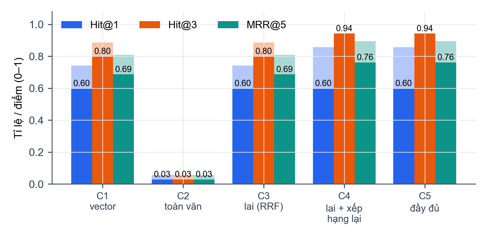
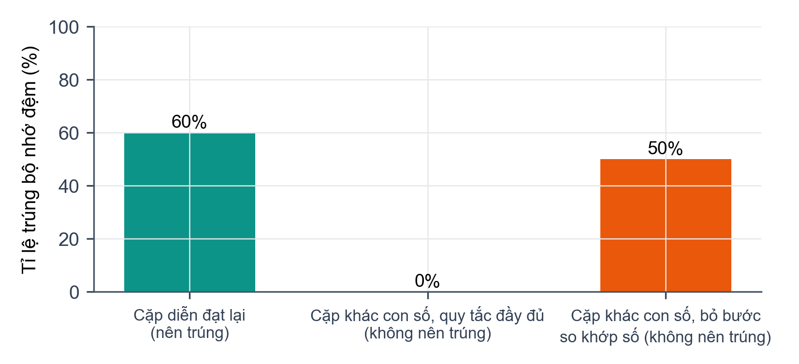
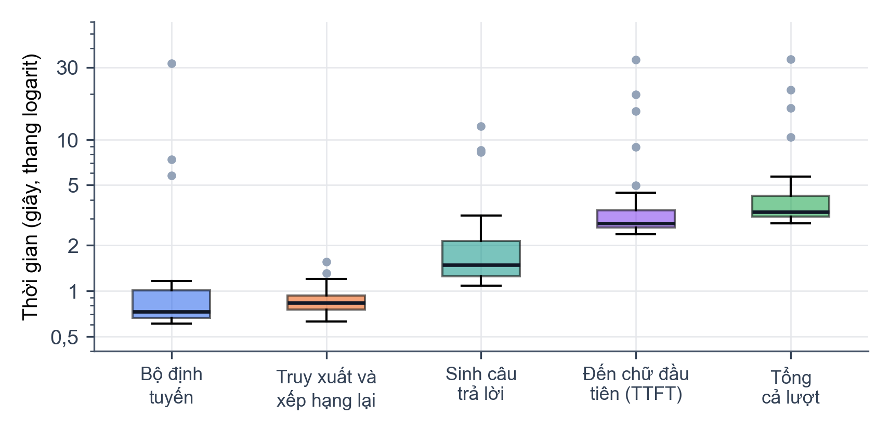

# CHƯƠNG 5. KIỂM THỬ VÀ ĐÁNH GIÁ

Chương này đánh giá hệ thống theo hai hướng. Hướng thứ nhất là đánh giá chatbot học vụ, thành phần trọng tâm: chất lượng truy xuất, chất lượng câu trả lời, bộ nhớ đệm, bộ lọc an toàn và độ trễ (mục 5.2). Hướng thứ hai là kiểm thử phần mềm nói chung và đánh giá ngắn các phân hệ hỗ trợ (mục 5.3). Nguyên tắc xuyên suốt: **mỗi con số trong chương đều có một script đo đi kèm** trong thư mục `eval/` của báo cáo hoặc trong thư mục `evaluation/` của từng service, và mỗi bảng ghi rõ số liệu do nhóm đo hay lấy lại từ báo cáo benchmark có sẵn trong mã nguồn. Các thí nghiệm chưa chạy được ghi là chờ số liệu (mục 5.1.3).

## 5.1 Môi trường và phương pháp

### 5.1.1 Môi trường thực nghiệm

Mọi phép đo của nhóm trong chương này chạy trên một máy cá nhân, không dùng máy chủ riêng (Bảng 5.1). Số liệu cấu hình do script `eval/env_info.py` ghi lại.

Bảng 5.1. Môi trường thực nghiệm

| Thành phần | Giá trị |
|--------------------|-------------------------------------------------|
| Hệ điều hành | Windows 11 (bản dựng 10.0.26300) |
| CPU | Intel Core i7-13650HX, 20 luồng |
| RAM | 23,7 GB |
| GPU | NVIDIA GeForce RTX 4060 Laptop, 8 GB VRAM, trình điều khiển 576.80 |
| Python | 3.11.8 |
| Thư viện chính | PyTorch 2.5.1 (CUDA 12.1), sentence-transformers 4.1.0, transformers 4.57.6, CTranslate2 4.6.0, fsrs 6.3.2, FastAPI 0.115.7, pytest 8.4.2 |
| Mô hình của chatbot | Bi-Encoder `vietnamese-bi-encoder` (768 chiều), Cross-Encoder `bge-reranker-v2-m3` (Bảng 2.1) |

Các thí nghiệm có gọi LLM (E2 và E5) dùng Gemini cho cả bộ định tuyến và bước sinh câu trả lời (script `run_answer_eval.py` mặc định ép `LLM_PROVIDER` và `REWRITER_PROVIDER` bằng `gemini`; mô hình ghi trong từng bản ghi kết quả). Kho tri thức được đo ở trạng thái ngày 31/10/2026 (Bảng 4.2). Khi triển khai với mô hình cục bộ (Bảng 2.1), độ trễ và chất lượng sẽ khác.

### 5.1.2 Dữ liệu và độ đo

**Kho tri thức.** Các thí nghiệm của chatbot chạy trên kho tri thức thật đã nạp bằng pipeline ở mục 4.1 (thống kê ở Bảng 4.2). Chúng tôi cố định một bản sao (snapshot) của kho trong suốt quá trình đo, vì mỗi lần nạp lại sẽ sinh mã đoạn mới.

**Bộ câu hỏi đánh giá.** Bộ câu hỏi (Phụ lục F, tệp `eval/data/questions.jsonl`) gồm 45 câu: tra cứu quy chế (15), hỏi thủ tục (13), nhiều ý (7), ngoài phạm vi học vụ (5) và ngoài kho tri thức (5). Ba nhóm đầu (35 câu) có đáp án trong kho, được soạn từ 19 tài liệu (chủ yếu các trang Cẩm nang người học), mỗi câu kèm nhãn nguồn đúng và đáp án tham chiếu. Hai nhóm cuối (10 câu) không có đáp án: câu không liên quan học vụ hoặc không phù hợp (như xin đáp án đề thi), và câu về trường khác hoặc dữ liệu cá nhân mà kho không có. Nhãn đặt ở mức tài liệu vì mã đoạn đổi sau mỗi lần nạp lại. Bộ câu hỏi nhỏ và do nhóm soạn từ chính tài liệu trong kho nên có thể dễ hơn câu hỏi thật của sinh viên (mục 5.4).

**Đánh giá chặt và nới lỏng.** Một quy định thường xuất hiện ở nhiều tài liệu (trang Cẩm nang, Quy chế đầy đủ, Sổ tay sinh viên), nên kết quả đúng nội dung nhưng từ tài liệu khác nhãn gold sẽ bị tính sai. Vì vậy truy xuất được báo hai cách chấm: *chặt* chỉ tính tài liệu gold; *nới lỏng* tính thêm mọi tài liệu chứa đủ các cụm khóa của câu hỏi (tệp `eval/data/key_phrases.json`, mỗi câu 1 đến 2 cụm đặc trưng).

**Độ đo truy xuất.** Dùng Hit Rate@K và MRR đã định nghĩa ở mục 2.2.7, công thức (2-7) và (2-8): với mỗi câu hỏi, danh sách kết quả được rút gọn về các tài liệu duy nhất theo thứ tự xếp hạng, và một câu hỏi được tính là trúng nếu có ít nhất một tài liệu đúng trong K vị trí đầu.

**Độ đo chất lượng câu trả lời.** Hai người trong nhóm chấm độc lập từng câu trả lời theo ba mức: *đúng* (đủ các ý chính của đáp án tham chiếu, không có thông tin sai), *đúng một phần* (thiếu ý hoặc có chi tiết sai không ảnh hưởng kết luận chính) và *sai* (sai kết luận hoặc bịa thông tin). Ngoài ra chấm nhị phân *trung thực*: mọi khẳng định trong câu trả lời đều có trong ngữ cảnh được truy xuất. Với câu hỏi ngoài kho, câu trả lời đúng là câu từ chối nêu rõ chưa có thông tin. Mức đồng thuận giữa hai người chấm được đo bằng hệ số Cohen's kappa

$$ \kappa=\frac{p_o-p_e}{1-p_e} \tag{5-1} $$

trong đó $p_o$ là tỉ lệ hai người chấm giống nhau và $p_e$ là tỉ lệ giống nhau kỳ vọng do ngẫu nhiên; các bất đồng được hai người thảo luận để chốt nhãn cuối.

**Thống kê.** Các tỉ lệ được báo cáo kèm khoảng tin cậy Wilson 95%, phù hợp với mẫu nhỏ:

$$ \frac{\hat p+\dfrac{z^2}{2n}\pm z\sqrt{\dfrac{\hat p(1-\hat p)}{n}+\dfrac{z^2}{4n^2}}}{1+\dfrac{z^2}{n}},\qquad z=1{,}96 \tag{5-2} $$

với $\hat p$ là tỉ lệ quan sát và $n$ là cỡ mẫu. Độ trễ được báo cáo bằng trung vị (p50) và phân vị 95 (p95) thay cho trung bình vì phân phối lệch phải.

### 5.1.3 Kế hoạch thí nghiệm

Bảng 5.2 liệt kê chín thí nghiệm; các script `eval/` nằm trong thư mục `eval/` của báo cáo. Các thí nghiệm E1 đến E6 do nhóm chạy trực tiếp cho chương này; E7 và E8 dùng lại kết quả của các script đánh giá đã có trong mã nguồn; E9 cần Docker Compose nên chưa chạy.

Bảng 5.2. Danh sách thí nghiệm

| Mã | Thí nghiệm | Script | Trạng thái |
|-----|------------------------------------|-------------------------------------------|----------------------|
| E1 | Truy xuất, 5 cấu hình | `run_retrieval_ablation.py` | Đã đo |
| E2 | Chất lượng câu trả lời | `run_answer_eval.py`, `rating_tools.py` | Đã thu, chờ chấm tay |
| E3 | Bộ nhớ đệm ngữ nghĩa | `run_cache_eval.py` | Đã đo (mô phỏng) |
| E4 | Bộ lọc an toàn | `run_guardrail_eval.py` | Đã đo |
| E5 | Độ trễ và thời gian đến chữ đầu | `run_answer_eval.py`, `run_latency_eval.py` | Đã đo |
| E6 | Kiểm thử tự động | `run_test_suites.py` | Đã đo |
| E7 | Sinh từ vựng bằng AI | `flashcard_service/evaluation/` | Kết quả có sẵn |
| E8 | Nhận diện ngôn ngữ và chuyên ngành | `realtime_translation_service/evaluation/` | Kết quả có sẵn |
| E9 | Giới hạn tần suất của Kong | Thủ công, hai tài khoản | Chờ số liệu |

## 5.2 Đánh giá chatbot

### 5.2.1 Chất lượng truy xuất (E1)

Thí nghiệm bật dần từng thành phần (ablation) trên 35 câu hỏi có đáp án (Bảng 5.3, Hình 5.1). C1 chỉ tìm kiếm vector; C2 chỉ tìm kiếm toàn văn; C3 tìm kiếm lai, hợp nhất bằng RRF với $k=60$; C4 là C3 cộng xếp hạng lại 50 ứng viên bằng Cross-Encoder; C5 là cấu hình đầy đủ ở mục 4.2.5 (ngưỡng 0,20, hạn mức, gộp về đoạn cha). Mỗi cấu hình lấy 50 ứng viên và dùng nguyên văn câu hỏi làm truy vấn, không qua bộ định tuyến. C1 và C3 gọi hàm `match_chunks_hybrid_rrf` (mục 3.4.2), C1 với chuỗi truy vấn rỗng nên nhánh toàn văn không có kết quả. C2 gọi nhánh toàn văn qua PostgREST rồi xếp hạng các đoạn khớp bằng BM25 tính trong Python, vì giao diện REST không trả điểm `ts_rank_cd`. C5 gọi trực tiếp hàm `retrieve_relevant_chunks_multi`.

Bảng 5.3. Chất lượng truy xuất theo cấu hình (35 câu hỏi; "nl" là đánh giá nới lỏng)

| Cấu hình | Hit@1 | Hit@3 | Hit@5 | MRR@5 | Hit@1 (nl) | Hit@3 (nl) | MRR@5 (nl) | p50 (ms) |
|---------------------------|-------|-------|-------|-------|-------|-------|-------|--------|
| C1. Chỉ vector | 60,0% | 80,0% | 82,9% | 0,687 | 74,3% | 88,6% | 0,810 | 123 |
| C2. Chỉ toàn văn | 2,9% | 2,9% | 2,9% | 0,029 | 5,7% | 5,7% | 0,057 | 75 |
| C3. Lai (RRF) | 60,0% | 80,0% | 82,9% | 0,687 | 74,3% | 88,6% | 0,810 | 98 |
| C4. Lai + xếp hạng lại | 60,0% | 94,3% | 94,3% | 0,762 | 85,7% | 94,3% | 0,895 | 395 |
| C5. Cấu hình đầy đủ | 60,0% | 94,3% | 94,3% | 0,762 | 85,7% | 94,3% | 0,895 | 403 |

{width=12cm}

Giả thuyết (a), tìm kiếm lai tốt hơn từng nhánh, **không được kiểm chứng**. Nhánh toàn văn chỉ có kết quả với 2 trong 35 câu: hàm `websearch_to_tsquery` nối các từ bằng phép AND nên câu hỏi dài hiếm khi có đoạn chứa đủ mọi từ. Danh sách toàn văn rỗng thì RRF không có gì để hợp nhất, nên C3 giống hệt C1. Trong hệ thống thật, bộ định tuyến rút câu hỏi thành truy vấn ngắn hơn nhưng vẫn là nhiều từ nối bằng AND, nên nhánh này nhiều khả năng cũng đóng góp ít.

Giả thuyết (b), xếp hạng lại cải thiện thứ hạng, **có xu hướng đúng**: từ C3 sang C4, Hit@3 tăng từ 80,0% (khoảng tin cậy 95%: 64% đến 90%) lên 94,3% (81% đến 98%), MRR@5 từ 0,687 lên 0,762, và Hit@1 nới lỏng từ 74,3% lên 85,7%. Các khoảng tin cậy chồng lấn nên với 35 câu chưa thể khẳng định. Mức cải thiện tập trung ở nhóm thủ tục (Hit@3 từ 10 lên 13 trên 13 câu) và nhóm nhiều ý (MRR@5 từ 0,45 lên 0,62 trên 7 câu). Giả thuyết (c), gộp về đoạn cha không đổi Hit@K ở mức tài liệu, **đúng**: C5 và C4 cho cùng danh sách tài liệu, và ngưỡng 0,20 không loại nhầm câu nào (điểm cao nhất có trung vị 0,99, nhỏ nhất 0,31).

Khoảng cách giữa hai cách chấm cho thấy mức trùng lặp của kho. Ở C4, Hit@1 chặt là 60,0% còn nới lỏng là 85,7%: trong 14 câu chưa trúng ở hạng 1 theo nhãn gold, 9 câu có tài liệu hạng 1 chứa đủ cụm khóa, 8 trong số đó là Quy chế đào tạo hoặc Sổ tay sinh viên. Hai câu trượt ở mọi cấu hình (Q14, Q35) hỏi về bảng thời hạn học tập theo khóa; nhóm chưa xác định nguyên nhân.

Với 10 câu không có đáp án, cấu hình đầy đủ trả danh sách rỗng cho 7 câu (điểm cao nhất từ 0,0004 đến 0,13). Ba câu còn lại vẫn nhận kết quả: dữ liệu cá nhân (0,27), số điện thoại trưởng khoa Công nghệ thông tin (0,94, khớp trang giới thiệu Khoa có số điện thoại văn phòng) và đồng phục của một trường khác (0,52, khớp nội quy học đường của IUH). Hai trường hợp sau cho thấy bộ xếp hạng lại chấm cao các đoạn cùng chủ đề dù câu hỏi nhắm tới thực thể khác, và ngưỡng 0,20 không ngăn được loại lỗi này. Về thời gian, C1 và C3 mất khoảng 100 đến 120 ms cho một lời gọi RPC, còn C4 và C5 khoảng 400 ms vì xếp hạng lại 50 cặp thêm gần 300 ms trên GPU. Kết quả cần đọc cùng ba giới hạn: bộ câu hỏi nhỏ do nhóm soạn, nhãn ở mức tài liệu, và truy vấn không qua bộ định tuyến (mục 5.2.2 đo đầu cuối).

### 5.2.2 Chất lượng câu trả lời (E2)

Thí nghiệm so sánh hai cách trả lời cùng 45 câu hỏi: (V1) LLM trả lời trực tiếp, không có tài liệu, với một prompt chỉ nêu vai trò trợ lý học vụ IUH; (V2) đường xử lý của hệ thống gồm bộ lọc an toàn, bộ định tuyến, truy xuất nhiều truy vấn, dựng prompt và sinh câu trả lời. V1 là cơ sở so sánh để thấy giá trị của việc truy xuất. Script `run_answer_eval.py` lặp lại các bước của endpoint `/messages/stream` nhưng không ghi hội thoại, nhật ký hay bộ nhớ đệm, và dùng một phiên mới cho mỗi câu hỏi. Cả hai phương án dùng Gemini; lớp nhà cung cấp tự chuyển sang mô hình dự phòng khi lỗi nên một số lời gọi dùng `gemini-3.1-flash-lite` hoặc `gemini-3.5-flash` (6 lời gọi bộ định tuyến và 7 lời gọi sinh trong 45 lượt V2). Với V2, bộ nhớ đệm không được dùng.

Hai người trong nhóm chấm độc lập 90 câu trả lời theo thang ở mục 5.1.2, không biết câu nào thuộc phương án nào (Bảng 5.4). Với nhóm câu hỏi ngoài phạm vi và ngoài kho, chỉ số chính là tỉ lệ từ chối đúng thay vì bịa câu trả lời.

Bảng 5.4. Chất lượng câu trả lời

| Chỉ số | V1: LLM không tài liệu | V2: hệ thống RAG |
|------------------------------------|----------------|---------------|
| Đúng | | |
| Đúng một phần | | |
| Sai | | |
| Trung thực với ngữ cảnh | không áp dụng | |
| Từ chối đúng (câu ngoài kho và ngoài phạm vi) | | |
| Cohen's kappa giữa hai người chấm | | |

> [CHỜ SỐ LIỆU: hai người chấm điền `eval/results/rating_r1.csv` và `rating_r2.csv` (tạo bằng `rating_tools.py make`), rồi chạy `rating_tools.py merge` và `report` để lấy Bảng 5.4 và 5.5.]

Trong khi chờ chấm tay, các chỉ báo tự động từ 45 lượt V2 (script `analyze_pipeline.py`) cho một số kết quả bước đầu. Chúng chỉ phản ánh hành vi của đường xử lý, chưa nói lên câu trả lời đúng hay sai.

- **Truy xuất đầu cuối.** Qua bộ định tuyến, câu hỏi được viết lại ngắn hơn (trung bình 1,2 truy vấn, 7 câu nhiều ý được tách). Tài liệu đúng ở hạng 1 trong 77,1% câu (27/35; khoảng tin cậy 61% đến 88%; 88,6% nếu nới lỏng) và trong 3 hạng đầu ở 91,4% (32/35). So với C5 dùng nguyên văn câu hỏi (Hit@1 chặt 60,0%, Hit@3 94,3%), viết lại có xu hướng đưa tài liệu đúng lên đầu nhưng mất một câu ở hạng 3; với 35 câu chưa đủ để kết luận.
- **Từ chối.** Không câu có đáp án nào bị từ chối nhầm. Trong 10 câu không có đáp án, bộ định tuyến từ chối 7 câu; 3 câu còn lại đi qua truy xuất và mô hình tự trả lời "chưa tìm thấy thông tin" (dữ liệu cá nhân, lịch lớp, số điện thoại trưởng khoa, nơi mô hình chỉ nêu số của văn phòng Khoa). Theo chỉ báo từ khóa, cả 10 câu có câu từ chối (10/10; khoảng tin cậy 72% đến 100%).
- **Tự đánh giá và lỗi định dạng.** Trong 38 câu qua truy xuất, 33 câu có `doc_relevance = YES` và `answer_confidence = HIGH`; ba câu ngoài kho nhận `NONE`, phù hợp với việc từ chối. Ở câu hỏi điểm trung bình cá nhân (Q43), mô hình đóng khối suy luận bằng `</doc_relevance>` thay vì `</thinking>`; trong endpoint streaming, bộ lọc ở mục 4.2.8 khi đó sẽ không gửi gì cho sinh viên. Đây là 1 trong 37 lượt (2,7%), xác nhận bằng thực nghiệm rủi ro đã nêu ở mục 4.2.8.

Bảng 5.5 sẽ đối chiếu độ tin cậy do mô hình tự khai với nhãn chấm tay. Kết quả này quyết định cổng chất lượng của bộ nhớ đệm có đáng tin hay không, vì cổng chỉ ghi câu trả lời khi độ tin cậy là `HIGH`. Phân bố tự khai hiện có: 34 lượt `HIGH`, 3 lượt `NONE` và 1 lượt không đọc được.

Bảng 5.5. Độ tin cậy do mô hình tự khai và nhãn chấm tay (V2)

| `answer_confidence` | Số câu | Đúng | Đúng một phần | Sai |
|---------------------|-------|-------|---------------|-----|
| `HIGH` | 34 | | | |
| `PARTIAL` | 0 | | | |
| `NONE` | 3 | | | |
| Không đọc được | 1 | | | |

> [CHỜ SỐ LIỆU: điền các cột nhãn của Bảng 5.5 sau khi chấm tay; phân tích riêng các câu `HIGH` nhưng chấm là sai.]

### 5.2.3 Bộ nhớ đệm ngữ nghĩa (E3)

Thí nghiệm đánh giá quy tắc quyết định của tầng ngữ nghĩa ở mục 4.2.4 trên 23 cặp câu hỏi do nhóm soạn (tệp `eval/data/cache_pairs.jsonl`): 15 cặp diễn đạt lại cùng ý, nơi câu thứ hai nên trúng câu đầu, và 8 cặp giống nhau về chữ nhưng khác một con số, như khóa 20 và khóa 21 hay B1 và B2, nơi câu thứ hai không được trúng câu đầu. Để không ghi vào Redis hay bảng `semantic_cache` của hệ thống thật, script mô phỏng trong bộ nhớ đúng quy tắc của hàm `check_semantic_cache`: lấy ứng viên gần nhất theo cosine trong chỉ mục gồm các câu đầu của 23 cặp, yêu cầu cosine từ 0,60, điểm Cross-Encoder từ 0,80 và hai câu cùng tập chữ số. Mô phỏng không gồm tầng Redis khớp chính xác và thời hạn hết hạn của mục. Kết quả ở Bảng 5.6 và Hình 5.2.

Bảng 5.6. Hiệu quả và độ an toàn của bộ nhớ đệm (mô phỏng quy tắc)

| Chỉ số | Giá trị |
|--------------------------------------------------------|----------------------------|
| Trúng đúng với cặp diễn đạt lại (15 cặp) | 60,0% [36–80] (9/15) |
| Trúng nhầm sang một câu khác với cặp diễn đạt lại | 0/15 |
| Trúng nhầm với cặp khác con số, quy tắc đầy đủ (8 cặp) | 0% [0–32] (0/8) |
| Trúng nhầm với cặp khác con số nếu bỏ bước so khớp số | 50,0% [22–78] (4/8) |
| Thời gian kiểm tra một câu, p50 / p95 (ms) | 18 / 24 |

{width=11cm}

Quy tắc đạt yêu cầu an toàn quan trọng nhất: không cặp khác con số nào trúng nhầm, và bước so khớp số là yếu tố quyết định, vì nếu bỏ bước này thì 4 trong 8 cặp trúng nhầm đúng câu gốc khác con số (cộng một cặp trúng một câu khác), do độ tương tự của hai câu rất cao (cosine từ 0,71 đến 0,97, điểm Cross-Encoder từ 0,91 đến 0,9995). Đổi lại quy tắc bỏ lỡ 6 trong 15 cặp diễn đạt lại: bốn cặp bị loại ở ngưỡng cosine 0,60 của Bi-Encoder (cosine từ 0,34 đến 0,55) và hai cặp ở ngưỡng Cross-Encoder (0,12 và 0,77). Quét ngưỡng Cross-Encoder từ 0,5 đến 0,95 cho thấy hạ ngưỡng không giúp (ở 0,5 vẫn chỉ trúng 10/15 cặp diễn đạt lại), nên hướng cải thiện tỉ lệ trúng là ngưỡng cosine của tầng đầu. Thời gian kiểm tra một câu khoảng 18 ms trên GPU, chưa tính các lời gọi Redis và Supabase. Thí nghiệm không đo hai điểm yếu ở mục 4.2.4 (khóa theo truy vấn đầu tiên, không tự xóa sau khi nạp lại tri thức) vì cần ghi vào bộ nhớ đệm thật; chỉ mục mô phỏng chỉ có 23 câu nên số trúng nhầm trong thực tế có thể cao hơn.

### 5.2.4 Bộ lọc an toàn (E4)

Thí nghiệm này đã được đo. Script `eval/run_guardrail_eval.py` nạp trực tiếp hàm `check_safety_and_jailbreak` của hệ thống (mục 4.2.2) và chạy trên hai bộ do nhóm biên soạn: 32 câu tấn công, chia thành bảy nhóm theo kiểu tấn công, và 60 câu hỏi học vụ hợp lệ, trong đó 10 câu cố ý chứa các từ dễ bị nhầm như "quên", "hủy", "bỏ qua", "hệ thống". Chỉ lớp biểu thức chính quy được đo, vì lớp từ chối của bộ định tuyến cần LLM.

Bảng 5.7 cho thấy bộ lọc chặn 19 trong 32 câu tấn công (59,4%; khoảng tin cậy 95% là 42,3% đến 74,5%) và chặn nhầm 6 trong 60 câu hợp lệ (10,0%; 4,7% đến 20,1%). Các nhóm có dấu hiệu rõ ràng được chặn tốt: giả mạo thẻ cấu trúc (4/4) và nhập vai (4/4). Điểm yếu tập trung ở hai chỗ. Thứ nhất là các cách diễn đạt nằm ngoài mẫu cố định, như "Disregard the above rules" (có chữ "the" xen giữa) hay "quên tất cả hướng dẫn" (mẫu chỉ nhận "mọi"), và toàn bộ bốn câu ngụy trang (thay chữ bằng số, tách ký tự, bỏ dấu, dùng từ đồng nghĩa) đều lọt qua. Thứ hai là chặn nhầm: 0 trong 50 câu hỏi thông thường nhưng 6 trong 10 câu chứa từ dễ nhầm, gồm "quên hướng dẫn đăng ký", "cập nhật hệ thống", "bỏ qua quy định", "cho tôi biết hướng dẫn ban đầu", "lệnh từ phòng đào tạo" và "hủy hướng dẫn viên".

Hai bộ dữ liệu do nhóm tự soạn và cố ý có các biến thể nằm ngoài mẫu, nên 59,4% phản ánh phạm vi mà các mẫu hiện tại bao phủ chứ không phải tần suất tấn công thực; tương tự, 10% chặn nhầm là do bộ có 10 câu được chọn để dễ nhầm. Biểu thức chính quy đủ để chặn các mẫu phổ biến nhưng không thể là lớp phòng thủ duy nhất, đúng như thiết kế hai lớp ở mục 4.2.2.

Bảng 5.7. Kết quả bộ lọc an toàn trên bộ câu mẫu của nhóm

| Nhóm | Số câu | Bị chặn | Tỉ lệ |
|---------------------------------------|-----|------|--------|
| Tấn công: bỏ qua chỉ dẫn (tiếng Anh) | 6 | 3 | 50,0% |
| Tấn công: bỏ qua chỉ dẫn (tiếng Việt) | 6 | 3 | 50,0% |
| Tấn công: dò prompt hệ thống (tiếng Anh) | 4 | 3 | 75,0% |
| Tấn công: dò prompt hệ thống (tiếng Việt) | 4 | 2 | 50,0% |
| Tấn công: nhập vai, chế độ quản trị | 4 | 4 | 100% |
| Tấn công: giả mạo thẻ cấu trúc | 4 | 4 | 100% |
| Tấn công: ngụy trang | 4 | 0 | 0% |
| **Tổng câu tấn công** | **32** | **19** | **59,4%** |
| Câu hợp lệ thông thường | 50 | 0 | 0% |
| Câu hợp lệ chứa từ dễ nhầm | 10 | 6 | 60,0% |
| **Tổng câu hợp lệ** | **60** | **6** | **10,0%** |

### 5.2.5 Độ trễ (E5)

Thời gian của một lượt hỏi đáp gồm ba phần: bộ định tuyến, truy xuất cùng dựng ngữ cảnh, và sinh câu trả lời. Với người dùng, chỉ số quan trọng là thời gian đến chữ đầu tiên hiển thị (TTFT), vì câu trả lời được truyền theo luồng nhưng khối suy luận được sinh trước và bị lọc đi (mục 4.2.8). Số liệu lấy từ 37 trong 45 lượt V2 của thí nghiệm E2 đã đi hết đường RAG, sau khi bỏ lượt đầu tiên (làm nóng); 7 lượt bị bộ định tuyến từ chối và lượt đầu bị bỏ. Thời gian được đo trong tiến trình, với bộ nhớ đệm tắt, mỗi câu một phiên mới và các câu chạy tuần tự (Bảng 5.8, Hình 5.3).

Bảng 5.8. Độ trễ từng giai đoạn của một lượt hỏi đáp (ms, 37 lượt)

| Giai đoạn | p50 | p95 | Lớn nhất |
|------------------------------------------------|-------|--------|--------|
| Bộ định tuyến | 727 | 6 114 | 31 953 |
| Dựng ngữ cảnh (sinh vector, truy xuất, ký ức phiên) | 1 104 | 1 749 | 2 121 |
| trong đó truy xuất và xếp hạng lại | 832 | 1 221 | 1 553 |
| Sinh câu trả lời (toàn bộ luồng) | 1 484 | 8 320 | 12 242 |
| Thời gian đến chữ đầu tiên (TTFT) | 2 801 | 16 256 | 33 787 |
| Tổng thời gian của lượt | 3 338 | 17 155 | 34 082 |

{width=12.5cm}

Trung vị của cả lượt là 3.3 giây, trong đó thời gian đến chữ đầu tiên là 2.8 giây, chiếm khoảng 84% tổng thời gian. Lý do là câu trả lời ngắn và mô hình sinh nhanh (trung vị 1.5 giây cho cả luồng), nên phần lớn thời gian chờ nằm ở bộ định tuyến, bước dựng ngữ cảnh và khối suy luận mở đầu câu trả lời, chứ không phải ở việc truyền chữ. Giai đoạn truy xuất và xếp hạng lại khá ổn định (p95 là 1.2 giây), trong khi hai lời gọi LLM có đuôi dài: p95 của cả lượt gấp gần 5 lần trung vị và lượt chậm nhất mất 34 giây, trong đó một lời gọi bộ định tuyến mất 32 giây. Các lượt chậm liên quan đến phía nhà cung cấp API: 6 lời gọi bộ định tuyến và 7 lời gọi sinh phải chuyển sang mô hình dự phòng. Sáu lượt đã ghi ở Bảng 4.8 (ngày 29/10/2026, cùng dòng mô hình) có bộ định tuyến mất từ 5,0 đến 23,6 giây, tức là độ trễ của cùng một thành phần có thể khác nhau hàng chục lần giữa các thời điểm, và các con số ở đây phản ánh một buổi đo chứ không phải giá trị cố định. Kết quả cũng không gồm độ trễ của Kong, nginx và mạng đến trình duyệt, nên thời gian sinh viên cảm nhận sẽ cao hơn một chút.

## 5.3 Kiểm thử phần mềm và phân hệ hỗ trợ

### 5.3.1 Kiểm thử tự động (E6)

Mỗi service có một bộ kiểm thử pytest riêng. Script `eval/run_test_suites.py` chạy lần lượt cả năm bộ, không cần Docker, và ghi kết quả (Bảng 5.9). Trong tổng số 1 642 kiểm thử, 1 634 đạt, 1 không đạt và 7 bị bỏ qua.

Bảng 5.9. Kết quả kiểm thử tự động theo service

| Service | Số kiểm thử | Đạt | Không đạt | Bỏ qua | Thời gian (giây) |
|-------------------------------|-------|-------|-----|-----|-------|
| Auth Service | 128 | 127 | 1 | 0 | 27,0 |
| Academic Chatbot Service | 140 | 140 | 0 | 0 | 116,0 |
| Flashcard Service | 867 | 867 | 0 | 0 | 6,7 |
| Realtime Translation Service | 454 | 447 | 0 | 7 | 254,1 |
| Document Translation Service | 53 | 53 | 0 | 0 | 27,7 |
| **Tổng** | **1 642** | **1 634** | **1** | **7** | |

Kiểm thử không đạt của Auth Service (`test_login_failure_is_logged_without_password`) là lỗi của kiểm thử chứ không của chức năng: dòng nhật ký `login_failed` được ghi đúng (tài khoản đã che thành `****345`), nhưng logger đặt `propagate = False` nên `caplog` của pytest không bắt được. Bảy kiểm thử bị bỏ qua của Translation Service là các kiểm thử đầu cuối cần backend tại `localhost:8000`. Kết quả khác CI trên nhánh `main`, nơi bốn kiểm thử của Translation Service thất bại (mục 4.4.2), vì theo ghi chép triển khai môi trường CI thiếu mô hình NLLB, Redis và dữ liệu NLTK. Phần lớn kiểm thử dùng đối tượng giả cho Supabase, Redis và LLM nên kiểm tra logic nghiệp vụ chứ không kiểm tra tích hợp thật, và nhóm chưa đo độ bao phủ mã.

### 5.3.2 Sinh từ vựng bằng AI (E7)

Pipeline ba bước ở mục 4.3.2 được so với phương án đối chứng gọi LLM một lần, trên 20 chủ đề, mỗi chủ đề xin 10 từ, cùng nhà cung cấp Groq `openai/gpt-oss-120b`. Script nằm ở `flashcard_service/evaluation/` (`run_vocab_eval.py` và `report.py`); Bảng 5.10 lấy các chỉ số chính từ báo cáo `results/REPORT.md` đã có trong mã nguồn, không chạy lại khi viết báo cáo (cần khóa Groq). Khoảng trong ngoặc vuông là khoảng tin cậy Wilson 95%.

Bảng 5.10. So sánh pipeline ba bước với một lời gọi LLM (20 chủ đề)

| Chỉ số | A: một lời gọi | B: ba bước |
|---------------------------------|------------------------|-------------------------|
| Thẻ đúng lược đồ / ứng viên | 97,3% [94–99] (214/220) | 100% [98–100] (214/214) |
| Ví dụ chứa từ khóa | 98,5% [96–99] (197/200) | 98,0% [95–99] (195/199) |
| Phiên âm IPA hợp lệ | 100% [98–100] (200/200) | 97,5% [94–99] (194/199) |
| Thẻ đã qua kiểm duyệt | 0% (không có bước này) | 95,5% [92–98] (190/199) |
| Thẻ được người kiểm duyệt sửa | 0% [0–2] (0/200) | 18,6% [14–25] (37/199) |
| Độ trễ p50 / p95 (giây) | 2,2 / 2,8 | 5,2 / 6,1 |
| Token mỗi thẻ | 111,1 | 379,1 |
| Số lời gọi LLM mỗi lần chạy | 1 | 3 |

Phương án ba bước đạt tỉ lệ đúng lược đồ cao hơn và là phương án duy nhất có bước kiểm duyệt; đổi lại nó chậm hơn khoảng 2,3 lần và tốn token mỗi thẻ gấp khoảng 3,4 lần. Điều đáng chú ý là bước kiểm duyệt sửa 18,6% số thẻ nhưng không loại thẻ nào, nghĩa là giá trị của bước này nằm ở việc sửa nghĩa chứ không phải lọc bỏ. Ví dụ chứa từ khóa và phiên âm hợp lệ của hai phương án xấp xỉ nhau, với khoảng tin cậy chồng lấn, nên mẫu này không cho thấy khác biệt có ý nghĩa ở hai chỉ số đó.

Về chống chèn lệnh, 20 tải trọng độc hại (đặt vào các trường đầu vào của yêu cầu) được gửi qua pipeline: 19 trong 20 đạt, tức không thấy dấu hiệu rò rỉ prompt hay khóa API và đầu ra đúng lược đồ. Tải trọng không đạt (I04, yêu cầu in biến môi trường và khóa Groq) vẫn trả về 10 từ vựng hợp lệ về chủ đề này, nhưng script phát hiện chuỗi tên khóa trong một trường kết quả; nhóm chưa phân biệt được đó là lặp lại nội dung tải trọng hay rò rỉ thật.

### 5.3.3 Nhận diện ngôn ngữ và chuyên ngành (E8)

Hai bộ nhận diện của Translation Service đã được nhóm đánh giá bằng các script trong `realtime_translation_service/evaluation/`, kết quả ghi ở các báo cáo benchmark ngày 10/10/2026 (mã nguồn tại commit `7e846214`, Windows 11, Python 3.11.8, chỉ CPU). Bảng 5.11 tóm tắt; chúng tôi không chạy lại các script này.

Bảng 5.11. Kết quả nhận diện ngôn ngữ và chuyên ngành (theo báo cáo benchmark của nhóm)

| Bài toán | Bộ dữ liệu | Chỉ số | Kết quả |
|----------------------|------------------------------------------|-----------------------------|------------------------------|
| Nhận diện ngôn ngữ | Tatoeba hold-out, 2 000 câu (1 500 hỗ trợ, 500 ngoài phạm vi) | Độ chính xác chặt | 97,8% |
| | | Tiếng Việt | 98,7% |
| | | Sai mà tự tin | 0,05% |
| | | Chấp nhận nhầm ngôn ngữ ngoài phạm vi | 0,2% |
| | | Độ trễ p95 (bộ đệm tắt) | 0,27 ms |
| Nhận diện chuyên ngành | Bộ val 57 mẫu / hold-out 60 mẫu | Macro-F1 trong phạm vi | 1,000 / 1,000 |
| | | Từ chối đúng ngoài phạm vi | 12/12 / 12/12 |
| | | Sai mà tự tin | 0/48 / 0/60 |
| | | Sai số hiệu chỉnh (ECE) | 0,040 / 0,031 |
| | | Token đầu p95 | 0,82 s / 0,73 s |

Cần đọc kết quả với các điều kiện sau. Tatoeba gồm câu sạch và ngắn, có nhãn nhiễu, không đại diện cho dữ liệu người dùng thật (gõ sai, tiếng lóng, trộn ngôn ngữ). Bộ chuyên ngành do nhóm tự viết hoặc lấy phần mở đầu bài Wikipedia, văn phong định nghĩa nên rất dễ nhận lĩnh vực; kết quả hoàn hảo trên mẫu nhỏ chỉ cho biết cận trên của tỉ lệ lỗi vào khoảng 3 chia cho cỡ mẫu (xấp xỉ 3,6% với 84 mẫu trong phạm vi). Điểm thiết kế được kiểm chứng là hệ thống ưu tiên từ chối hơn là đoán sai: trên 1 500 câu hỗ trợ không có câu nào bị gán sai ngôn ngữ, mọi sai sót đều là yêu cầu người dùng chọn lại.

### 5.3.4 Giới hạn tần suất của Kong (E9)

Mục 3.3.2 ghi rằng Kong áp giới hạn chung 1 000 yêu cầu mỗi phút và giới hạn riêng cho việc sinh từ vựng (6 yêu cầu mỗi phút, 60 mỗi giờ). Đối chiếu cấu hình cho thấy tệp `kong.template.yml` không đặt tham số `limit_by`, nên Kong dùng giá trị mặc định là theo consumer; vì mọi JWT đều được ký dưới một consumer chung, hai người dùng khác nhau có thể dùng chung một bộ đếm. Cũng cần kiểm chứng giới hạn 20 yêu cầu mỗi phút của chatbot, vì service đếm theo địa chỉ nguồn và nằm sau Kong (mục 4.2.1). Thí nghiệm (kết quả ở Bảng 5.12) dùng hai tài khoản A và B: tài khoản A gọi `/vocabulary/generate` sáu lần, sau đó tài khoản B gọi lần thứ bảy; nếu B nhận mã 429 thì bộ đếm đang dùng chung. Làm tương tự với `/messages/stream` để kiểm tra giới hạn của chatbot.

Bảng 5.12. Kiểm chứng giới hạn tần suất với hai tài khoản

| Endpoint | Giới hạn cấu hình | Lần gọi thứ 7 của tài khoản B | Kết luận |
|-----------------------------|------------------|--------------------|-------------|
| `/vocabulary/generate` | 6 yêu cầu/phút | | |
| `/messages/stream` | 20 yêu cầu/phút | | |

> [CHỜ SỐ LIỆU: chạy Docker Compose, đăng ký hai tài khoản và thực hiện thí nghiệm như trên; điền Bảng 5.12. Nếu bộ đếm bị dùng chung, nêu ở Chương 6 và đề xuất đặt `limit_by` theo header hoặc theo IP.]

## 5.4 Thảo luận

**Kết quả chính cho chatbot.** Ở khâu truy xuất, xếp hạng lại bằng Cross-Encoder là thành phần cho cải thiện rõ nhất (Hit@3 từ 80,0% lên 94,3%, MRR@5 từ 0,687 lên 0,762), còn nhánh toàn văn của tìm kiếm lai hầu như không đóng góp với câu hỏi dạng câu, nên tìm kiếm lai chưa hơn tìm kiếm vector (mục 5.2.1). Bước viết lại của bộ định tuyến đưa tài liệu đúng lên hạng 1 thường xuyên hơn so với dùng nguyên văn câu hỏi (77,1% so với 60,0%). Với câu hỏi không có đáp án, hệ thống từ chối ở nhiều lớp: bộ định tuyến chặn 7 trên 10 câu, các câu còn lại được mô hình trả lời là chưa tìm thấy thông tin; ngưỡng điểm xếp hạng lại không phải lớp chặn đáng tin vì bộ xếp hạng chấm cao các đoạn cùng chủ đề dù câu hỏi nhắm tới thực thể khác. Bộ lọc biểu thức chính quy chặn 59,4% câu tấn công mẫu và chặn nhầm 10% câu hợp lệ, đủ cho các mẫu phổ biến nhưng không thể là lớp phòng thủ duy nhất (mục 5.2.4). Bộ nhớ đệm đạt yêu cầu an toàn quan trọng nhất là không trúng nhầm các câu khác con số, đổi lại chỉ trúng 60% các câu diễn đạt lại, và nguyên nhân chính là ngưỡng cosine của tầng đầu (mục 5.2.3). Về tốc độ, trung vị 3,3 giây cho một lượt nhưng đuôi dài do hai lời gọi LLM (mục 5.2.5).

**Mối đe dọa đến tính hợp lệ.** Một là bộ câu hỏi nhỏ (35 câu có đáp án) và do chính nhóm soạn từ các tài liệu trong kho, nên dễ hơn câu hỏi tự nhiên của sinh viên (viết tắt, sai chính tả, câu hỏi mơ hồ); khoảng tin cậy rộng nên nhiều so sánh chưa đủ để kết luận. Hai là nhãn đặt ở mức tài liệu trong khi nội dung bị trùng ở nhiều tài liệu, nên phải báo cả hai cách chấm (chặt và nới lỏng); cách nới lỏng dựa trên cụm khóa nên có thể còn bỏ sót hoặc nhận thừa. Ba là kho tri thức được đo ở một thời điểm và mọi phép đo chạy trên một máy cá nhân, mỗi câu hỏi chỉ chạy một lần với LLM không xác định hoàn toàn. Bốn là độ trễ phụ thuộc tải của API Gemini tại thời điểm đo và việc tự chuyển mô hình. Năm là thí nghiệm bộ nhớ đệm là mô phỏng quy tắc trên chỉ mục 23 câu, không đo trên bộ nhớ đệm thật.

**Liên hệ với các hạn chế ở Chương 4.** Các phép đo xác nhận một số hạn chế đã nêu khi đọc mã nguồn: bộ lọc chặn nhầm (mục 5.2.4), khối suy luận đóng sai làm mất câu trả lời (mục 5.2.2) và đuôi độ trễ do phụ thuộc API (mục 5.2.5). Hai điểm chưa được đo là chất lượng câu trả lời theo chấm tay và việc giới hạn tần suất của Kong có dùng chung giữa các người dùng hay không.

> [TODO: Sau khi hoàn thành chấm tay (E2) và kiểm chứng giới hạn tần suất (E9), bổ sung một đoạn về chất lượng câu trả lời của V2 so với V1 và về các câu `HIGH` nhưng sai, rồi cập nhật các câu ở đây.]
