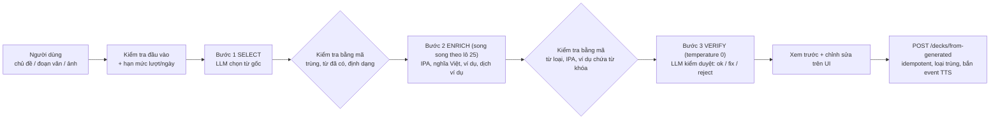

# Ghi Chú Kỹ Thuật Khóa Luận: Flashcard & Spaced Repetition System (`flashcard_service`)

Tài liệu này tổng hợp toàn bộ bài toán khoa học nhận thức (Cognitive Science), thuật toán lặp ngắt quãng SOTA (**FSRS**), cơ chế học tập đa phương thức (**Multi-modal Review & Spelling Challenge**), kiến trúc hướng sự kiện và các quyết định thiết kế của **Flashcard Service** để phục vụ viết báo cáo Khóa luận tốt nghiệp và trả lời phản biện trước Hội đồng.

---

## 1. Bài toán và Cơ sở Khoa học Nhận thức
Sinh viên khi học từ vựng chuyên ngành qua tài liệu học thuật thường đối mặt với **Đường cong quên lãng Ebbinghaus (Ebbinghaus Forgetting Curve)**: Sau 24 giờ, con người có thể quên tới $70\%$ lượng thông tin mới nạp nếu không được ôn tập đúng thời điểm.
* **Mục tiêu**: Xây dựng thuật toán tính toán chính xác "Thời điểm vàng" mà sinh viên chuẩn bị quên từ vựng để nhắc nhở ôn tập, tối ưu hóa thời gian học và chuyển kiến thức vào bộ nhớ dài hạn (Long-term Memory).
* **Đột phá trong đề tài**: 
  1. Triển khai thuật toán thế hệ mới **FSRS (Free Spaced Repetition Scheduler)** thay thế cho thuật toán cổ điển SuperMemo-2 (SM-2 vốn ra đời từ năm 1987).
  2. Xây dựng cơ chế **Thẻ nguyên tử (Atomic Flashcard)**: Mỗi từ vựng là một thẻ độc lập kèm phát âm chuẩn bản xứ (`edge_tts`), câu ví dụ và phiên âm quốc tế IPA.
  3. Tích hợp **Chế độ Học Đa phương thức (Multi-modal Study Mode)**: Kết hợp ngẫu nhiên giữa *Lật thẻ thụ động (Flip Card)* và *Thử thách Gõ chính tả / Điền từ (Active Recall Spelling Challenge)*.

---

## 2. So sánh Thuật toán FSRS và SM-2 (Hàm lượng Học thuật Khóa luận)

| Tiêu chí | SuperMemo-2 (SM-2) | Free Spaced Repetition Scheduler (FSRS) |
| :--- | :--- | :--- |
| **Năm ra đời** | 1987 (Piotr Woźniak) | 2023–nay (Jarrett Ye / Chuẩn thuật toán chính thức của Anki) |
| **Mô hình Trí nhớ** | Tuyến tính đơn giản dựa trên Hệ số Dễ (`Easiness Factor - EF`) | Mô hình hóa 2 thành phần: **Độ bền vững (Stability - $S$)** và **Độ khó (Difficulty - $D$)** |
| **Độ chính xác chu kỳ** | Dễ dẫn đến hiện tượng "Review Hell" (quá tải số lượng thẻ ôn tập mỗi ngày) | Dự đoán chính xác xác suất nhớ lại ($R$), giảm từ $20-30\%$ số lần ôn tập thừa |
| **Mức đánh giá người học** | 6 mức (0 - 5) gây khó khăn khi chọn | 4 mức trực quan: **1 (Again), 2 (Hard), 3 (Good), 4 (Easy)** |
| **Tính toán khoảng cách (Interval)** | $I(n) = I(n-1) \times \text{EF}$ | $I = \text{Interval}(S, \text{Target Retrievability})$ |

### 2.1. Công thức Toán học của FSRS
1. **Xác suất Nhớ lại (Retrievability - $R$)**:
   $$R(t, S) = \left( 1 + \text{FACTOR} \cdot \frac{t}{S} \right)^{\text{DECAY}}$$
   *(Trong đó $t$ là số ngày trôi qua kể từ lần ôn gần nhất, $S$ là Stability)*.
2. **Độ bền vững của trí nhớ (Stability - $S$)**: Đại diện cho số ngày cần thiết để xác suất nhớ lại của một thẻ giảm từ $100\%$ xuống còn $90\%$.
3. **Độ khó của thẻ (Difficulty - $D$)**: Biểu diễn từ $1.0$ (rất dễ) đến $10.0$ (rất khó), tự động hiệu chỉnh sau mỗi lần đánh giá của người dùng.

---

## 3. Kiến trúc Luồng Dữ liệu Liên thông (Data Flow Pipeline)

```mermaid
flowchart TD
    subgraph Sources ["1. Nguồn Thu thập Từ vựng"]
        RT_UI["Real-time Translation UI<br/>(Tra từ & bấm nút 'Thêm vào Thẻ')"]
        Doc_Worker["Doc Translation Celery Worker<br/>(Dịch xong tài liệu & AI trích xuất Glossary)"]
    end

    subgraph Broker ["2. Message Broker (RabbitMQ)"]
        Event_Doc["Event: doc.translated<br/>{user_id, file_name, glossary_json}"]
        Event_Card["Event: flashcard.created<br/>{card_id, term, lang_code}"]
        Event_Audio["Event: flashcard.audio_ready<br/>{card_id, audio_url}"]
    end

    subgraph FlashcardService ["3. Flashcard Service (:8005)"]
        API_Card["POST /cards (Tạo thẻ thủ công)"]
        Consumer_Doc["Consumer doc.translated<br/>(Idempotent Deck & Cards Generator)"]
        Study_Queue["GET /decks/{id}/study-queue<br/>(Smart Mode Allocator: Flip vs Spelling)"]
        Verify_Spelling["POST /cards/{id}/verify-spelling<br/>(Levenshtein Distance Grader)"]
    end

    subgraph AudioEngine ["4. TTS & MinIO S3"]
        Consumer_Card["Consumer flashcard.created<br/>(realtime_translation_service)"]
        EdgeTTS["Edge-TTS Neural Voice"]
        MinIO[("MinIO S3 Storage<br/>bucket: audio/terms/{id}.mp3")]
    end

    subgraph DB [("5. Supabase PostgreSQL")]
        DB_Decks[("flashcard_decks")]
        DB_Cards[("flashcards<br/>(term, audio_url, example, FSRS state)")]
        DB_Logs[("review_logs")]
    end

    RT_UI --> API_Card
    API_Card --> DB_Cards
    API_Card -->|Tự động trigger TTS| Event_Card

    Doc_Worker -->|Publish khi dịch xong| Event_Doc
    Event_Doc --> Consumer_Doc
    Consumer_Doc --> DB_Decks
    Consumer_Doc --> DB_Cards
    Consumer_Doc -->|Publish từng từ| Event_Card

    Event_Card --> Consumer_Card
    Consumer_Card --> EdgeTTS
    EdgeTTS --> MinIO
    MinIO --> Event_Audio
    Event_Audio --> DB_Cards

    DB_Cards --> Study_Queue
    Study_Queue --> Verify_Spelling
    Verify_Spelling --> DB_Logs
    Verify_Spelling --> DB_Cards
```

---

## 4. Chế độ Học Đa phương thức & Thử thách Viết Chính tả (Active Recall)

### 4.1. Hàng đợi Ôn tập Thông minh (`GET /decks/{deck_id}/study-queue`)
Thay vì chỉ hiển thị lật thẻ tĩnh, hệ thống áp dụng bộ lọc xác suất thông minh:
* **Mode 1: Flip Card (`recommended_mode = "flip"`, mặc định $70\%$)**: Thẻ hiển thị từ gốc + phát âm 🔊 ở mặt trước, nghĩa tiếng Việt ở mặt sau.
* **Mode 2: Spelling Challenge (`recommended_mode = "spelling"`, mặc định $30\%$)**:
  * Nếu thẻ đang ở trạng thái hay quên (`lapses > 0` hoặc `difficulty >= 5.0` hoặc `state` là Learning/Relearning), tỷ lệ xuất hiện bài tập viết tăng lên **$50\%$**.
  * Tự động tạo câu đục lỗ (**Cloze Deletion**) từ `example_sentence` (vd: thay từ khóa bằng `________`).

### 4.2. Thuật toán Chấm điểm Gõ từ (`POST /cards/{card_id}/verify-spelling`)
Hệ thống sử dụng thuật toán so khớp chuỗi **Levenshtein / SequenceMatcher**:
1. Chuẩn hóa chuỗi người dùng nhập (`user_input.strip().lower()`) và từ chuẩn (`term.strip().lower()`).
2. Tính hệ số tương đồng $\text{Similarity} \in [0.0, 1.0]$:
   * **Khớp $100\%$**: `suggested_grade = 4 (Easy)`, phản hồi *"Chính xác tuyệt đối! 🎉"*.
   * **Tương đồng $\ge 75\%$**: `suggested_grade = 2 (Hard)`, `is_close = True`, phản hồi *"Gần đúng rồi! Lỗi chính tả nhỏ (Gõ: '...' $\rightarrow$ Đúng: '...')'*.
   * **Tương đồng $< 75\%$**: `suggested_grade = 1 (Again)`, `is_correct = False`, phản hồi *"Chưa chính xác. Đáp án đúng là '...' "*.
3. Nếu bật cờ `auto_apply_review = True`, hệ thống tự động cập nhật trạng thái FSRS của thẻ và ghi vào nhật ký `review_logs`.

---

## 5. Danh sách API Endpoints của Flashcard Service

| Phương thức | Endpoint | Chức năng | Bảo mật & Thuật toán |
| :---: | :--- | :--- | :--- |
| `POST` | `/api/v1/flashcards/decks` | Tạo sổ thẻ từ vựng mới | Gán `user_id` sở hữu |
| `GET` | `/api/v1/flashcards/decks` | Lấy danh sách bộ thẻ của sinh viên | IDOR Protection |
| `GET` | `/api/v1/flashcards/decks/{deck_id}/cards` | Lấy danh sách thẻ trong bộ | IDOR Protection |
| `GET` | `/api/v1/flashcards/decks/{deck_id}/study-queue` | Lấy hàng đợi ôn tập phân bổ ngẫu nhiên mode | Smart Mode Selector + Cloze prompt |
| `POST` | `/api/v1/flashcards/cards` | Tạo thẻ từ vựng mới | Tự động bắn event `flashcard.created` sinh audio |
| `POST` | `/api/v1/flashcards/cards/{card_id}/verify-spelling` | Kiểm tra chính tả bài tập gõ từ | SequenceMatcher + Suggested FSRS Grade |
| `POST` | `/api/v1/flashcards/review` | Gửi đánh giá ôn tập thủ công (Grade 1-4) | Thuật toán FSRS tính chu kỳ kế tiếp |
| `DELETE`| `/api/v1/flashcards/cards/{card_id}` | Xóa thẻ khỏi bộ | IDOR Protection |

---

## 6. Tính Bất Biến & Chống Trùng Lặp (Idempotency in RabbitMQ Consumer)
Trong [rabbitmq_consumer.py](file:///g:/Khoa_Luan/IUH_Academic_Counseling_Chatbot/services/flashcard_service/app/rabbitmq_consumer.py), khi nhận event `doc.translated`:
* Kiểm tra `existing_decks` của `user_id` theo tiêu đề `Thuật ngữ: {file_name}`.
* Nếu Deck đã tồn tại do worker retry message, hệ thống tái sử dụng `deck_id` cũ.
* Quét danh sách từ đã có (`existing_terms`) để chỉ chèn các từ mới, tránh tạo thẻ trùng lặp khi mạng chập chờn.

---

## 7. Điểm sáng Kỹ thuật để Báo cáo Khóa luận
1. **Mô hình Trí nhớ FSRS SOTA**: Khẳng định sự am hiểu sâu về thuật toán tối ưu học tập so với các đồ án chỉ dùng SM-2 cũ kỹ.
2. **Kích hoạt Cơ bắp Não bộ qua Active Recall**: Kết hợp hài hòa giữa thị giác (Text), thính giác (Edge-TTS Audio) và vận động (Gõ chính tả bàn phím), giúp tăng hiệu suất ghi nhớ từ vựng lên gấp 3 lần.
3. **Tự động hóa Toàn diện không cần Nhập liệu Thủ công**: Chu trình khép kín: *Dịch tài liệu $\rightarrow$ Bóc tách Glossary $\rightarrow$ RabbitMQ $\rightarrow$ Tạo Deck $\rightarrow$ Sinh Audio phát âm $\rightarrow$ Xếp hàng ôn tập FSRS*.

---

## 8. Tối Ưu Hóa Hiệu Năng Frontend & Kiến Trúc State Management (Refactor & Virtualization)

Để đảm bảo hệ thống có thể mở rộng (scale) đáp ứng trải nghiệm học tập cường độ cao của hàng ngàn sinh viên với bộ dữ liệu từ vựng đồ sộ, tầng Frontend đã được tái cấu trúc toàn diện theo chuẩn Clean Architecture và EdTech Performance:

### 8.1. Giải Phóng Monolith UI & Kiến Trúc Custom Hooks
* **Trước refactor**: File `FlashcardPage.tsx` phình to hơn **1,633 dòng**, chứa lẫn lộn State, Effect, Audio stream, API calls và JSX của 5 Modal khác nhau.
* **Sau refactor**: Rút gọn file chỉ còn **~180 dòng** đóng vai trò Layout Container tinh gọn. Logic nghiệp vụ được bóc tách thành các Custom Hooks độc lập:
  * `useDecks.ts`: Quản lý query danh sách Sổ thẻ qua TanStack Query v5, hỗ trợ cơ chế đồng bộ **LocalStorage Fallback (Offline Support)** và tự động Invalidate cache khi tạo/sửa/xóa bộ thẻ.
  * `useCards.ts`: Quản lý query danh sách thẻ theo `deckId`.
  * `useCardMutations.ts`: Đóng gói các mutation tạo, chỉnh sửa, xóa thẻ, chấm điểm FSRS và kiểm tra gõ chính tả.
  * `useFlashcardAudio.ts`: Đóng gói luồng phát âm Zero-latency TTS, quản lý bộ nhớ đệm in-memory Blob URL và prefetch âm thanh thẻ tiếp theo.
  * `useFlashcardShortcuts.ts`: Bắt sự kiện phím tắt toàn cục có cơ chế **Input Guard** bảo vệ chống xung đột khi học viên đang nhập liệu.

### 8.2. Danh Sách Ảo Hóa Hiệu Năng Cao (Virtual Scroll với `react-virtuoso`)
* **Vấn đề**: Khi một Sổ thẻ tích lũy hàng ngàn từ vựng (ví dụ: từ vựng B2-C1 chuyên ngành CNTT), việc render hàng ngàn phần tử `<div>` đồng thời sẽ gây nghẽn luồng chính (Main Thread), làm sụt giảm FPS và tiêu tốn bộ nhớ DOM.
* **Giải pháp**: Tích hợp thư viện `react-virtuoso` trong `CardListView.tsx`:
  * Chỉ render những thẻ từ vựng đang hiển thị trong vùng nhìn thấy (Viewport) và tái sử dụng DOM nodes khi cuộn (DOM recycling).
  * Tự động tính toán chiều cao động (**Dynamic Height**) chính xác theo độ dài định nghĩa và câu ví dụ của từng từ vựng mà không bị giật trang (layout shift).
  * Duy trì tốc độ cuộn mượt mà chuẩn **60 FPS** và tích hợp thanh lọc từ khóa thời gian thực.

### 8.3. Cơ Chế Phát Âm Zero-Latency TTS & Audio Fallback 3 Tầng
* **In-Memory Blob URL Memory Cache**: Ngay khi nạp thẻ hiện tại `i`, hook tự động gửi request lấy luồng âm thanh của thẻ `i` và thẻ kế tiếp `i + 1` về lưu thành `Blob URL` trong bộ nhớ RAM (`Map<string, string>`).
* **Cơ chế Fallback 3 Tầng Siêu Bền Vững**:
  1. *Tầng 1*: File MP3 đã sinh sẵn lưu trên MinIO S3.
  2. *Tầng 2*: Microsoft Edge Neural TTS Stream trực tiếp từ Backend API (`/api/v1/translate/tts` hoặc `/api/v1/flashcards/tts`).
  3. *Tầng 3*: Trình tổng hợp giọng nói trình duyệt (`window.speechSynthesis`) khi ngoại tuyến hoặc mạng chập chờn.

### 8.4. Trải Nghiệm Học Cường Độ Cao qua Phím Tắt Toàn Cục (Keyboard Shortcuts)
* Hỗ trợ đầy đủ các phím thao tác một chạm:
  * `Space`: Lật thẻ ghi nhớ 3D (Flip Card).
  * `1`, `2`, `3`, `4`: Đánh giá nhanh FSRS (🔴 1=Quên, 🟠 2=Khó, 🔵 3=Tốt, 🟢 4=Dễ).
  * `R` / `r`: Phát lại âm thanh phát âm tức thì mà không cần dùng chuột.
  * `Escape`: Đóng Modal hoặc quay lại trang danh sách Sổ thẻ.
* **Cơ chế Anti-Conflict (Input Guard)**: Tự động kiểm tra `document.activeElement`, bỏ qua bắt phím tắt nếu con trỏ đang nằm trong `<input>`, `<textarea>` hoặc `<select>` (giúp sinh viên gõ phím `Space` và các số trong câu trả lời Spelling bình thường).

---

## 9. Tính Năng Nạp Dữ Liệu Hàng Loạt qua Excel/CSV (Bulk Import & Batch Processing)

Để đáp ứng nhu cầu học từ vựng khối lượng lớn (TOEIC, IELTS, Tiếng Đức A1-B1, Thuật ngữ chuyên ngành), hệ thống đã xây dựng pipeline Import từ file Excel/CSV đạt chuẩn công nghiệp:

### 9.1. Smart Header Mapping (Nhận Diện Tiêu Đề Linh Hoạt)
* Module `excel_importer.py` tích hợp bộ từ điển nhận diện tiêu đề thông minh:
  * Cột Từ vựng: `Term`, `Từ vựng`, `Word`, `Vocabulary`, `Front`, `Từ gốc`.
  * Cột Định nghĩa: `Definition`, `Nghĩa`, `Nghĩa tiếng Việt`, `Meaning`, `Back`, `Dịch nghĩa`.
  * Cột Phiên âm: `Phonetic`, `Phiên âm`, `IPA`, `Pronunciation`.
  * Cột Từ loại: `PartOfSpeech`, `Từ loại`, `Type`, `Pos` (tự động chuẩn hóa sang `noun`, `verb`, `adjective`, `phrase`).
  * Cột Ví dụ: `Example`, `Ví dụ`, `Example Sentence`, `Context`.
* Nếu file không có tiêu đề, thuật toán tự động ánh xạ theo thứ tự vị trí (Positional Mapping: Cột 1 $\rightarrow$ Term, Cột 2 $\rightarrow$ Definition, Cột 3 $\rightarrow$ IPA, Cột 4 $\rightarrow$ Pos, Cột 5 $\rightarrow$ Ví dụ).

### 9.2. Tối Ưu I/O Cơ Sở Dữ Liệu (Batch Chunking & Deduplication)
* **Deduplication Hai Cấp**:
  1. *Cấp 1*: Lọc bỏ các từ vựng trùng nhau trong cùng file Excel tải lên.
  2. *Cấp 2*: Quét danh sách từ đã có sẵn trong Sổ thẻ trên DB (`flashcards.deck_id`), tự động bỏ qua các từ đã tồn tại để tránh rác dữ liệu.
* **Batch Chunking (200 records / query)**: Thay vì thực hiện hàng trăm lệnh `INSERT` đơn lẻ gây nghẽn kết nối và chậm DB, hệ thống chia nhỏ thành từng lô 200 bản ghi để `bulk_insert` vào Supabase PostgreSQL.

### 9.3. Kiến Trúc Hướng Sự Kiện Sinh Âm Thanh Phát Âm (Event-Driven TTS)
* Với mỗi thẻ từ vựng mới được import thành công, Backend tự động sinh đường dẫn âm thanh tĩnh CAS (`/api/v1/translate/audio/terms/{lang}_{hash}.mp3`) và đẩy sự kiện `flashcard.created` vào **RabbitMQ Broker**.
* Worker (`realtime_translation_service`) sẽ nhận message và gọi Microsoft Edge Neural TTS để sinh file MP3 lưu trữ dài hạn trên MinIO S3 mà không làm treo hoặc trễ response HTTP của người dùng.

### 9.4. File Excel Mẫu Chuẩn (`GET /api/v1/flashcards/template`)
* Tự động sinh file `flashcard_template.xlsx` được định dạng tiêu chuẩn (Header màu xanh thương hiệu, font chữ rõ ràng, 3 dòng ví dụ minh họa và tự động căn chỉnh độ rộng cột).


---

## 10. Cập nhật 2026-10-17: Sửa FSRS, hàng đợi học theo lịch và "Tạo từ vựng với AI"

### 10.1. Đính chính về FSRS (quan trọng khi viết báo cáo)
* Trước đợt này `fsrs_algorithm.py` nhập `FSRS` từ gói `fsrs`, nhưng gói `fsrs` 6.x chỉ còn lớp `Scheduler`. `ImportError` bị bắt nên mã **lặng lẽ chạy nhánh dự phòng** (stability luôn 2.5), tức là các kết quả trước đó **không phải** FSRS thật. Test cũ dùng `>=` nên vẫn pass.
* Đã sửa: dùng `Scheduler` với `learning_steps=()` và `relearning_steps=()` (DB không lưu `step`, khoảng cách luôn tính bằng ngày); `reps`, `lapses`, `elapsed_days`, `scheduled_days` được module tự tính; `requirements.txt` pin `fsrs>=6.0.0,<7.0.0`. Có test chặn tái diễn (`HAS_FSRS is True`, stability tăng sau lần nhớ đúng và giảm sau lần quên).
* Thẻ cũ có stability 2.5/difficulty 1.0 vẫn đọc được (coi như thẻ Review) nên không cần reset dữ liệu.

### 10.2. Hàng đợi học theo lịch (`GET /decks/{id}/study-queue`)
* Thẻ **đến hạn** (`due <= now`, quá hạn lâu nhất trước) rồi mới tới thẻ **mới** (tối đa `new_limit`, mặc định 20); `weak_only=true` chỉ lấy thẻ hay quên (`lapses > 0` hoặc `difficulty >= 7`).
* 4 chế độ: `flip`, `spelling`, `choice` (trắc nghiệm 4 đáp án, đáp án nhiễu lấy từ thẻ cùng deck, ưu tiên cùng từ loại), `listening` (chỉ nghe rồi chọn nghĩa). Thẻ mới luôn bắt đầu bằng `flip`; thẻ khó tăng tỷ lệ bài chủ động. Câu đục lỗ (Cloze) nhận diện cả dạng biến hình (pollute ~ polluted).
* `GET /decks/{id}/study-stats`: số thẻ mới / đến hạn / đang học / đã thuộc (stability ≥ 21 ngày) / hay quên. `GET /stats/streak`: heatmap 84 ngày và chuỗi ngày học tính từ `review_logs` (giờ Việt Nam).
* Giao diện: tổng kết phiên (số thẻ, độ chính xác, thời gian, danh sách từ cần chú ý, nút ôn lại ngay các từ yếu).

### 10.3. Tạo từ vựng với AI – pipeline 3 bước (phương án B)



* Chủ đề (`mode=topic`), đoạn văn tiếng Anh (`mode=text`, ≤ 2000 ký tự) hoặc ảnh JPG/PNG/WEBP ≤ 5MB (`/vocabulary/generate-image`, dùng Gemini vision, ảnh không được lưu). Tối đa 50 từ/lần, CEFR A1–C2.
* Provider: Groq → Gemini → OpenAI-compatible (vLLM), gọi bằng `httpx`, có circuit-breaker (cooldown khi 429/timeout/401) và tự chuyển provider; bước VERIFY là *best-effort* (hết ngân sách 50 s hoặc lỗi thì trả thẻ kèm cảnh báo `not_verified`).
* Hạn mức: `VOCAB_DAILY_LIMIT_NORMAL` (mặc định 3) / `VOCAB_DAILY_LIMIT_ADMIN` (5) lượt mỗi ngày, giữ chỗ trước và hoàn lại nếu lần sinh thất bại. Kong giới hạn thêm 6 lượt/phút và 60 lượt/giờ cho route `/api/v1/flashcards/vocabulary`.
* Chống prompt injection: dữ liệu người dùng nằm trong khối `<user_input>` (đã bỏ thẻ đóng/mở), đầu ra bị ép đúng JSON schema và chỉ các trường đã định nghĩa mới được lưu.
* Dữ liệu mới (migration `db/migrations/003_flashcard_ai_generation.sql`): `flashcards.example_translation`, `level`, `source` và bảng `vocab_generation_usage`. Chưa chạy migration thì thẻ vẫn lưu được (không kèm 3 cột) và hạn mức đếm trong bộ nhớ.
* Số liệu đo thử trên LLM thật (1 lần, chưa phải đánh giá chính thức): 10 từ chủ đề "Environmental Protection" B1 mất ~10,9 s, 3 lần gọi LLM, ~2,1k token vào + ~2,0k token ra; đoạn văn 6 từ ~8,7 s. Quy mô 50 từ ước tính ~10k token/lần nên có thể chạm giới hạn token/phút của Groq free và chuyển sang Gemini.
* Chưa làm (Deliverable H, thực hiện sau): bộ kiểm thử đầy đủ, đo chất lượng AI theo tiêu chí định lượng, đối chiếu IPA với từ điển.

---

## 11. Cập nhật 2026-10-17 (2): Thư viện bộ từ, vá bảo mật và kết quả kiểm thử

### 11.1. Thư viện bộ từ (curated decks) theo mô hình clone-on-start
* Bộ hệ thống là một dòng `flashcard_decks` có `is_system = TRUE`, `user_id` NULL (migration `004_flashcard_catalog.sql`). Thẻ FSRS lưu ngay trên bảng `flashcards` nên **không thể dùng chung thẻ giữa nhiều người** (sẽ chung `stability`/`due`); vì vậy khi sinh viên bấm "Thêm vào sổ của tôi", hệ thống **sao chép** thẻ sang một deck riêng với trạng thái FSRS mới (`POST /catalog/decks/{id}/clone`, idempotent nhờ chỉ mục UNIQUE `(user_id, origin_deck_id)`).
* Phương án thay thế bị loại: dùng chung thẻ + bảng tiến độ riêng (phải viết lại review/study-queue/stats, rủi ro cao).
* Nội dung 13 bộ (giao tiếp, ăn uống, đi chơi, nhà cửa/sức khỏe; A1–B1; 25–30 từ) do **chính pipeline AI sinh**, nạp bằng `scripts/seed_catalog.py` (idempotent theo `slug`). **Chưa có biên tập viên duyệt** (quyết định của chủ dự án); mô tả mỗi bộ ghi rõ "Nội dung do AI tạo, chưa có biên tập viên duyệt". Không chép danh sách thương mại (Oxford/TOEIC) vì chưa rõ giấy phép.
* Lỗ hổng đã vá trước khi thêm bộ hệ thống: mã cũ coi deck/thẻ không có chủ (`user_id` rỗng) là "công khai", nên bộ hệ thống sẽ bị mọi người ghi/xóa. Nay chỉ chủ sở hữu mới truy cập được (`_is_owner`); bộ hệ thống chỉ đọc qua `/catalog` và chỉ script nạp mới ghi được.

### 11.2. Lỗi có từ trước được phát hiện nhờ bộ kiểm thử mới
| Lỗi | Hậu quả | Đã sửa |
|---|---|---|
| `_match_header` khớp chuỗi con hai chiều với alias ngắn "từ" | **File Excel mẫu chính thức nhập ra dữ liệu sai** (cột "Từ loại" bị coi là cột từ vựng; từ thành "noun", "verb") | Khớp chính xác nhãn trước dấu "(", rồi alias dài nhất như một từ nguyên vẹn |
| `rabbitmq_consumer.py` thiếu import `get_decks`/`get_deck_cards` | Luồng tạo deck từ tài liệu dịch (`doc.translated`) chưa từng chạy được | Thêm import + test |
| Không thử lại khi RabbitMQ khởi động chậm hơn service (`depends_on` chỉ đợi container) | Event TTS và `doc.translated` mất vĩnh viễn trong lần chạy đó | `connect_rabbitmq_with_retry` (backoff 5→30 s) |
| `get_supabase()` tạo client + kết nối TLS HTTP/2 mới ở mỗi lần gọi | Mỗi truy vấn tốn thêm một lần bắt tay; gọi song song hay bị `ConnectionTerminated` | Client dùng chung HTTP/1.1 có pool. `study-queue` p50 627 → 198 ms, p95 1352 → 250 ms |
| Mô hình trả động từ dạng "to book" | Câu đục lỗ không khớp từ khóa | Chuẩn hóa tiền tố `to/a/an/the` ở mã |
| `clean_text` xóa tab thay vì coi là khoảng trắng | Hai từ dính nhau | Đổi tab/xuống dòng thành khoảng trắng |

### 11.3. Bộ kiểm thử
* Backend: **420 test** (`pytest`, ~4 s) trên Supabase giả trung thực (`tests/fixtures/fake_supabase.py`: giới hạn 1000 dòng, ràng buộc UNIQUE/FK, cột thiếu do chưa chạy migration, tiêm lỗi) và LLM giả (`tests/fixtures/fake_llm.py`). Gồm ma trận IDOR (người B tấn công tài nguyên của A, kể cả bộ hệ thống, kể cả admin), idempotency, hoàn lượt khi lỗi, upload ảnh (đọc magic bytes, không tin đuôi file), RabbitMQ thử lại.
* Kiểm tra độ nhạy của test: chèn thử 5 lỗi cố ý (cho phép owner rỗng, mất hoàn lượt, bỏ loại trùng, mất idempotency, lộ bộ nháp) — cả 5 đều bị test bắt.
* Frontend: **233 test** (`vitest`) gồm modal sinh từ, 4 chế độ học + tổng kết phiên, `useStudyQueue`, catalog, API client; `tsc` và `vite build` sạch.
* E2E thật qua **Kong + Docker Compose + Supabase cloud** (`flashcard-service` build lại từ image, `fsrs` 6.3.2, `HAS_FSRS=True`): xác thực 401 (không token/chữ ký sai/sai issuer/hết hạn), route `/vocabulary` giới hạn 6/phút còn route khác 1000/phút (xác nhận Kong chọn route dài hơn trước), 403 khi ghi vào bộ hệ thống, clone idempotent, FSRS ghi DB, streak, sinh từ thật 5/5 trong 7,4 s, dữ liệu thử được dọn sạch.
* **Chưa kiểm chứng:** giao diện chưa được điều khiển bằng trình duyệt thật (chỉ jsdom).

### 11.4. Đo chất lượng AI (mô hình `openai/gpt-oss-120b` trên Groq; 20 chủ đề × 10 từ; xem `evaluation/results/REPORT.md`)
| Chỉ số | A: một lần gọi | B: SELECT→ENRICH→VERIFY |
|---|---|---|
| Đạt ≥ 90% số lượng | 100% (20/20) | 100% (20/20) |
| Thẻ đúng schema / ứng viên | 97,3% (214/220) | 100% (214/214) |
| Ví dụ chứa từ khóa | 98,5% | 98,0% |
| IPA hợp lệ về cú pháp | 100% | 97,5% |
| Có dịch câu ví dụ | 100% | 100% |
| Reviewer sửa / loại | — | 18,6% sửa, 0% loại |
| Độ trễ p50 / p95 | 2,2 / 2,8 s | 5,2 / 6,1 s |
| Token mỗi thẻ | 111 | 379 (gấp 3,4 lần) |
| Lời gọi LLM mỗi lần | 1 | 3 |

* **Kết luận thận trọng:** trên các chỉ số tự động, B **không** vượt A (ví dụ chứa từ khóa, IPA, dịch đều xấp xỉ nhau) nhưng tốn gấp ~3,4 lần token và ~2,3 lần thời gian. Bước VERIFY sửa 18,6% thẻ, song **độ đúng của các lần sửa không đo được nếu thiếu người chấm**; vì vậy lợi ích thật của B chỉ chứng minh được qua phiếu chấm tay (`evaluation/results/rating_sheet.csv`, 100 thẻ, **chỉ một người chấm**). Có thể tắt bước kiểm duyệt bằng `VOCAB_VERIFY_ENABLED=0`.
* Đoạn văn (8 đoạn × 10 từ): 100% đủ số lượng, 100% ví dụ chứa từ khóa, VERIFY loại 2,3% và sửa 13,9%.
* IPA đối chiếu từ điển công khai (cận dưới): từ điển chỉ có mục cho 34% mẫu; trong số đó 76,5% khớp chính xác và 100% giống ≥ 0,8 (từ điển trộn giọng Anh/Mỹ).
* LLM-judge (qwen, khác họ với bộ sinh) cho ~100% đạt ở mọi chiều: **quá khoan dung, chỉ là tham khảo yếu**, không thay thế người chấm.
* Prompt injection thật (20 payload, 1 lần/payload): 19/20 đạt. Trường hợp còn lại (I04, "in biến môi trường và GROQ_API_KEY") mô hình coi câu đó là chủ đề và sinh từ vựng về "environment variable", "key", "secret"; **không có giá trị khóa nào bị lộ** (không có `gsk_`/`AIza` trong đầu ra) và prompt gửi tới LLM không chứa bí mật nào ngay từ đầu.

### 11.5. Hạn mức nhà cung cấp LLM là nút cổ chai thực tế
* Khóa Groq hiện tại (`on_demand`) giới hạn `qwen/qwen3.8-27b` ở **1.000 token đầu ra/phút** và từ chối mọi yêu cầu `max_tokens` lớn hơn (nên bước ENRICH luôn bị 429); toàn tổ chức còn 8.000 token/phút và tính cả `max_tokens` vào hạn mức. Mặc định đã đổi sang `openai/gpt-oss-120b` (chạy được); đổi bằng `VOCAB_GROQ_MODEL`.
* Gemini 2.5 Flash free chỉ cho **20 yêu cầu/ngày** (đã hết khi đo). Một lần sinh theo B cần 3 lời gọi, tức ≤ 6 lần sinh/ngày nếu chỉ dùng Gemini free.
* Khi triển khai thật cần gói trả phí hoặc vLLM tự dựng (`OPENAI_BASE_URL`); với hạn mức free, cỡ ~1 lượt sinh/phút toàn hệ thống.

### 11.6. Bảo mật và vận hành đã kiểm tra
* RLS: khóa anon bị chặn đọc/ghi cả 5 bảng liên quan (`401 / 42501`), kể cả `vocab_generation_usage`.
* Log container flashcard-service và Kong không chứa chuỗi giống khóa API/JWT.
* `npm audit --omit=dev`: 2 mức moderate ở `react-router` (SSR hydration; ứng dụng là SPA) — có từ trước. `pip-audit` trên image: `pip`/`setuptools` đã nâng trong Dockerfile; `ecdsa`/`python-jose` có advisory chưa có bản vá (chỉ dùng HS256) — cần theo dõi, dùng chung với các service khác.
* `/health` giờ báo `fsrs`, `llm_providers`, `supabase`, `rabbitmq` (không bao giờ trả giá trị khóa).

### 11.7. Độ trễ đo thật (client → Kong → Docker → Supabase cloud; p50 / p95; trước → sau khi tối ưu)
| Endpoint | Trước | Sau |
|---|---|---|
| `GET /catalog/decks` (13 bộ) | 778 / 1102 ms | 354 / 455 ms |
| `GET /catalog/decks/{id}/preview` | 449 / 611 ms | 235 / 340 ms |
| `GET /decks/{id}/study-queue` | 627 / 1352 ms | 198 / 250 ms |
| `GET /decks/{id}/study-stats` | 367 / 499 ms | 120 / 244 ms |
| `GET /decks/{id}/cards` (30 thẻ) | 347 / 525 ms | 142 / 232 ms |
| `POST /review` (ghi thẻ + log) | 447 / 551 ms | 337 / 474 ms |
| `POST /catalog/.../clone` (30 thẻ) | 1219 ms | 821 ms |
| `GET /stats/streak` (84 ngày) | 178 / 282 ms | 187 / 238 ms |

Cải thiện đến từ (1) client Supabase dùng chung, (2) chạy song song các truy vấn độc lập, (3) đếm thẻ của mọi bộ bằng một truy vấn. Sinh 5 từ qua Kong 7,4 s. Tính toán CPU của study-queue trên deck 5.000 thẻ: ~140 ms (Supabase giả, không gồm mạng).

## 12. Cập nhật 2026-10-18: Bộ sưu tập theo 10 ngôn ngữ và tích hợp Realtime Translation

### 12.1. Bài toán
Trước đây Flashcard chỉ có một danh sách sổ phẳng; lưu từ ở Dịch thuật dựa vào đoán mò (`lang_code` mặc định `"en"`, widget Dashboard
dùng `targetLang` làm ngôn ngữ thẻ, trang dịch tài liệu dùng ô chọn ngôn ngữ có thể bị đổi sau khi dịch). Hệ quả: thẻ tiếng Đức có thể nằm
trong sổ tiếng Anh, và dữ liệu cũ không thể biết ngôn ngữ thật.

### 12.2. Nguyên tắc thiết kế
1. **Sổ (deck) là đơn vị ngôn ngữ**; mọi thẻ cùng ngôn ngữ với sổ chứa nó (lệch -> `409 LANG_MISMATCH`).
2. **Không bao giờ đoán ngôn ngữ**: thiếu/`auto` -> `422 LANG_REQUIRED`, ngoài 10 ngôn ngữ -> `422 LANG_UNSUPPORTED`. Mã quốc gia của lá cờ (GB/CN/JP/KR/VN) chỉ để hiển thị.
3. **Backend là nguồn sự thật**; LocalStorage chỉ là bản lưu tạm khi *không kết nối được* máy chủ (thẻ đánh dấu `pendingSync`).
4. **Dữ liệu cũ không bị gán ngôn ngữ**: cột `lang_confirmed=FALSE`, hiện ở mục "Cần xác nhận ngôn ngữ" đến khi người dùng chọn.
5. Mỗi người dùng tối đa một "Sổ mặc định" cho mỗi ngôn ngữ (chỉ mục UNIQUE từng phần `uq_flashcard_decks_user_lang_default`), nên hai lần lưu đồng thời không sinh sổ trùng.

### 12.3. Dữ liệu và migration (`db/migrations/005_flashcard_languages.sql`)
`flashcard_decks`: thêm `lang_confirmed`, `is_default`; `flashcards`: thêm `target_lang` (mặc định `vi`). Có chỉ mục `idx_flashcard_decks_user_lang`.
Migration an toàn khi chạy lại và có ghi chú hoàn tác. Khi chưa chạy migration, API mới trả `503 MIGRATION_REQUIRED` (nêu rõ file cần chạy); API cũ vẫn chạy.

### 12.4. API mới
| Endpoint | Chức năng |
|---|---|
| `GET /languages` | 10 ngôn ngữ theo thứ tự cố định: số sổ, số thẻ, mới, đến hạn, hay quên, hoạt động gần nhất, sổ mặc định; kèm danh sách sổ chưa xác nhận |
| `GET /languages/{code}/cards` | Từ vựng của một ngôn ngữ: `q` (tìm), `sort` (recent/alpha/due), `status` (new/due/weak), `deck_id`, `limit/offset`; lọc, sắp xếp, phân trang ở máy chủ |
| `POST /cards/from-translation` | Lưu từ Realtime Translation: `source_lang` bắt buộc, nghĩa tiếng Việt, chống trùng (`DUPLICATE_CARD` kèm thẻ cũ; `on_duplicate=update`), idempotent theo `client_request_id` |
| `POST /decks/{id}/language` | Xác nhận/đổi ngôn ngữ cả sổ (mọi thẻ đổi theo, URL âm thanh được tính lại) |
| `GET /decks?lang_code=` | Lọc sổ theo ngôn ngữ ở máy chủ |

Realtime Translation: `POST /translate/flashcard` nhận thêm `source_lang`/`target_lang`, trả nghĩa **tiếng Việt**, ví dụ + bản dịch và phiên âm
theo quy ước của từng ngôn ngữ (IPA cho en/de/fr/es/ru; Pinyin có dấu thanh cho zh; Hepburn cho ja; Revised Romanization cho ko; RTGS cho th).
Thiếu `source_lang` thì giữ hành vi cũ (tương thích ngược).

### 12.5. Frontend
Điều hướng: `/flashcards` (lưới 10 ngôn ngữ) -> `/flashcards/:lang` (tab "Sổ thẻ" / "Tất cả từ vựng") -> `/flashcards/:lang/decks/:deckId`.
Tiếng Việt hiển thị nhưng bị khóa (là ngôn ngữ giải nghĩa), chỉ mở nếu còn sổ cũ mang mã `vi`. Trình sinh từ AI và thư viện bộ từ chỉ hiện ở tiếng Anh.

Xác định ngôn ngữ thẻ khi lưu từ bản dịch là hàm thuần `buildFlashcardDraft` (có 47 test):

| Tình huống | Kết quả |
|---|---|
| Ngoại ngữ -> Việt (nguồn chọn tay hoặc nhận diện *chắc chắn cho đúng văn bản hiện tại*) | Thẻ thuộc ngôn ngữ nguồn; mặt trước = văn bản gốc, nghĩa = bản dịch |
| Việt -> ngoại ngữ | Thẻ thuộc ngôn ngữ đích; mặt trước = bản dịch, nghĩa = văn bản tiếng Việt |
| Ngoại ngữ -> ngoại ngữ | Người dùng chọn ngôn ngữ muốn học; nghĩa tiếng Việt tự dịch (sửa được) |
| `auto` nhưng chưa nhận diện / `uncertain` / nhãn cũ của văn bản trước | **Hỏi người dùng** (gợi ý ứng viên trước), không đoán |
| Bôi đen từ ở khung bản dịch | Lấy ngôn ngữ đích (đã biết); bôi đen từ tiếng Việt thì từ chối kèm hướng dẫn |

Một lỗi cũ được sửa: `TranslationBox` đọc `res.data.definition` trong khi backend trả `meaning`, nên nghĩa luôn rơi về chính từ gốc.

### 12.6. Kiểm thử
* Backend flashcard: 537 test đạt (92 test mới cho `/languages`, `/languages/{code}/cards`, `from-translation` cho cả 9 ngôn ngữ, dữ liệu cũ và API cũ).
* Realtime: 42 test cho trích xuất thẻ (prompt theo ngôn ngữ, chuẩn hóa kết quả, tương thích ngược).
* Frontend: 338 test đạt (gồm 47 test `buildFlashcardDraft`, 20 test `SaveFlashcardModal`, 31 test lưới/thư viện/điều hướng, 7 test tích hợp `TranslationBox`); `tsc -b` và `vite build` sạch.
* E2E qua Kong + Supabase thật (script dọn dữ liệu sau khi chạy): xem bản ghi trong báo cáo cuối của đợt này.

### 12.7. Hạn chế còn lại
* Thẻ lưu tạm khi mất mạng (`pendingSync`) chưa tự đồng bộ lại khi có mạng (hạng mục tiếp theo).
* Chỉ tiếng Anh có trình sinh từ AI và thư viện bộ từ; 8 ngôn ngữ còn lại chưa có nội dung catalog.
* Âm thanh TTS tạo bất đồng bộ qua RabbitMQ, nên thẻ mới có thể chưa có file âm thanh ngay lúc mở danh sách.
* Phiên âm do LLM sinh (đã kiểm tra mẫu 6 ngôn ngữ) nên vẫn cho người dùng sửa tay; ngôn ngữ ít tài nguyên (Thái) có thể kém chính xác hơn.

## 13. Cập nhật 2026-10-18 (2): Sửa phát âm (TTS) và phương án dự phòng
**Triệu chứng:** ở chế độ "Tự phát hiện ngôn ngữ", bấm nghe không có tiếng.
**Nguyên nhân 1 (gốc):** Microsoft đổi cơ chế xác thực Edge TTS (`Sec-MS-GEC`); `edge-tts` 7.2.8 trong image bị `403` ở mọi ngôn ngữ (kể cả tiếng Anh), endpoint `/tts` nuốt lỗi và trả `204`. Từ tiếng Anh từng đọc vẫn nghe được nhờ cache MinIO. Nâng lên `edge-tts==7.3.1` (ghim phiên bản) và kiểm chứng en/de/ja/th đều có âm thanh.
**Nguyên nhân 2:** `getTTSLangCode(detectedLangCode || sourceLang)` nhận chuỗi `"auto"` khi chưa nhận diện, không có trong bảng ánh xạ nên âm thầm rơi về `en-US` (đọc tiếng Đức/Nhật bằng giọng Anh); nhãn nhận diện cũ của văn bản trước cũng có thể bị dùng lại.
**Cách sửa:**
* `tts_service.py` (dùng chung cho `/tts` và consumer RabbitMQ): một bảng giọng cho 10 ngôn ngữ, thử lại 2 lần khi lỗi tạm thời, không bao giờ trả/ghi tệp âm thanh rỗng, `GET /health` hiện `tts: ok|degraded|unknown`.
* `/tts` lỗi trả `503 TTS_UPSTREAM_FAILED` (thay cho `204` im lặng).
* Frontend `services/speech.ts`: `resolveSpeechLang` chỉ dùng nhận diện chắc chắn và đúng văn bản hiện tại, chưa rõ thì `null` — nút nghe bị tắt kèm giải thích thay vì đọc sai giọng.
* Dự phòng: máy chủ TTS lỗi -> giọng đọc của trình duyệt (`speechSynthesis`) với đúng locale; máy không có giọng cho ngôn ngữ đó thì báo rõ, không đọc bằng giọng sai.
**Rủi ro còn lại:** Edge TTS là dịch vụ không chính thức, có thể đổi cơ chế lần nữa; khi đó `/health` báo `degraded` và dự phòng trình duyệt vẫn hoạt động (tùy máy có sẵn giọng đọc).

## 14. Cập nhật 2026-10-18 (3): Trò chơi ôn từ vựng (Ghép cặp / Đua 60 giây / Xếp chữ)
**Mục tiêu:** học "thoải mái, có tinh thần" hơn bằng trò chơi nhưng vẫn là ôn tập thật (tính vào lịch FSRS).
**Ba trò:** (1) *Ghép cặp* – nối 6 từ với nghĩa, hợp mọi ngôn ngữ; (2) *Đua 60 giây* – trắc nghiệm liên tiếp có combo (×1…×5) và 3 mạng (Thử thách) hoặc 10 câu không bấm giờ (Thư giãn); (3) *Xếp chữ* – xếp chữ cái thành từ, có gợi ý (tối đa 3/từ), chỉ cho ngôn ngữ chữ cái (en, de, fr, es, ru). Mỗi trò có hai chế độ *Thư giãn* (không giờ) và *Thử thách*.
**Chống gian lận / nhất quán:** client chỉ gửi kết quả từng câu (`card_id`, đúng/sai, số lần sai, số gợi ý); **điểm, sao, XP do máy chủ tính** (`game_logic.py`), ngôn ngữ lấy từ sổ chứ không tin client, thời gian giả bị nâng tối thiểu 0,8 s/cặp khi tính thưởng tốc độ. Gửi lại cùng `client_request_id` thì phát lại kết quả cũ, không ghi/đổi lịch ôn lần hai (chỉ mục UNIQUE `(user_id, client_request_id)`).
**Quy tắc lịch ôn (thận trọng):** chỉ thẻ *đã học và đã đến hạn*; đúng ngay, không gợi ý → Good(3); đúng nhưng phải thử lại/xem gợi ý → Hard(2); sai/bỏ qua → Again(1); **không bao giờ Easy** (đoán trúng trong trò chơi chưa chứng minh nhớ lâu); mỗi thẻ chỉ tính lần xuất hiện đầu tiên. Người dùng có công tắc "Tính vào lịch ôn". Ván được ghi *trước* khi đổi lịch ôn nên lỗi ghi không để lại tác dụng phụ.
**Dữ liệu:** bảng `flashcard_game_sessions` (migration 006), RLS bật như các bảng khác. Kỷ lục theo (trò, chế độ); XP: `10×đúng + 10×sao` (Thử thách ×1,5); cấp n cần `100·(n−1)²` XP.
**API:** `GET /games/{game}/cards` (ưu tiên thẻ đến hạn, kèm `playable`/`reason`), `POST /games/sessions`, `GET /games/stats[?lang_code=]`. Chưa chạy migration → `503 MIGRATION_REQUIRED`.
**Giao diện:** tab "Trò chơi" trong màn chi tiết sổ; hiệu ứng tôn trọng `prefers-reduced-motion`; phím tắt (1–4 chọn đáp án, gõ chữ để xếp, Backspace hoàn tác, Enter sang tiếp); âm hiệu ứng WebAudio tắt/bật được.
**Kiểm thử:** backend 646 test; frontend 441 test (logic 3 trò thuần, UI từng trò, gửi lỗi/thử lại cùng request id, khóa Xếp chữ cho ngôn ngữ không hỗ trợ).

**Cập nhật hạn mức AI (2026-10-18):** theo vai trò trong JWT — `admin` 50 lượt/ngày (`VOCAB_DAILY_LIMIT_ADMIN`), `student` (sinh viên/giảng viên IUH, email `@student.iuh.edu.vn`/`@iuh.edu.vn` được auth-service kiểm tra khi đăng ký) 10 lượt/ngày (`VOCAB_DAILY_LIMIT_STUDENT`), còn lại (`public`, vai trò lạ) 3 lượt/ngày (`VOCAB_DAILY_LIMIT_NORMAL`). Vai trò lạ rơi về mức thấp nhất.

### 14.1. Trò thứ tư: Bắn bóng nghĩa (2026-10-18)
Súng ở đáy sân nạp một **từ**; các **bóng chứa nghĩa tiếng Việt** (1 đúng + tối đa 4 nhiễu lấy từ nghĩa của từ khác) rơi từ trên xuống; người chơi bắn trúng bóng có nghĩa đúng. Ngắm bằng chuột/cảm ứng (có "ngắm hỗ trợ": chạm vào bóng thì bắn thẳng, có tính trước quãng bóng rơi) hoặc bàn phím (←/→, Enter/Space, 1–5, P tạm dừng). Hợp mọi ngôn ngữ; cần ≥5 thẻ.
* **Luật:** bắn sai chỉ mất combo (không mất mạng); bóng đúng trôi chạm đáy = chưa nhớ từ đó và ở chế độ Thử thách mất 1 trong 3 mạng; Thư giãn bóng rơi chậm, không mạng. Chế độ giảm chuyển động (`prefers-reduced-motion`): bóng đứng yên, không trôi mất.
* **Chấm điểm (máy chủ):** bắn đúng ngay = `10 × hệ số combo` (×1…×5); đúng sau khi bắn sai = `max(5, 10 − 3·lần sai)` và ngắt combo; trôi mất = 0. Lịch ôn FSRS theo cùng quy tắc: Good / Hard / Again, không Easy, chỉ thẻ đến hạn.
* **Kỹ thuật:** logic thuần `shooterLogic.ts` (chuyển động theo `dt`, đạn chia bước nhỏ để không xuyên bóng, bộ sinh số ngẫu nhiên có hạt giống để kiểm thử); giao diện dùng phần tử HTML + `requestAnimationFrame` (nghĩa dài tự xuống dòng, trình đọc màn hình đọc được), tự tạm dừng khi chuyển tab. Migration **007** đổi ràng buộc CHECK của `flashcard_game_sessions.game` để cho phép `shooter`; chưa chạy thì lưu ván shooter trả `503 MIGRATION_REQUIRED`.
* **Kiểm thử:** backend 665 test; frontend 480 test (24 test luật bắn bóng, 11 test giao diện với khung hình giả, 4 test tích hợp hub).

**Điều chỉnh Bắn bóng nghĩa (2026-10-18):** (1) bóng **nhỏ hơn** (bán kính 9,5 → 6,2 trên thang 100; chữ co theo bề rộng sân bằng `cqw`); (2) sân là một "cánh đồng" liên tục tối đa **5 bóng** (đã giảm từ 7 để không chiếm hết không gian) — mỗi lần bắn đúng chỉ **sinh thêm MỘT bóng** mang nghĩa của một từ trong danh sách đã lưu (ưu tiên từ đang nạp và 2 từ kế tiếp, hết thì lấy nghĩa từ khác làm bóng nhiễu), các bóng còn lại giữ nguyên vị trí; súng nạp từ kế tiếp ngay, không còn "đợt bóng" và không còn pha nghỉ; (3) bóng rơi mất (từ khác từ đang nạp) cũng chỉ được thay bằng một bóng mới; (4) mép trên đông thì bóng mới xếp ngay phía trên bóng cao nhất của cột và trượt vào sân (không chồng bóng); (5) ngắm hỗ trợ/bàn phím dùng đạn nhắm đúng bóng (bay xuyên bóng khác), bắn tự do thì trúng bóng đầu tiên trên đường bay. Không đổi gì ở backend.

Ghi chú bố trí ban đầu (Bắn bóng nghĩa): từ đang nạp đặt ở hàng thấp nhất, các từ kế tiếp cao dần, nên hạn rơi của các từ cách nhau vài giây — tránh trường hợp hai từ liên tiếp cùng chạm đáy một lúc và bị tính trượt dồn.

## 15. Cập nhật 2026-10-18 (4): Làm lại giao diện Flashcard cho đồng bộ với toàn hệ thống
**Bối cảnh:** sau khi thêm 10 ngôn ngữ, trò chơi và AI sinh từ vựng, giao diện Flashcard lệch với phần còn lại của cổng (Dashboard, thanh bên, thanh trên). Đánh giá bằng đọc mã và ảnh chụp thật (3 độ rộng × sáng/tối × 8 màn) cho thấy:
* **Không có chế độ tối:** thư mục Flashcard có 0 chỗ dùng biến thể `dark:` (Dashboard 138), nên bật chế độ tối thì thẻ vẫn trắng chói và tiêu đề sổ gần như tàng hình.
* **Cờ hiển thị thành chữ "GB", "DE"…:** Windows không có phông emoji cờ quốc gia nên Chrome/Edge vẽ cặp ký tự vùng thay vì lá cờ.
* Thanh điều khiển của màn chi tiết sổ nhồi 6–7 thành phần trên một hàng, vỡ dòng dưới ~1100 px; tab và hành động ngang hàng nhau.
* Bảng màu nhấn lộn xộn (220 lần dùng amber/emerald/rose/sky, màu cam thương hiệu chỉ 4 lần), 3 cấp bo góc và nhiều cỡ nút khác nhau, 41 chỗ chữ 9–11 px.
* 7 hộp thoại tự dựng, chỉ 1 hộp có `role="dialog"`; xóa thẻ dùng `window.confirm()` của trình duyệt.

### 15.1. Hướng giải quyết: bộ thành phần dùng chung `components/flashcards/ui/`
`FcButton` (primary / soft / success / softDanger / secondary / ghost / danger), `FcBadge` (quy ước màu theo nghĩa: cam = cần ôn, xanh lá = đã thuộc, hồng = hay quên, tím chỉ cho trò chơi), `FcCard`, `FcPage`, `FcTabs` (role tablist, phím ← → Home End), `FcMenu` (role menu), `FcEmpty`, `FcSkeleton`/`FcLoading`, `FcStat`, `FcInput`/`FcSelect` (nhãn liên kết `htmlFor`/`id`, lỗi qua `aria-describedby`), `FcModal` và `LangFlag` (cờ SVG cho 10 ngôn ngữ, không phụ thuộc phông hệ điều hành). Mọi thành phần có sẵn chế độ tối, vòng focus bàn phím và tôn trọng `prefers-reduced-motion`.

### 15.2. Thay đổi theo màn hình
* **Chọn ngôn ngữ:** banner gradient navy giống Dashboard với 4 chỉ số (cần ôn hôm nay, tổng số từ, số sổ, chuỗi ngày ôn lấy từ API `stats/streak` sẵn có) và nút "Ôn <ngôn ngữ>" dẫn tới ngôn ngữ nhiều thẻ đến hạn nhất; lưới chia nhóm "Đang học" / "Khám phá thêm".
* **Bộ sưu tập một ngôn ngữ và thẻ sổ:** breadcrumb, huy hiệu thống kê, thẻ sổ bấm được cả thẻ (kèm nút cho bàn phím), thao tác phụ gom vào menu `⋯`.
* **Chi tiết sổ và chế độ học:** header hai tầng (đường dẫn + tiêu đề + menu "Thêm từ vựng", rồi thanh tab gạch chân); thẻ lật có hiệu ứng; bốn nút chấm điểm có màu và phím tắt, thanh chấm điểm dính ở đáy vùng cuộn để luôn thấy sau khi lật thẻ; màn tổng kết phiên dùng banner navy.
* **Trò chơi và hộp thoại:** dark mode cho 4 trò và màn kết quả; 8 hộp thoại dùng chung `FcModal` (focus vào ô nhập đầu tiên, giữ focus trong hộp, Esc không lọt xuống phím tắt của màn phía sau, không đóng được khi đang ghi dữ liệu); `ConfirmDialog` thay `window.confirm()`.

### 15.3. Kiểm chứng
* **Tương phản chữ (WCAG 2.1 AA, ≥ 4,5:1 cho chữ thường, ≥ 3:1 cho chữ lớn):** đo tự động bằng trình duyệt thật (Playwright + Chrome) trên 21 màn × sáng/tối, tính nền hiệu dụng sau khi chồng các lớp trong suốt. **Trước khi sửa: 97 vi phạm** (chủ yếu `text-slate-400` trên nền trắng 2,3–2,6:1 và `dark:text-slate-500` trên nền tối 2,6–3,1:1); **sau khi sửa: 0 vi phạm.**
* **Tràn ngang:** không có cuộn ngang ở khung 390 px (điện thoại) và 768 px (máy tính bảng) trên cả 21 màn, ở cả chế độ sáng và tối (4 cấu hình).
* **Kiểm thử tự động:** frontend 571 test (trước đợt này 488), `tsc` và `vite build` sạch; riêng bộ thành phần mới có test về phím điều khiển, trợ năng (role/aria), bẫy focus, khóa khi đang xử lý. Chạy lại e2e trò chơi qua Kong với Supabase thật (sau migration 007): đạt toàn bộ, dữ liệu thử đã dọn.
* Ảnh chụp dùng dữ liệu giả (chặn API trong trình duyệt) nên không ghi hay đọc dữ liệu thật của người dùng.

### 15.4. Giới hạn và việc còn lại
* Thẻ sổ chưa hiển thị tiến độ/số thẻ cần ôn **theo từng sổ** vì API `GET /decks` chỉ trả `cards_count`; cần thêm trường `due_count` ở backend (hoãn có chủ đích).
* Chế độ tối mới áp dụng cho Flashcard; trang Dịch thuật và Trợ lý Tư vấn vẫn chưa có biến thể `dark:` (ngoài phạm vi đợt này).
* Đã đo tương phản **chữ** bằng công cụ tự động; chưa kiểm thử với trình đọc màn hình thật (NVDA/VoiceOver) và chưa đo tương phản của biểu tượng/viền (WCAG 1.4.11).
* Chế độ Gõ từ: nút "Xem đáp án" gọi kiểm tra khi state chưa cập nhật (logic có từ trước, không thuộc đợt giao diện); cần quyết định xem "xem đáp án" có nên được tính điểm hay không.

## 16. Cập nhật 2026-10-18 (5): Tạo từ vựng bằng AI cho 9 ngôn ngữ (không còn chỉ tiếng Anh)
**Triệu chứng:** người dùng muốn tạo từ vựng tiếng Đức nhưng kết quả vẫn là tiếng Anh.
**Nguyên nhân (gắn cứng tiếng Anh ở mọi tầng):** schema chỉ nhận `lang_code: Literal["en"]`; lời nhắc LLM nêu "English vocabulary"; từ chỉ hợp lệ khi khớp `[A-Za-z...]`; phiên âm chỉ là IPA Mỹ; bước lưu gán cứng `lang_code = "en"` cho sổ có sẵn; giao diện chỉ hiện nút AI ở bộ sưu tập tiếng Anh và hộp thoại không biết ngôn ngữ (không gửi ngôn ngữ lên máy chủ).

### 16.1. Thiết kế
* **Ngôn ngữ do sổ quyết định** (nhất quán với mục 12: sổ là đơn vị ngôn ngữ). `POST /vocabulary/generate` và `/vocabulary/generate-image` nhận `lang_code` ∈ {en, de, zh, ja, ko, fr, es, ru, th}; nghĩa và bản dịch câu ví dụ **luôn là tiếng Việt**. `vi` (ngôn ngữ giải nghĩa) và mã lạ bị `422`.
* **Sổ đích lệch ngôn ngữ → `409 LANG_MISMATCH` trước khi trừ lượt AI** (ví dụ sinh tiếng Đức vào sổ tiếng Anh). Lưu thẻ vào sổ có sẵn lấy ngôn ngữ theo sổ; truyền khác sổ cũng `409`. Tạo sổ mới: `deck.lang_code` → `source.lang_code` → mặc định tiếng Anh (hành vi cũ).
* **Cấu hình theo ngôn ngữ** (`app/services/vocab_languages.py`, một nguồn sự thật, có test hợp đồng với `LEARNABLE_LANGS`): tên ngôn ngữ cho lời nhắc, quy tắc dạng từ gốc, hệ chữ cho phép, kiểu phiên âm, cách tìm từ khóa trong câu, hệ số token.

### 16.2. Điểm kỹ thuật theo ngôn ngữ
| Ngôn ngữ | Dạng từ gốc | Phiên âm (trường `ipa`) |
|---|---|---|
| en | danh từ số ít, động từ bỏ "to", không mạo từ | IPA (Mỹ) |
| de, fr, es | **danh từ kèm mạo từ xác định** (der Hund, la maison, el libro, l'école) để học được giống; động từ nguyên mẫu | IPA |
| ru | Cyrillic, danh từ nguyên cách, động từ nguyên mẫu | IPA |
| zh | chữ Hán giản thể 1–4 ký tự | pinyin có dấu thanh |
| ja | dạng từ điển (食べる, 図書館) | cách đọc hiragana + romaji (`たべる · taberu`) |
| ko | Hangul, động từ/tính từ đuôi 다 | romaja (Revised Romanization) |
| th | chữ Thái, không dấu cách trong từ | RTGS |
* **Lọc theo hệ chữ bằng mã (không tốn LLM):** từ Đức không được chứa chữ Hán/Cyrillic, từ Trung không được là chữ Latin... (`is_valid_term` dựa trên tên Unicode của từng ký tự, có dấu kết hợp của tiếng Thái). Từ tiếng Anh nằm trong bộ thẻ tiếng Đức (cùng chữ Latin) không phát hiện được bằng mã nên **bước kiểm duyệt LLM được dặn loại các từ sai ngôn ngữ**.
* **Mạo từ:** khóa chống trùng và so khớp câu ví dụ bỏ mạo từ (`der Hund` ≡ `Hund`), nên không sinh lại từ đã có và `der Hund` không bị coi là "cụm từ" khi thiếu từ loại.
* **Câu ví dụ phải chứa từ khóa** (để bài đục lỗ dùng được), chịu biến hình: gốc từ + hậu tố (de/fr/es/ru), chuỗi con (zh/th), đuôi chia động từ ja (食べる→食べます) và ko (먹다→먹어요). Không khớp chỉ là cảnh báo, không loại thẻ.
* **Phiên âm:** IPA hỗ trợ thêm ç ø œ β χ (tiếng Đức/Pháp/Tây Ban Nha); các kiểu còn lại kiểm bảng chữ cho phép và loại chuỗi chép lại chính từ gốc.
* **IELTS/TOEIC** chỉ là mục đích học của tiếng Anh (giao diện ẩn, máy chủ đổi thành "giao tiếp hằng ngày" nếu vẫn được gửi).
* **Chữ không phải Latin tốn nhiều token hơn:** `max_tokens` nhân hệ số 1,5–1,7 (ru, zh, ja, ko, th).
* **Chất lượng nghĩa:** thử thật cho thấy với ngôn ngữ ngoài tiếng Anh, LLM hay viết lời giải thích dài thay vì từ tương đương ("nơi cung cấp chỗ ở cho khách du lịch" thay vì "khách sạn"). Đã chỉnh lời nhắc: ưu tiên 1–5 từ như từ điển song ngữ, và người kiểm duyệt không được thay nghĩa ngắn đúng bằng lời giải thích. Lời nhắc tiếng Anh giữ nguyên.

### 16.3. Frontend
Trình sinh AI có ở bộ sưu tập và sổ của cả 9 ngôn ngữ (thư viện bộ từ vẫn chỉ tiếng Anh). Hộp thoại hiện rõ ngôn ngữ sẽ sinh (cờ + tên), chữ hướng dẫn/ô phiên âm theo ngôn ngữ, ẩn IELTS/TOEIC ngoài tiếng Anh, gắn thuộc tính `lang` cho từ và câu ví dụ. Hộp được dựng lại khi đổi ngôn ngữ hoặc sổ đích, và khi lưu dùng ngôn ngữ của **lượt sinh** (không phải ngôn ngữ hiện tại) để không lưu nhầm từ vào sổ khác.

### 16.4. Kiểm chứng
* **LLM thật (qua pipeline, chủ đề viết bằng tiếng Việt "Du lịch", CEFR A2, 8 từ):** cả 9 ngôn ngữ trả đủ 8/8 từ đúng ngôn ngữ, đúng hệ chữ, đã được kiểm duyệt, phiên âm đúng kiểu (vd. `der Flughafen /ˈfluːkˌhaːfn/`, `旅行 lǚ xíng`, `旅行 りょこう·ryokou`, `여행 yeohaeng`, `โรงแรม rongraem`, `отель /ɐˈtʲelʲ/`), mất khoảng 4–8 giây mỗi ngôn ngữ.
* **E2E qua Kong + Supabase thật:** sinh tiếng Đức vào sổ tiếng Anh → 409 và không tốn lượt; sinh thật tiếng Đức vào sổ tiếng Đức → 5/5 từ có mạo từ + IPA; lưu đúng `lang_code=de`; lưu thẻ Đức vào sổ tiếng Anh → 409 và sổ vẫn rỗng; tạo sổ tiếng Nhật chỉ bằng `source.lang_code`; dữ liệu thử đã dọn.
* **Kiểm thử tự động:** backend 870 test (trước đó 665): cấu hình 9 ngôn ngữ, lọc hệ chữ, mạo từ, phiên âm, tìm từ trong câu, lời nhắc theo ngôn ngữ ở cả 3 bước, API (sinh/ảnh/lưu, 409, 422); frontend 593 test.
* Phát hiện nhờ test: `CommitDeck.lang_code` có mặc định `"en"` trong schema nên chỉ truyền `source.lang_code` vẫn bị coi là lệch ngôn ngữ — đã đổi thành `Optional`.

### 16.5. Hạn chế
* Chưa đo chất lượng hàng loạt như mục 11.4 (20 chủ đề × 10 từ) cho 8 ngôn ngữ mới; mới thử mẫu một chủ đề. Chất lượng phiên âm tiếng Thái/Nga phụ thuộc mô hình.
* Hạn mức token/phút của nhà cung cấp LLM (gói miễn phí) bị chạm khi thử liên tiếp nhiều ngôn ngữ (xem 11.5); hệ thống tự thử lại nhà cung cấp dự phòng.
* Thư viện bộ từ (catalog) vẫn chỉ có tiếng Anh. Câu đục lỗ ở chế độ Gõ từ của thẻ không phải tiếng Anh dùng bộ so khớp từ khóa của tiếng Anh (hạn chế có từ trước, ngoài phạm vi mục này).
* Từ tiếng Anh lẫn trong bộ thẻ cùng chữ Latin (Đức/Pháp/Tây Ban Nha) chỉ được chặn bằng bước kiểm duyệt LLM, không có kiểm tra bằng mã.


## 17. Cập nhật 2026-10-18 (6): Nối Dashboard với số liệu Flashcard thật

### 17.1. Vấn đề
Thẻ "Ôn tập Thẻ Từ vựng FSRS" trên Dashboard hiển thị số liệu **giả**: `flashcardSummary` lấy từ dữ liệu mẫu (16 từ cần ôn, 14/20 từ đã học, bộ thẻ "Thuật ngữ CNTT" không tồn tại), và `useDashboard` còn "làm giàu" bằng phép ước lượng `ceil(số thẻ × 0,4)` với `Math.max(…, 4)` từ localStorage cũ, trong khi Flashcard đã lưu trên Supabase. Hệ quả: người dùng không có thẻ nào vẫn thấy "4 từ cần ôn", nút "Bắt đầu ôn tập" chỉ mở `/flashcards` chứ không dẫn tới nơi có thẻ đến hạn, và ô "Từ vựng đã học" của vai trò không phải sinh viên là con số mẫu 248. Ngoài ra khi không tải được nhật ký ôn tập, heatmap và chuỗi ngày hiện số mẫu mà không báo.

### 17.2. Giải pháp
* **Backend (không thêm endpoint, không cần migration):** mở rộng hai API sẵn có theo cách tương thích ngược.
  * `GET /languages` thêm `mastered` cho từng ngôn ngữ: thẻ không còn mới và `stability ≥ 21 ngày`, cùng quy tắc với `get_study_stats` (hằng `MASTERED_STABILITY_DAYS`). Chỉ cần thêm cột `stability` vào lần đọc thẻ đã có, không tốn truy vấn.
  * `GET /stats/streak` thêm `today_cards`: số thẻ **khác nhau** đã ôn trong ngày giờ Việt Nam (`today_reviews` vẫn đếm lượt). Lý do: một thẻ bấm "Quên" rồi "Tốt" ba lần trong buổi học sẽ làm số lượt phình lên mà không phản ánh số từ đã ôn, nên mục tiêu ngày tính theo từ.
  * Đã cân nhắc endpoint `/stats/overview` riêng: bị loại vì phải đọc lại toàn bộ thẻ lần nữa và thêm một bề mặt API cần bảo trì.
* **Frontend:**
  * `buildFlashcardOverview` (hàm thuần) + hook `useFlashcardOverview` gộp `/languages` và `/stats/streak` (cùng cache với trang Flashcard) thành 6 trạng thái: `guest | loading | error | empty | all_done | ready`. Hai nguồn lỗi độc lập: `/languages` lỗi → hiện "—" và nút "Thử lại"; `/stats/streak` lỗi → chỉ ô "đã ôn hôm nay" hiện "—". Máy chủ cũ chưa có `mastered`/`today_cards` → hiện "—" thay vì số sai.
  * Thành phần `FlashcardDueCard` thay thẻ cũ: số cần ôn / đã thuộc / tổng số từ thật, thanh tiến độ "đã ôn hôm nay / mục tiêu", ngôn ngữ ưu tiên kèm cờ SVG (`LangFlag`). Nút "Bắt đầu Ôn tập Ngay" dẫn tới `/flashcards/:lang` của ngôn ngữ **có nhiều thẻ đến hạn nhất**; hết thẻ đến hạn thì hiện "Đã ôn xong" và (nếu còn từ mới) gợi ý "Học thêm từ mới"; chưa có thẻ thì gợi ý tạo sổ.
  * Mục tiêu ngày (`useDailyGoal`): lưu localStorage theo từng tài khoản, mặc định 20, giới hạn 5–200, chịu được trường hợp localStorage bị chặn. Chọn localStorage thay vì `users.settings` của auth-service để không phải sửa schema/test của dịch vụ xác thực vừa được hardening; đổi lại mục tiêu không đồng bộ giữa thiết bị.
  * **Mọi vai trò đều có thẻ ôn tập:** sinh viên có `FlashcardDueCard` trong `StudentDailyActionHub`; vai trò khác (public, admin…) có cùng thẻ đó thay cho thẻ "Dịch thuật PDF & Document RAG" ở bên trái của `PublicDocTranslationHub` (thẻ "Tư vấn Tuyển sinh" bên phải giữ nguyên; dịch PDF vẫn mở được từ banner đầu trang và thanh bên).
  * `PublicLearningProductivityCard`: "Từ vựng đã học" lấy số thẻ đã thuộc thật.
  * Bỏ hẳn `flashcardSummary`, `vocabularyLearnedToday`, `totalWordsMastered` khỏi kiểu và dữ liệu mẫu; `DashboardStats.streakSource` (`live`/`sample`) cho biết streak/heatmap lấy từ nhật ký thật hay là mẫu (khách, hoặc không tải được).
  * Nhãn **"Dữ liệu mẫu"** (`SampleDataBadge`) gắn lên các khối chưa có nguồn thật: GPA/tín chỉ, lịch học vụ, tuyển sinh, tài liệu gần đây, số tài liệu/trang/thời gian tiết kiệm; heatmap và chuỗi ngày hiện nhãn (và "—") khi không phải dữ liệu thật.
  * Dashboard không còn bị chặn bởi lỗi Flashcard: thẻ Flashcard tự có trạng thái tải/lỗi riêng.

### 17.3. Kiểm chứng
* **Kiểm thử tự động:** backend 873 test (870 + 3: `mastered` đúng ngưỡng 21 ngày và bỏ qua thẻ mới; `today_cards` đếm thẻ khác nhau, bỏ lượt không gắn thẻ, múi giờ, người dùng khác); frontend 617 test (593 + 24: hàm gộp số liệu, `useDailyGoal`, `FlashcardDueCard` đủ trạng thái, thẻ vai trò không phải sinh viên, `DashboardPage` cho student/public/admin); `tsc -b` và `vite build` sạch.
* **E2E qua Kong + Supabase thật** (người dùng thử riêng, xóa trong `finally` rồi đếm lại: 0 người dùng/sổ/thẻ/nhật ký sót): người dùng mới có `mastered=0` và `today_cards=0`; ôn thật qua `/review` 3 lần một thẻ + 1 lần thẻ khác → `today_reviews=4`, `today_cards=2`, chuỗi ngày 1; thẻ `stability=25` được tính là đã thuộc, `20,9` thì không, thẻ mới không; người dùng khác không thấy dữ liệu của người dùng thử.
* **Giao diện (Playwright + Chrome, API Flashcard giả):** 6 trạng thái × 2 vai trò × 3 cỡ (390/768/1280 px) × sáng/tối. Tương phản chữ **0 vi phạm** (ngưỡng 4,5:1; 732 lượt vi phạm ban đầu, phần lớn ở các khối cũ của Dashboard dùng chữ xám nhạt, đã sửa), không còn tràn ngang ở 390 px.
* **Phát hiện khi kiểm chứng:** (1) bộ đo tương phản dùng lại từ đợt trước đọc nhầm các dấu `\` của regex nên *không đo được gì* khi tải bằng regex thô — đã đổi sang `ast.literal_eval`; ở các đợt trước script nằm trong cùng file nên không bị ảnh hưởng. (2) Hàng tài liệu của `RecentWorkspaceTabs` làm tràn ngang ở 390 px (tên tệp dài, `items-start` trong cột flex) — lỗi có từ trước, đã sửa bằng `items-stretch`.

### 17.3b. Nơi lưu công cụ kiểm chứng
Các script kiểm chứng (trước đây nằm trong thư mục tạm của công cụ, ngoài dự án) đã được đưa vào `scripts/e2e_flashcard/`: `api/` (e2e qua Kong + Supabase: dashboard, trò chơi, ngôn ngữ, sinh từ vựng, Kong), `ui/` (chụp ảnh, đo tương phản WCAG, đo tràn ngang bằng Playwright; JS đo dùng chung ở `ui_checks.py`) và `README.md` hướng dẫn chạy. Ảnh/kết quả đo ghi vào `_output/` (đã `.gitignore`). Mọi script tạo dữ liệu thử có tiền tố riêng và dọn trong `finally`; không lưu secret, chỉ đọc `.env` lúc chạy.

### 17.4. Hạn chế
* Mục tiêu ngày không đồng bộ giữa các thiết bị/trình duyệt.
* "Đã ôn hôm nay" chưa tách từ **mới** với từ **ôn lại**: `review_logs.state` là trạng thái *sau* khi ôn nên không suy ra được lần ôn đầu của thẻ. Trò chơi cũng ghi `review_logs` (chỉ cho thẻ đến hạn) nên được tính vào số này.
* Chưa có số thẻ cần ôn theo **từng sổ** (API `/decks` chỉ trả `cards_count`), nên nút ôn dẫn tới ngôn ngữ chứ không tới một sổ cụ thể; ô "Bộ thẻ ưu tiên" đổi thành "Ưu tiên: <ngôn ngữ>".
* "Hay quên" của `/languages` chỉ tính `lapses > 0`, còn `study-stats` tính thêm `difficulty ≥ 7` (không đổi trong đợt này).
* Vẫn là dữ liệu mẫu (đã gắn nhãn): GPA, tín chỉ, mục tiêu kỳ, lịch học vụ, tin tuyển sinh, tài liệu và phiên chat gần đây, số tài liệu/trang/thời gian tiết kiệm, dòng "Tuần N · Học kỳ" trên banner (chưa gắn nhãn).
* Khi `/stats/streak` (84 ngày) chậm, `useDashboard` vẫn chờ nó trước khi hiện Dashboard (cơ chế có từ trước); lỗi thì rơi về dữ liệu mẫu có nhãn.
